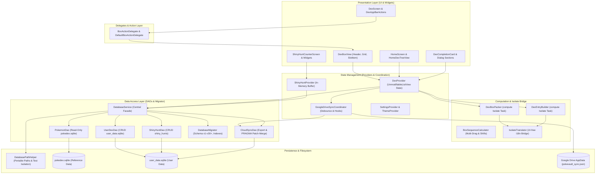

# PokéVault Architecture & System Documentation

> **Languages / Sprachen:** [🇩🇪 Deutsch](locales/ARCHITECTURE.de.md) | **[🇬🇧 English](ARCHITECTURE.md)** | [🇫🇷 Français](locales/ARCHITECTURE.fr.md) | [🇪🇸 Español](locales/ARCHITECTURE.es.md) | [🇮🇹 Italiano](locales/ARCHITECTURE.it.md) | [🇯🇵 日本語](locales/ARCHITECTURE.ja.md) | [🇰🇷 한국어](locales/ARCHITECTURE.ko.md) | [🇨🇳 简体中文](locales/ARCHITECTURE.zh-hans.md) | [🇹🇼 繁體中文](locales/ARCHITECTURE.zh-hant.md) | [🇵🇹 Português](locales/ARCHITECTURE.pt.md) | [🇳🇱 Nederlands](locales/ARCHITECTURE.nl.md) | [🇵🇱 Polski](locales/ARCHITECTURE.pl.md) | [🇷🇺 Русский](locales/ARCHITECTURE.ru.md)

This document describes the technical architecture, data persistence, cloud synchronization, modularization, and code standards of **PokéVault**. It serves developers and AI assistants as a primary reference for design decisions and extensions.

> [!TIP]
> **Active Roadmap & Next Release (v1.7.0):**
> The complete specification and implementation roadmap for release **v1.7.0 "The Language Expansion"** (decoupled languages, 9 franchise languages, local REST API server, multi-emulator hunting, desktop OCR & mobile camera scanner) is located in [docs/plans/v1_7_0_the_language_expansion.md](docs/plans/v1_7_0_the_language_expansion.md).
> An interactive HTML prototype is available at [docs/prototypes/v1_7_0_prototype.html](docs/prototypes/v1_7_0_prototype.html).

---

## 1. Overview & Technology Stack

PokéVault is a cross-platform companion app for Pokémon collectors (Living Dex, Forms, Shinies, Ribbons & Marks, Shiny Hunting).

- **Framework**: [Flutter 3.x](https://flutter.dev/) (Dart SDK `^3.12`)
- **Target Platforms**: Windows (Desktop), Android, iOS, macOS, Linux, Web
- **State Management**: [Provider](https://pub.dev/packages/provider) (`DexProvider`, `SettingsProvider`, `ShinyHuntProvider`, `TutorialProvider`, `ThemeProvider`) with strict state encapsulation (`UnmodifiableListView`)
- **Localization (i18n) & Multi-Language Core (v1.7.0)**:
  - [slang](https://pub.dev/packages/slang) for type-safe UI localization (13 supported languages)
  - Complete decoupling of **App UI Language** (`currentLanguage`) and **Pokémon Franchise Language** (`pokemonLanguage`)
  - Dynamic language registry via `lib/i18n/languages.json` and code-generated `LanguageRegistry` (`lib/i18n/language_registry.g.dart`)
  - Multi-language SQLite schema with 9 franchise language columns (`name_<lang>`) in `pokedex.sqlite`
  - Automated multi-engine translation pipeline (`tool/translate_all.py`) featuring MD5 caching, token masking, `locales/` document synchronization, and Slang compilation
  - `IsolateTranslator` as a lightweight bridge for UI-independent background isolates (`compute()`)
- **Persistence & DAO Layer**:
  - SQLite via `sqflite` (Android/iOS), `sqflite_common_ffi` (Desktop), and `sqflite_common_ffi_web` (Web)
  - Modularized into focused Data Access Objects: `PokemonDao`, `UserDexDao`, `ShinyHuntDao`, `CloudSyncDao`, and `DatabaseMigrator`
  - `shared_preferences` for application settings and onboarding state
- **Cloud Synchronization**: Google Drive REST API v3 (AppData folder) via `googleapis` & `googleapis_auth`, coordinated by the dedicated `GoogleDriveSyncCoordinator`

---

## 2. System Architecture

The following diagram visualizes the layered architecture of PokéVault, separation of UI components via delegates, offloading compute-heavy isolate tasks, and the modular DAO database layer:



---

## 3. Database Architecture & DAO Model (Dual-SQLite)

PokéVault strictly distinguishes between immutable static franchise reference data and dynamic user tracking data:

```
┌─────────────────────────────────────────┐       ┌─────────────────────────────────────────┐
│             pokedex.sqlite              │       │            user_data.sqlite             │
│   (Read-Only Reference Data/PokemonDao) │       │   (Read-Write User Data / UserDexDao)   │
├─────────────────────────────────────────┤       ├─────────────────────────────────────────┤
│ • pokemon (1025+ National Dex)          │       │ • user_dexes (Configurations)           │
│ • forms (Mega, G-Max, Regional)         │       │ • folders (Folder Hierarchy)            │
│ • encounters & dex_orders               │       │ • folder_structure (Relations)          │
│ • pokemon_moves & abilities             │       │ • user_pokemon (Status/Shinies)         │
│ • ribbons, marks & catch_rates          │       │ • shiny_hunts (Counters & Phases)       │
│ • shiny_locks (502+ global & loc locks) │       │                                         │
└─────────────────────────────────────────┘       └─────────────────────────────────────────┘
```

### 3.1 Data Access Objects (DAOs)
The former monolithic `DatabaseService` serves as a clean facade and delegates all queries to specialized DAOs:
- **`PokemonDao`**: Handles all read operations against `pokedex.sqlite`. Encapsulates in-memory caches for Pokémon, attacks, ribbons, balls, forms, and shiny locks.
- **`UserDexDao`**: Responsible for all CRUD operations on user tables in `user_data.sqlite` (`user_dexes`, `folders`, `folder_structure`, `user_pokemon`), including orphan record cleanup.
- **`ShinyHuntDao`**: Manages active and archived shiny hunts, hunting phases, and incremental counter mutations.
- **`CloudSyncDao`**: Provides `exportCloudSyncData()` and transactional `mergeCloudSyncData()` with dynamic `PRAGMA table_info` column verification for bidirectional schema compatibility.
- **`DatabaseMigrator`**: Encapsulates schema migrations (v1 to v30+), index generation (`ensureUserDataIndexes`, `ensureAppDatabaseIndexes`), and non-destructive downgrade handlers.

### 3.2 Portability & Path Resolution (`DatabasePathHelper`)
In compliance with repository quality guidelines, databases are stored portably in the `database/` subdirectory, **never** in the user's OS Documents folder:
- **Development Environment (Desktop)**: `<project_root>/database/` (detected via the presence of `pubspec.yaml`).
- **Release / Portable Executable (Desktop)**: `<exe_dir>/database/` directly adjacent to the application binary.
- **Read-Only Fallback**: If the execution directory is write-protected (e.g. `C:\Program Files`), the application automatically falls back to `<application_support_dir>/database/`.
- **Legacy Migration**: If legacy databases exist in the Windows Documents folder, `DatabasePathHelper.migrateLegacyDocumentsDatabasesIfNeeded()` migrates them transparently, compares modification timestamps, and creates timestamped safety backups (`.bak_<timestamp>`).
- **Parallel Test Isolation**: During automated test execution, `DatabasePathHelper` isolates test database paths dynamically by process ID (`pokevault_test_dbs/proc_$pid`) to prevent lock collisions and race conditions.

---

## 4. State Management, Encapsulation & Coordination

### 4.1 State Encapsulation with `UnmodifiableListView`
In `DexProvider`, mutable state collections (`_userDexes`, `_folders`) are private. Public getters return read-only unmodifiable views (`UnmodifiableListView`). State mutations occur exclusively through dedicated domain methods (`createUserDex`, `deleteFolder`, `updatePokemonStatus`), preventing side-effects and uncoordinated in-memory mutations.

### 4.2 `GoogleDriveSyncCoordinator`
Cloud synchronization is separated from `DexProvider` into the autonomous `GoogleDriveSyncCoordinator`:
- **Debounced Upload**: Prevents API throttling and remote race conditions during rapid user clicks via a timed debouncer.
- **Periodic Sync**: Configurable background timer to fetch and apply updates from other devices.
- **Lifecycle Flush**: When the app pauses or suspends (`AppLifecycleState.paused` / `inactive`), unpersisted changes are flushed to Google Drive immediately.
- **Hook Chain**: Pre- and post-processing hooks (`registerBeforeUploadHook`, `registerCloudDataMergedHook`) decouple state synchronization from networking calls.

---

## 5. Computation Logic, Separation & Isolate Safety

Computationally intensive operations are modularized and hardened for background execution (`compute()`):

1. **`DexBoxPacker`**:
   - Computes distribution of Pokémon lists into standard 30-slot PC boxes (`generateBoxesIsolateTask`).
   - Supports dynamic box layouts (Kanto, Johto, Living Dex, Form Dex).
2. **`DexEntryBuilder`**:
   - Pre-builds `DexDisplayEntry` view models inside background isolates (`buildEntriesIsolateTask`).
3. **`BoxSequenceCalculator`**:
   - Mathematical calculation utilities for multi-drag, slot swaps, gap closing, and cross-box relocations.
4. **`IsolateTranslator` (i18n Bridge)**:
   - Background isolates lack Flutter UI contexts (`BuildContext`). `IsolateTranslator` provides type-safe string translations for regions, forms, and box headers without accessing UI singletons.

---

## 6. UI Modularization & Interaction Model

The user interface is decomposed into modular sub-widgets:

### 6.1 `BoxActionDelegate` & `DexBoxView`
The PC Box view (`DexBoxView`) is decoupled from business logic via the `BoxActionDelegate` interface:
- `DexBoxHeader`: Navigation, box title, and completeness statistics.
- `DexBoxGrid`: Responsive 6x5 grid with automatic viewport constraint sizing.
- `DexBoxSlotItem`: Individual Pokémon slot with sprites, type markers, shiny indicators, and drag-and-drop feedback.

### 6.2 Modular Dialogs & Screens
- **Dex Completion Cards**: Partitioned into `CardAppearanceSection`, `CardTogglesSection`, `CardActionsBar`, and custom canvas painters (`CardPainterRenderer`, `CardPokemonMosaic`, `CardStatsSummary`).
- **Shiny Hunt Module**: Broken down into `HuntCounterControls` (large display, count buttons), `HuntOddsCard` (probabilities), and `HuntGameMethodSelector` (game edition & method presets).
- **Home Screen**: Navigation decoupled from `HomeDexTreeView` with smooth drag-and-drop reordering.

---

## 7. Offline Database Pipeline (`tool/data_pipeline/`)

The core reference database `assets/db/pokedex.sqlite` is compiled via a Python pipeline:
- **All-in-One Runner**: `python tool/data_pipeline/run_pipeline.py` executes the entire pipeline (web scraping, submodule sync, database build, multi-language population, evolution trees, shiny locks, and SQLite index optimization) deterministically.
- **Pipeline Stages**:
  1. `python update_data.py`: Downloads external wiki dumps, legal matching ball sheets, and updates the PokeAPI submodule.
  2. `python tool/data_pipeline/build_database.py`: Aggregates all sources and creates the SQLite database.
  3. `python tool/data_pipeline/update_pokemon_languages.py`: Synchronizes localized species names for all 9 franchise languages into `name_<lang>` columns.
  4. `python tool/data_pipeline/update_evolutions_db.py`: Injects structured evolution chains from raw PokeAPI records.
  5. `python tool/data_pipeline/update_cap_locks_and_trades.py`: Integrates shiny locks for special cap forms, cosplay variants, and in-game trades.
  6. `python tool/data_pipeline/optimize_databases.py`: Builds covering indexes, executes `ANALYZE`, and compacts storage via `VACUUM`.

Detailed developer instructions are available in [tool/data_pipeline/README.md](tool/data_pipeline/README.md).

---

## 8. Multi-Language & Translation Architecture (`tool/translate_all.py`)

PokéVault v1.7.0 features an automated localization and documentation pipeline:

### 8.1 Decoupled Language Selection
- **UI Language (`currentLanguage`)**: Controls all interface elements, menus, dialogs, and settings (supports 13 languages via `slang`).
- **Pokémon Language (`pokemonLanguage`)**: Controls Pokémon names, forms, and marks independently from UI language (e.g. German UI with English or Japanese Pokémon names). When set to `'auto'`, it follows the UI language if official franchise names exist, falling back to English (`resolveEffectivePokemonLanguage`).

### 8.2 Configuration & Code Generation
- **`lib/i18n/languages.json`**: Central JSON configuration of all supported languages with ISO codes, flags, native names, franchise status (`isPokemonFranchise`), and slang codes.
- **`LanguageRegistry` (`lib/i18n/language_registry.g.dart`)**: Code-generated from `languages.json` by `translate_all.py`, providing type-safe lists and lookup methods for widgets and providers.

### 8.3 Automated Translation Pipeline
- **Multi-Engine Cascade**: Free translation cascade (Bing $\rightarrow$ Google $\rightarrow$ MyMemory) with optional DeepL API support (`DEEPL_API_KEY`).
- **Token & Plural Protection**: Masks Slang placeholders (`{name}`, `{count}`), ICU plurals, and newlines (`\n`) before transmission, restoring them losslessly afterwards.
- **MD5 Caching & Anti-Poisoning**: Caches translations in `tool/.translation_cache.json` and prevents failed or identical source strings from poisoning cache entries.
- **`locales/` Document Synchronization**: Markdown documentation is maintained cleanly in organized `locales/` directories; relative internal links and language switcher banners are dynamically rewritten.

---

## 9. Quality Assurance & Zero-Tolerance Quality Gate

PokéVault enforces strict quality standards through test-driven development (TDD) and automated quality gates:

- **Automated Tests**: Over **1,380+ tests** (`flutter test`) with a **100% pass rate** across unit, widget, integration, boundary, and challenger suites, plus standalone Python unit tests (`test/tool/`).
- **Static Analysis**: `flutter analyze` and `dart analyze --fatal-infos` with **0 errors, 0 warnings, and 0 lints**.
- **Cross-Platform Resilience**: Boundary stress tests for extreme screen dimensions (320x480 up to 4K), rapid gesture cancellations, and runtime language switching.
- **GitHub Actions CI**: Automated CI quality gate executed on every commit and pull request (`.github/workflows/ci.yml`).
