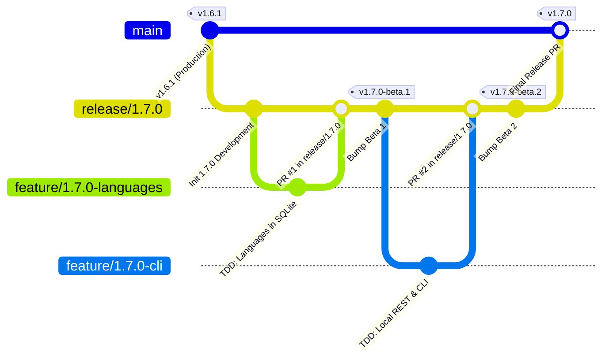

# PokéVault Git Branching Model & Release Pipeline Guide

> **Languages / Sprachen:** [🇩🇪 Deutsch](locales/GIT_WORKFLOW_AND_RELEASES.de.md) | **[🇬🇧 English](GIT_WORKFLOW_AND_RELEASES.md)** | [🇫🇷 Français](locales/GIT_WORKFLOW_AND_RELEASES.fr.md) | [🇪🇸 Español](locales/GIT_WORKFLOW_AND_RELEASES.es.md) | [🇮🇹 Italiano](locales/GIT_WORKFLOW_AND_RELEASES.it.md) | [🇯🇵 日本語](locales/GIT_WORKFLOW_AND_RELEASES.ja.md) | [🇰🇷 한국어](locales/GIT_WORKFLOW_AND_RELEASES.ko.md) | [🇨🇳 简体中文](locales/GIT_WORKFLOW_AND_RELEASES.zh-hans.md) | [🇹🇼 繁體中文](locales/GIT_WORKFLOW_AND_RELEASES.zh-hant.md) | [🇵🇹 Português](locales/GIT_WORKFLOW_AND_RELEASES.pt.md) | [🇳🇱 Nederlands](locales/GIT_WORKFLOW_AND_RELEASES.nl.md) | [🇵🇱 Polski](locales/GIT_WORKFLOW_AND_RELEASES.pl.md) | [🇷🇺 Русский](locales/GIT_WORKFLOW_AND_RELEASES.ru.md)

This document describes the official Git branching model, branch protection rules, and the automated build and release process for developers and AI assistants.

---

## 1. The Branching Model

PokéVault uses a structured **Release Branching Strategy**:



### The 3 Branch Levels:

| Branch Type | Name / Pattern | Purpose & Protection |
| :--- | :--- | :--- |
| **Production** | `main` | **Protected**. Contains exclusively stable, published live code. Every merge here corresponds to an official store / GitHub release. Direct pushes are disabled. |
| **Release / Staging** | `release/<version>` (e.g. `release/1.7.0`) | Staging branch for all sub-features of a major release. This is where integration testing happens and **Beta releases / Pre-releases** are built. |
| **Feature Branches** | `feature/<version>-<topic>` (e.g. `feature/1.7.0-languages`, `feature/1.7.0-cli`) | Short-lived development branches for individual modules. Always branch off the corresponding `release/*` branch and are merged back via Pull Request. |
| **Hotfixes** | `hotfix/<version>` (e.g. `hotfix/1.6.2`) | Urgent bugfixes for the live version. Branch off `main` and are merged into both `main` and `release/*`. |

---

## 2. GitHub Branch Protection Setup (Step-by-Step)

To prevent accidental pushes to `main` and ensure that only thoroughly tested code can be merged, configure branch protection rules in the GitHub web interface:

### Rule 1: Protection for `main`
1. Open the GitHub repository in your browser $\rightarrow$ Click **Settings** $\rightarrow$ **Branches** (under *Code and automation*).
2. Click **Add branch protection rule** (or edit the existing rule for `main`).
3. **Branch name pattern**: `main`
4. Enable the following checkboxes:
   - [x] **Require a pull request before merging**
     - *(Optional: Set "Require approvals" to 1 if team code reviews are required, or keep at 0 for solo development).*
   - [x] **Require status checks to pass before merging**
     - [x] **Require branches to be up to date before merging**
     - Search in the search box for the CI job: `Flutter Analyze & Test` (or `analyze-and-test`) and select it.
   - [x] **Do not allow bypassing the above settings** *(ensures administrators cannot accidentally bypass CI checks).*
5. Click **Save changes** at the bottom.

### Rule 2: Protection for `release/*` (Recommended)
Repeat the process with:
- **Branch name pattern**: `release/*`
- [x] **Require status checks to pass before merging** (`Flutter Analyze & Test`).
- This guarantees no feature branch with failing tests can enter the release staging branch.

---

## 3. Daily Development Workflow

### Step 1: Create a Feature Branch
Before starting a new task, ensure `release/1.7.0` is up to date:
```bash
git checkout release/1.7.0
git pull origin release/1.7.0
git checkout -b feature/1.7.0-languages
```

### Step 2: Development with Strict TDD
According to `AGENTS.md`:
1. **Tests first**: Write test cases in `test/` (e.g. `test/services/language_expansion_test.dart`).
2. **Implement**: Write minimal production code in `lib/` until all tests pass.
3. **Verify**:
   ```bash
   flutter test
   dart analyze --fatal-infos
   ```

### Step 3: Commit & Push
```bash
git add .
git commit -m "feat(i18n): add 9 franchise languages to pokemon database and dao"
git push -u origin feature/1.7.0-languages
```

### Step 4: Open Pull Request on GitHub
- **Base Branch**: `release/1.7.0`
- **Compare Branch**: `feature/1.7.0-languages`
- GitHub Actions automatically starts the workflow `CI Quality Gate` (`.github/workflows/ci.yml`).
- Once checks pass $\rightarrow$ Click **Squash and merge** (or *Rebase and merge*).

---

## 4. Building Pre-Releases & Betas (Multi-Platform)

Once one or more features have been integrated into `release/1.7.0` and need testing:

### Method A: Automatically via Git Tag (Recommended)
1. **Bump version** on `release/1.7.0`:
   ```bash
   git checkout release/1.7.0
   git pull origin release/1.7.0
   python tool/bump_version.py beta --commit
   ```
   *(e.g. produces `1.7.0-beta.1+9` in `pubspec.yaml` and commits the change).*

2. **Create and push Git tag**:
   ```bash
   git tag v1.7.0-beta.1
   git push origin release/1.7.0 --tags
   ```

3. **Automated Build in GitHub Actions**:
   The workflow `.github/workflows/release.yml` starts automatically on GitHub runners and builds all 4 packages:
   - 📱 `PokeVault_V<version>.apk`
   - 💻 `PokeVault_V<version>_Windows.zip`
   - 🐧 `PokeVault_V<version>.AppImage`
   - 📦 `PokeVault_V<version>.tar.gz`

4. **Automated GitHub Pre-Release**:
   - Because the tag contains `-beta`, GitHub automatically marks the release as a **Pre-release**.
   - Testers can download the built installer packages directly under **Releases**.
   - PokéVault's integrated in-app updater (`UpdateHelper`) detects the appropriate file extension for each operating system.

### Method B: Manually via the GitHub Web UI
1. In the GitHub repository, navigate to **Actions** $\rightarrow$ **Build & Release Multi-Platform Packages**.
2. Click **Run workflow** on the right.
3. Select the branch (e.g. `release/1.7.0`), enter the version tag (e.g. `v1.7.0-beta.1`), and leave the checkbox *"Mark as pre-release / beta"* checked as `true`.
4. Click **Run workflow**.

---

## 5. Publishing a Final Stable Release

When all beta testing is complete and version 1.7.0 is ready for production:

1. **Set version to stable**:
   ```bash
   git checkout release/1.7.0
   python tool/bump_version.py 1.7.0 --commit
   git push origin release/1.7.0
   ```

2. **Open Pull Request from `release/1.7.0` to `main` & Merge**:
   - Base: `main` $\leftarrow$ Compare: `release/1.7.0`.
   - CI Quality Gate runs and passes.
   - Merge the PR.

3. **Fully Automated Release via GitHub Actions**:
   - The push to `main` automatically triggers `.github/workflows/release.yml`.
   - **Release Gate Evaluation**: The workflow checks if a git tag for `v<version>` already exists.
     - If the tag exists (e.g. from an earlier release or a documentation push on `main`), the build is skipped in ~5 seconds without overwriting existing releases.
     - If the tag is new, the multi-platform build proceeds automatically.
   - The release metadata extractor (`tool/extract_release_info.py`) extracts:
     - The **Release Title** from quotes on the first line of `RELEASE_NOTES.md` (e.g. `The Language Expansion`).
     - The **Version Tag** from `pubspec.yaml` (e.g. `v1.7.0`).
     - The complete multi-language text from `RELEASE_NOTES.md` as the GitHub Release body.
   - All 4 binary packages (Android APK, Windows Zip, Linux Tar.gz & AppImage) are built and published as the official **Latest Stable Release**.
   - Immediately following release creation, `deploy.yml` deploys the new web application to GitHub Pages.
