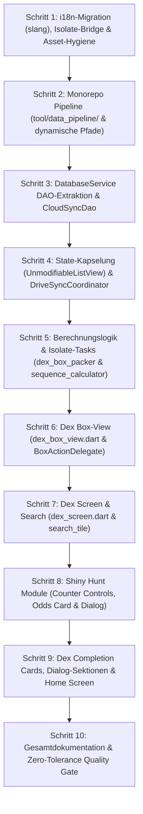

# PokéVault: Modularer Schritt-für-Schritt Sanierungsplan (V2 — Gehärtet)

> [!IMPORTANT]
> **Nutzung in neuen Chat-Sitzungen**:
> Dieser Plan ist vollständig autark formuliert. In jedem neuen Chat genügt der Befehl:
> **`Lies docs/REFACTORING_PLAN.md und führe Schritt [Nummer] aus.`**
> Jeder Schritt folgt striktem TDD, enthält seine exakten Vorbedingungen, Dateiänderungen, Code-Verträge und Verifikations-Befehle.

> [!NOTE]
> **Autonome Datei- & Refactoring-Vollmacht (Geltungsbereich: Projekt PokéVault)**:
> - **Volle Ausführungs-Autorisierung**: Der ausführende Agent hat die ausdrückliche Berechtigung und Pflicht, alle im jeweiligen Schritt definierten Datei- und Ordneroperationen (`[NEW]`, `[MODIFY]`, `[DELETE]`, `[MOVE]`) **autonom ohne vorherige Rückfragen** direkt umzusetzen.
> - **Ordner-Hygiene**: Werden alle Dateien eines Verzeichnisses verschoben oder gelöscht (z. B. `bin/`, `assets/data/`), ist der leere Ordner automatisch aus dem Dateisystem zu entfernen.
> - **Git-Integrität**: Für getrackte Dateien, Verzeichnisse und Submodule ist `git mv` zu nutzen, um die Git-Historie zu wahren.
> - **Strikter Projekt-Scope**: Alle Aktionen sind **ausnahmslos auf das Projektverzeichnis (`pokevault`) beschränkt**. Dateien außerhalb des Repositories dürfen niemals modifiziert oder gelöscht werden; sollte dies in absoluten Ausnahmefällen nötig sein, MUSS vorher zwingend eine Begründung vorgelegt und die Erlaubnis des Nutzers eingeholt werden.

---

## 📋 Übersicht der 10 Sanierungsschritte



---

## 🛠️ Schritt 1: i18n-Migration (`slang`), Isolate-Bridge & Asset-Hygiene

### Ziel:
Vollständige Umstellung aller verbliebenen Legacy-Aufrufe von `Translator` auf `slang` (`lib/i18n/strings.g.dart`), Bereitstellung eines schlanken `isolate_translator.dart` für Hintergrund-Isolate (`compute()`), Entfernung redundanter JSON-Assets und Bereinigung von `pubspec.yaml`.

### Zu erstellende / modifizierende / löschende Dateien:
1. **[NEW] `lib/utils/isolate_translator.dart`**:
   - Schlanke Hilfsklasse für Hintergrund-Isolate (`compute()` in `DexLogicHelper`), die sprachabhängige String-Formatierungen (Regionen, Box-Labels, Formen) ohne Flutter-UI-Context abbildet.
2. **[NEW] `test/utils/isolate_translator_test.dart`**:
   - TDD-Absicherung: Prüft Korrektheit aller Form-/Box- und Regionenübersetzungen in `de` und `en`.
3. **[MODIFY] Produktionscode (Migration auf `slang` / `t` / `isolate_translator`)**:
   - `lib/providers/settings_provider.dart`: `Translator.currentLanguage` durch `LocaleSettings.setLocale` ersetzen.
   - `lib/providers/theme_provider.dart`: `Translator.get(...)` durch typsichere `t`-Schlüssel ersetzen.
   - `lib/services/database_service.dart`: `Translator.get(...)` durch `t` ersetzen; redundanten Fallback auf `assets/data/shiny_locks.json` in `getAllShinyLocks()` entfernen (Locks werden ausschließlich via SQLite geladen).
   - `lib/services/dex_card_export_service.dart`: `Translator.get(...)` durch `t` ersetzen.
   - `lib/services/dex_storage_service.dart`: `Translator.get(...)` durch `t` ersetzen.
   - `lib/utils/dex_logic_helper.dart`: Aufrufe in `compute()` auf `IsolateTranslator` umstellen; Hauptthread-Aufrufe auf `t`.
   - `lib/utils/dex_progress_helper.dart`: Box-Settings-Übersetzungen über `t` auflösen.
   - `lib/utils/shiny_hunt_odds_helper.dart`: Jagd-Methoden über `t` auflösen.
4. **[MODIFY] Tests (Aktualisierung auf `slang` / `isolate_translator`)**:
   - `test/providers/settings_provider_test.dart`
   - `test/utils/dex_logic_helper_categories_test.dart`
   - `test/utils/dex_logic_helper_enhancements_test.dart`
   - `test/widgets/dex_completion_card_test.dart`
   - `test/services/shiny_lock_service_test.dart`: Test-Titel und Assertions von Fallback bereinigen.
5. **[DELETE] `lib/l10n/app_translations.dart`**:
   - Vollständig löschen (jetzt zu 100% verwaist und sicher entfernbar).
6. **[DELETE] `assets/data/shiny_locks.json`**:
   - Löschen (alle 502 Locks liegen in der SQLite-Tabelle `shiny_locks`).
7. **[MODIFY] `pubspec.yaml`**:
   - Eintrag `- assets/data/` aus `assets:` entfernen.
8. **[MOVE] `assets/screenshots/` $\rightarrow$ `docs/screenshots/`**:
   - Ordner verschieben und Bildpfade in `README.md` sowie `README.de.md` anpassen.

### Verifikation:
```powershell
flutter test
flutter analyze
```
*Kriterium:* **0 Fehler, 0 Warnungen, alle 1.186+ Tests grün.**

---

## 🛠️ Schritt 2: Monorepo Pipeline Restrukturierung (`bin/` $\rightarrow$ `tool/data_pipeline/`)

### Ziel:
Die Python-Pipeline an den offiziellen Dart/Flutter-Konventionsort `tool/data_pipeline/` verschieben, Pfade dynamisch via `Path(__file__).resolve().parent` auflösen, Generierung veralteter JSONs deaktivieren und Submodule sauber anbinden.

### Zu ändernde Dateien:
1. **[MOVE] Submodule via `git mv`**:
   ```bash
   git mv bin/api-data tool/data_pipeline/api-data
   git mv bin/ribbons_guide tool/data_pipeline/ribbons_guide
   ```
2. **[MOVE] Skripte, Tabellen & Dokumente**:
   - Alle Python-Dateien (`build_database.py`, `optimize_databases.py`, `database_constants.py`, `update_cap_locks_and_trades.py`, `update_evolutions_db.py`), Excel (`Legal_Matching_Pokeballs.xlsx`), Custom JSONs und HTML-Dumps von `bin/` nach `tool/data_pipeline/` verschieben.
   - `bin/README.md` nach `tool/data_pipeline/README.md` verschieben.
   - Verzeichnis `bin/` vollständig entfernen.
3. **[MODIFY] Python-Skripte (`tool/data_pipeline/*.py`)**:
   - Alle relativen Pfade über dynamische Basis-Pfade definieren:
     ```python
     BASE_DIR = Path(__file__).resolve().parent
     REPO_ROOT = BASE_DIR.parent.parent
     ```
   - In `build_database.py`: Das Schreiben von `assets/data/shiny_locks.json` (Zeilen 729–736) vollständig entfernen.
4. **[MODIFY] `.gitignore`**:
   ```gitignore
   # Data Pipeline Cache & Python Bytecode
   tool/data_pipeline/cache/
   tool/data_pipeline/**/__pycache__/
   tool/data_pipeline/**/*.pyc
   ```
5. **[MODIFY] Projekt-Dokumentation**:
   - `.github/ISSUE_TEMPLATE/json_data_update.md` & `json_data_update.de.md`
   - `README.md` & `README.de.md` (Verweise von `bin/` auf `tool/data_pipeline/` anpassen).

### Verifikation:
```powershell
git status
flutter analyze
```
*Kriterium:* `.gitmodules` ist synchron, `bin/` existiert nicht mehr, Git-Status sauber.

---

## 🛠️ Schritt 3: `DatabaseService` DAO-Extraktion & CloudSyncDao

### Ziel:
Den 1.334-Zeilen-Monolithen `DatabaseService` in 5 fokussierte DAOs zerlegen. Vollständige Unterstützung von `overrideUserDatabase`/`overrideAppDatabase` in Tests durch dynamische Getter.

### TDD (Erst Tests!):
1. **[NEW] `test/services/dao/pokemon_dao_test.dart`**
2. **[NEW] `test/services/dao/user_dex_dao_test.dart`**
3. **[NEW] `test/services/dao/shiny_hunt_dao_test.dart`**
4. **[NEW] `test/services/dao/cloud_sync_dao_test.dart`**

### Zu erstellende / modifizierende Dateien:
1. **[NEW] `lib/services/dao/pokemon_dao.dart`**:
   - Read-Only auf `appDatabase` (`pokedex.sqlite`): Pokémon, Bänder, Bälle, Formen, Moves, Abilities, Shiny-Locks.
2. **[NEW] `lib/services/dao/user_dex_dao.dart`**:
   - CRUD auf `userDatabase` (`user_data.sqlite`): `user_dexes`, `folders`, `folder_structure`, `user_pokemon`, Status-Updates, Orphan-Cleanup.
3. **[NEW] `lib/services/dao/shiny_hunt_dao.dart`**:
   - CRUD für Shiny Hunts (`shiny_hunts`-Tabelle, Zähler, Phasen).
4. **[NEW] `lib/services/dao/cloud_sync_dao.dart`**:
   - `exportCloudSyncData()` und transaktionales `mergeCloudSyncData()` mit dynamischer `PRAGMA table_info`-Spaltenprüfung.
5. **[NEW] `lib/services/dao/database_migrator.dart`**:
   - Tabellenerstellung, Index-Erstellung (`ensureUserDataIndexes`, `ensureAppDatabaseIndexes`), Schema-Migrationen v1 bis v13+ und Downgrade-Routinen.
6. **[MODIFY] `lib/services/database_service.dart`**:
   - Hält Instanzen der DAOs, die dynamisch auf `appDatabase` und `userDatabase` zugreifen.
   - Alle bestehenden Methoden leiten 1:1 an die DAOs weiter (`getAllPokemon() => pokemonDao.getAllPokemon()`).
   - `overrideAppDatabase(db)` und `overrideUserDatabase(db)` wirken sofort auf alle DAOs.

### Verifikation:
```powershell
flutter test test/services/
flutter analyze
```
*Kriterium:* Alle bestehenden und neuen Service- und Migrations-Tests bestehen zu 100%.

---

## 🛠️ Schritt 4: State-Kapselung & DriveSyncCoordinator (`dex_provider.dart`)

### Ziel:
`DexProvider` (1.244 Zeilen) entschlacken: Google-Drive-Sync in `GoogleDriveSyncCoordinator` auslagern, Zustand mit `UnmodifiableListView` schützen und direkte Test-Mutationen bereinigen.

### TDD (Erst Tests!):
1. **[NEW] `test/services/sync/google_drive_sync_coordinator_test.dart`**:
   - Testet Debouncer, Intervall-Timer, Hook-Registrierungen und Lifecycle-Flush bei Pause/Inactive.

### Zu erstellende / modifizierende Dateien:
1. **[NEW] `lib/services/sync/google_drive_sync_coordinator.dart`**:
   - Kapselt `_uploadDebouncer`, `_downloadTimer`, `_lastSyncTime`, `_isSyncing`, `_hasPendingChanges`, Vorab- und Nachher-Hooks sowie Lifecycle-Flush.
2. **[MODIFY] `lib/providers/dex_provider.dart`**:
   - `userDexes` und `folders` auf private Listen umstellen (`_userDexes`, `_folders`).
   - Öffentliche Getter als `UnmodifiableListView` bereitstellen:
     ```dart
     UnmodifiableListView<UserDex> get userDexes => UnmodifiableListView(_userDexes);
     UnmodifiableListView<DexFolder> get folders => UnmodifiableListView(_folders);
     ```
   - Alle Mutationen über Methoden (`createUserDex`, `deleteFolder`, etc.) kapseln.
   - Sync-Hooks leiten transparent an den `GoogleDriveSyncCoordinator` weiter.
3. **[MODIFY] `test/providers/dex_provider_actions_test.dart`**:
   - Zeilen 143 und 158: `provider.folders.add(...)` durch offizielle Erstellungsmethode oder kontrollierten Test-Setter ersetzen.

### Verifikation:
```powershell
flutter test test/providers/
flutter analyze
```
*Kriterium:* Alle Provider-Tests laufen ohne `UnsupportedError` durch.

---

## 🛠️ Schritt 5: Berechnungslogik & Isolate-Sicherheit (`dex_logic_helper.dart` & `box_sequence_manager.dart`)

### Ziel:
Die beiden Logik-Riesen (1.738 und 1.024 Zeilen) modularisieren, ohne die Isolate-Fähigkeit (`compute()`) zu beeinträchtigen.

### TDD (Erst Tests!):
1. **[NEW] `test/utils/dex_box_packer_test.dart`**
2. **[NEW] `test/utils/box_sequence_calculator_test.dart`**

### Zu erstellende / modifizierende Dateien:
1. **[NEW] `lib/utils/dex_box_packer.dart`**:
   - Box-Aufteilungslogik und Isolate-Einstiegspunkt (`generateBoxesIsolateTask`).
2. **[NEW] `lib/utils/dex_entry_builder.dart`**:
   - Isolate-Routine zur Generierung von `DexDisplayEntry` (`buildEntriesIsolateTask`).
3. **[MODIFY] `lib/utils/dex_logic_helper.dart`**:
   - Schlanke Fassade, delegiert an `DexBoxPacker` und `DexEntryBuilder`.
4. **[NEW] `lib/utils/box_sequence_calculator.dart`**:
   - Mathematische Berechnungsfunktionen für Multi-Drag, Shift, Swap und Gap-Closing.
5. **[MODIFY] `lib/utils/box_sequence_manager.dart`**:
   - Behält öffentliche API bei, nutzt `BoxSequenceCalculator` für Berechnungen.

### Verifikation:
```powershell
flutter test test/utils/
flutter analyze
```
*Kriterium:* Alle Berechnungs- und Stresstests (inkl. `box_sequence_stress_test.dart`) grün.

---

## 🛠️ Schritt 6: Dex Box-View Entflechtung & BoxActionDelegate (`dex_box_view.dart`)

### Ziel:
Das 1.682-Zeilen-Widget und seinen 20-Parameter-Konstruktor entflechten, einen schlanken `BoxActionDelegate` etablieren und die 4 betroffenen Testdateien sauber umstellen.

### TDD (Erst Tests!):
1. **[NEW] `test/screens/dex/delegates/box_action_delegate_test.dart`**

### Zu erstellende / modifizierende Dateien:
1. **[NEW] `lib/screens/dex/delegates/box_action_delegate.dart`**:
   - Bündelt `onSelectionChanged`, `onInsertPokemon`, `onMovePokemon`, `onSwapPokemon`, `onMoveMultiplePokemon` etc.
   - Enthält eine `DefaultBoxActionDelegate`-Implementierung für einfache Tests.
2. **[NEW] `lib/screens/dex/widgets/box_view/dex_box_header.dart`**:
   - Box-Kopfzeile, Titel, Navigation und Zähler.
3. **[NEW] `lib/screens/dex/widgets/box_view/dex_box_grid.dart`**:
   - Responsives 6x5 Grid mit Slot-Handling.
4. **[NEW] `lib/screens/dex/widgets/box_view/dex_box_slot_item.dart`**:
   - Einzelner Pokémon-Slot (Sprite, Auswahlrahmen, Gesten).
5. **[MODIFY] `lib/screens/dex/dex_box_view.dart`**:
   - Schlanker Host-Widget (~300 Zeilen), Konstruktor nutzt `BoxActionDelegate actionDelegate = const DefaultBoxActionDelegate()`.
6. **[MODIFY] `lib/screens/dex/dex_screen.dart`**:
   - Erstellt die `BoxActionDelegate`-Instanz aus den DexScreen-Handlern.
7. **[MODIFY] Test-Dateien (Aktualisierung auf `actionDelegate`)**:
   - `test/screens/dex/dex_box_view_multi_drag_test.dart`
   - `test/screens/dex/dex_box_view_paket2_test.dart`
   - `test/screens/dex/dex_box_view_stress_test.dart`
   - `test/screens/dex/dex_box_view_test.dart`

### Verifikation:
```powershell
flutter test test/screens/dex/dex_box_view*
flutter test test/e2e/
flutter analyze
```
*Kriterium:* Alle Box-View Rendering- und E2E Drag-Drop-Flows fehlerfrei.

---

## 🛠️ Schritt 7: Dex Screen & Search Entflechtung (`dex_screen.dart` & `pokemon_search_selection.dart`)

### Ziel:
`dex_screen.dart` (2.088 Zeilen) und `pokemon_search_selection.dart` (1.151 Zeilen) modularisieren unter striktem Erhalt aller Widget-Keys und Semantik für Challenger- und Overflow-Tests.

### Zu erstellende / modifizierende Dateien:
1. **[NEW] `lib/screens/dex/widgets/dex_app_bar_actions.dart`**:
   - Suchleiste, Ansichtswechsel (Box/Liste), Sortier-Buttons.
2. **[NEW] `lib/screens/dex/widgets/dex_filter_bottom_sheet.dart`**:
   - Filter-Dialog für Generationen, Typen, Shinies und Formen.
3. **[NEW] `lib/screens/dex/widgets/search/pokemon_search_tile.dart`**:
   - Einzelne Kachel in der Suchauswahl.
4. **[MODIFY] `lib/screens/dex/dex_screen.dart`**:
   - Basis-Gerüst und State-Verwaltung (~400 Zeilen).
5. **[MODIFY] `lib/screens/dex/pokemon_search_selection.dart`**:
   - Aufspaltung in Filter-Chips und Suchergebnis-Raster.

### Verifikation:
```powershell
flutter test test/screens/dex/dex_screen*
flutter test test/screens/dex/pokemon_search*
flutter analyze
```

---

## 🛠️ Schritt 8: Shiny Hunt Module (`shiny_hunt_counter_screen.dart` & Dialog)

### Ziel:
Die beiden Shiny-Hunt-Riesen (1.306 und 1.285 Zeilen) in modulare Teilkomponenten zerlegen.

### Zu erstellende / modifizierende Dateien:
1. **[NEW] `lib/screens/shiny_hunt/widgets/hunt_counter_controls.dart`**:
   - Große Zähleranzeige, +1/-1 Buttons, Timer, Phasen-Button.
2. **[NEW] `lib/screens/shiny_hunt/widgets/hunt_odds_card.dart`**:
   - Wahrscheinlichkeits-Rechner und Anzeige der aktuellen Chance.
3. **[NEW] `lib/screens/shiny_hunt/dialogs/widgets/hunt_game_method_selector.dart`**:
   - Auswahl von Edition, Fang-Methode und Shiny-Charm-Status.
4. **[MODIFY] `lib/screens/shiny_hunt/shiny_hunt_counter_screen.dart`**:
   - Schlanker Host-Screen (~350 Zeilen).
5. **[MODIFY] `lib/screens/shiny_hunt/dialogs/create_edit_hunt_dialog.dart`**:
   - Modulare Formular-Abschnitte.

### Verifikation:
```powershell
flutter test test/screens/shiny_hunt/
flutter test test/providers/shiny_hunt_*
flutter analyze
```

---

## 🛠️ Schritt 9: Dex Completion Cards, Dialog-Sektionen & Home Screen

### Ziel:
Vollständige Modularisierung von `dex_completion_card.dart` (2.190 Zeilen), `dex_completion_card_dialog.dart` (1.359 Zeilen) und `home_screen.dart` (1.129 Zeilen).

### Zu erstellende / modifizierende Dateien:
1. **[NEW] `lib/widgets/dex_card/widgets/card_painter_renderer.dart`**:
   - Reines Canvas-Rendering und CustomPainter für den Bildexport.
2. **[NEW] `lib/widgets/dex_card/widgets/card_stats_summary.dart`**:
   - Statistik-, Box-Details- und Fortschrittsbalken.
3. **[NEW] `lib/widgets/dex_card/widgets/card_pokemon_mosaic.dart`**:
   - Mosaik-Rendering für alle Pokémon-Icons.
4. **[NEW] `lib/screens/dex/widgets/completion_card/completion_card_appearance_section.dart`**:
   - Kartentyp-Wahl, Farbwähler, Hintergrundmuster.
5. **[NEW] `lib/screens/dex/widgets/completion_card/completion_card_toggles_section.dart`**:
   - Schalter für Tera-Typen, Trainer-Name, Datum, Box-Details.
6. **[NEW] `lib/screens/dex/widgets/completion_card/completion_card_actions_bar.dart`**:
   - Download-, Share- und Schließen-Schaltflächen.
7. **[NEW] `lib/screens/home/widgets/home_dex_tree_view.dart`**:
   - Ordner- und Dex-Liste mit Drag-and-Drop-Sortierung.
8. **[MODIFY] `lib/widgets/dex_card/dex_completion_card.dart`**:
   - Kapselt Host-Container und delegiert Darstellung an Sub-Widgets.
9. **[MODIFY] `lib/screens/dex/widgets/dex_completion_card_dialog.dart`**:
   - Dialog-Gerüst mit den 3 neuen Sektionen.
10. **[MODIFY] `lib/screens/home/home_screen.dart`**:
    - Schlanke Navigation und Menüleiste.

### Verifikation:
```powershell
flutter test test/widgets/dex_completion_card_test.dart
flutter test test/screens/home/
flutter analyze
```

---

## 🛠️ Schritt 10: Gesamtdokumentation & Zero-Tolerance Quality Gate

### Ziel:
Dokumentation auf den neuesten Stand bringen und das finale Qualitäts-Audit durchführen.

### Zu ändernde / erstellende Dateien:
1. **[MODIFY] `ARCHITECTURE.md`**:
   - Neues Architektur-Diagramm mit DAOs, `GoogleDriveSyncCoordinator` und `BoxActionDelegate`.
   - Dokumentation von `tool/data_pipeline/`.
   - Dokumentation der Isolate-Translation-Bridge.
2. **[MODIFY] `README.md` & `README.de.md`**:
   - Aktualisierung aller Feature-Listen, Verweise und Screenshot-Pfade (`docs/screenshots/`).
3. **[NEW] `tool/data_pipeline/README.md`**:
   - Ausführliche Entwickler-Anleitung für die Release- und Scraping-Pipeline.

### Finales Quality Gate (MANDATORY):
```powershell
# 1. Gesamte Testsuite ausführen
flutter test

# 2. Statische Code-Analyse
flutter analyze
```
*Anforderung:* **100% Pass Rate bei allen 1.186+ Tests**, **0 Fehler, 0 Warnungen, 0 Lints**.
