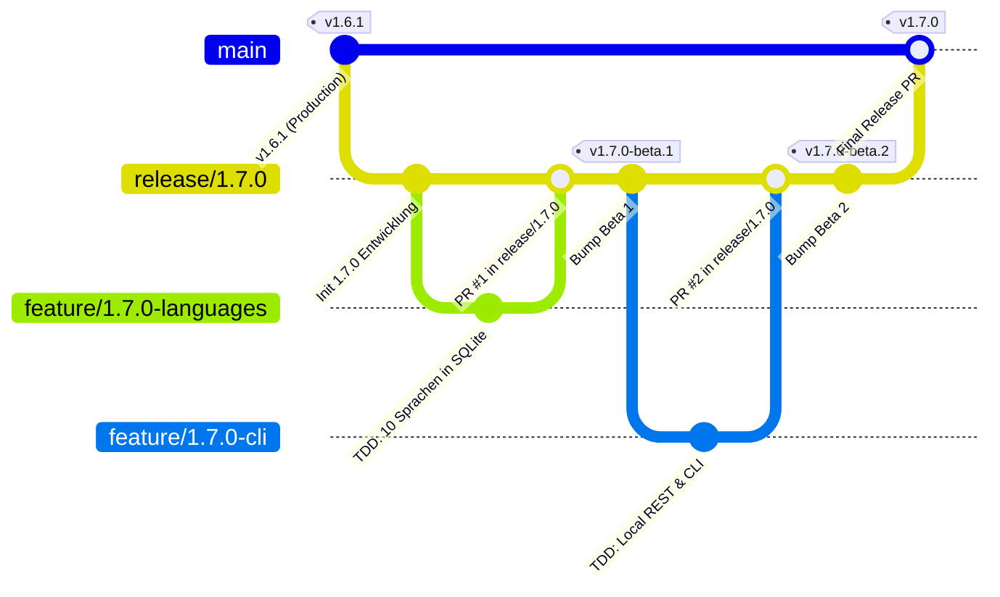

# PokéVault Git Branching-Modell & Release-Pipeline Leitfaden

> **Languages / Sprachen:** **[🇩🇪 Deutsch](GIT_WORKFLOW_AND_RELEASES.de.md)** | [🇬🇧 English](../GIT_WORKFLOW_AND_RELEASES.md) | [🇫🇷 Français](GIT_WORKFLOW_AND_RELEASES.fr.md) | [🇪🇸 Español](GIT_WORKFLOW_AND_RELEASES.es.md) | [🇮🇹 Italiano](GIT_WORKFLOW_AND_RELEASES.it.md) | [🇯🇵 日本語](GIT_WORKFLOW_AND_RELEASES.ja.md) | [🇰🇷 한국어](GIT_WORKFLOW_AND_RELEASES.ko.md) | [🇨🇳 简体中文](GIT_WORKFLOW_AND_RELEASES.zh-hans.md) | [🇹🇼 繁體中文](GIT_WORKFLOW_AND_RELEASES.zh-hant.md) | [🇵🇹 Português](GIT_WORKFLOW_AND_RELEASES.pt.md) | [🇳🇱 Nederlands](GIT_WORKFLOW_AND_RELEASES.nl.md) | [🇵🇱 Polski](GIT_WORKFLOW_AND_RELEASES.pl.md) | [🇷🇺 Русский](GIT_WORKFLOW_AND_RELEASES.ru.md)


Dieses Dokument beschreibt das offizielle Git-Branching-Modell, die Branch-Protection-Regeln und den automatisierten Build- und Release-Prozess für Entwickler und KI-Assistenten.

---

## 1. Das Branching-Modell

PokéVault verwendet eine strukturierte **Release-Branching-Strategie**:



### Die 3 Branch-Ebenen:

| Branch-Typ | Name / Muster | Zweck & Schutz |
| :--- | :--- | :--- |
| **Production** | `main` | **Geschützt (Protected)**. Enthält ausschließlich stabilen, veröffentlichten Live-Code. Jeder Merge hier entspricht einem offiziellen Store-/GitHub-Release. Direkte Pushes sind gesperrt. |
| **Release / Staging** | `release/<version>` (z.B. `release/1.7.0`) | Sammelbecken für alle Sub-Features einer Hauptversion. Hier werden Integrationstests durchgeführt und **Beta-Releases / Pre-Releases** gebaut. |
| **Feature Branches** | `feature/<version>-<thema>` (z.B. `feature/1.7.0-languages`, `feature/1.7.0-cli`) | Kurzlebige Entwicklungs-Branches für einzelne Teilmodule. Zweigen immer vom zugehörigen `release/*` Branch ab und werden per Pull Request zurückgemergt. |
| **Hotfixes** | `hotfix/<version>` (z.B. `hotfix/1.6.2`) | Dringende Bugfixes für die Live-Version. Zweigen von `main` ab und werden in `main` und `release/*` gemergt. |

---

## 2. GitHub Branch Protection einrichten (Schritt-für-Schritt)

Um versehentliche Pushes auf `main` zu verhindern und sicherzustellen, dass nur getesteter Code gemergt werden kann, werden im GitHub Web-Interface Branch-Protection-Regeln konfiguriert:

### Regel 1: Schutz für `main`
1. Öffne das GitHub-Repository im Browser $\rightarrow$ Klicke auf **Settings** $\rightarrow$ **Branches** (unter *Code and automation*).
2. Klicke auf **Add branch protection rule** (oder bearbeite die bestehende Regel für `main`).
3. **Branch name pattern**: `main`
4. Aktiviere folgende Checkboxen:
   - [x] **Require a pull request before merging**
     - *(Optional: "Require approvals" auf 1 setzen, falls Reviews im Team erzwungen werden sollen, oder auf 0 belassen bei Solo-Entwicklung).*
   - [x] **Require status checks to pass before merging**
     - [x] **Require branches to be up to date before merging**
     - Suche im Suchfeld nach dem CI-Job: `Flutter Analyze & Test` (oder `analyze-and-test`) und wähle ihn aus.
   - [x] **Do not allow bypassing the above settings** *(stellt sicher, dass auch Administratoren die CI-Prüfung nicht versehentlich umgehen).*
5. Klicke unten auf **Save changes**.

### Regel 2: Schutz für `release/*` (Empfohlen)
Wiederhole den Vorgang mit:
- **Branch name pattern**: `release/*`
- [x] **Require status checks to pass before merging** (`Flutter Analyze & Test`).
- Dadurch wird garantiert, dass kein Feature-Branch mit fehlerhaften Tests in den Release-Zweig gelangen kann.

---

## 3. Täglicher Entwicklungs-Workflow

### Schritt 1: Feature-Branch erstellen
Vor Beginn einer neuen Aufgabe sicherstellen, dass `release/1.7.0` aktuell ist:
```bash
git checkout release/1.7.0
git pull origin release/1.7.0
git checkout -b feature/1.7.0-languages
```

### Schritt 2: Entwicklung nach Strict TDD
Gemäß `AGENTS.md`:
1. **Tests zuerst**: Testfälle in `test/` schreiben (z. B. `test/services/language_expansion_test.dart`).
2. **Implementieren**: Minimalen Code in `lib/` schreiben, bis alle Tests grün sind.
3. **Prüfen**:
   ```bash
   flutter test
   dart analyze --fatal-infos
   ```

### Schritt 3: Commit & Push
```bash
git add .
git commit -m "feat(i18n): add 10 franchise languages to pokemon database and dao"
git push -u origin feature/1.7.0-languages
```

### Schritt 4: Pull Request in GitHub öffnen
- **Base Branch**: `release/1.7.0`
- **Compare Branch**: `feature/1.7.0-languages`
- GitHub Actions startet automatisch den Workflow `CI Quality Gate` (`.github/workflows/ci.yml`).
- Nach erfolgreichem Durchlauf $\rightarrow$ Klick auf **Squash and merge** (oder *Rebase and merge*).

---

## 4. Pre-Releases & Betas erstellen (Multi-Plattform)

Sobald ein oder mehrere Features auf `release/1.7.0` integriert sind und getestet werden sollen:

### Methode A: Automatisch per Git-Tag (Empfohlen)
1. **Version bumpen** auf `release/1.7.0`:
   ```bash
   git checkout release/1.7.0
   git pull origin release/1.7.0
   python tool/bump_version.py beta --commit
   ```
   *(Erzeugt z. B. `1.7.0-beta.1+9` in `pubspec.yaml` und committet die Änderung).*

2. **Git-Tag erstellen & pushen**:
   ```bash
   git tag v1.7.0-beta.1
   git push origin release/1.7.0 --tags
   ```

3. **Automatischer Build in GitHub Actions**:
   Der Workflow `.github/workflows/release.yml` startet automatisch auf GitHub-Servern und baut alle 4 Pakete:
   - 📱 `PokeVault_V<version>.apk`
   - 💻 `PokeVault_V<version>_Windows.zip`
   - 🐧 `PokeVault_V<version>.AppImage`
   - 📦 `PokeVault_V<version>.tar.gz`

4. **Automatisches GitHub Pre-Release**:
   - Da der Tag `-beta` enthält, markiert GitHub das Release automatisch als **Pre-Release**.
   - Tester können die fertigen Installationsdateien direkt unter **Releases** herunterladen.
   - Der integrierte In-App-Updater von PokéVault (`UpdateHelper`) erkennt die passenden Dateiendungen für jedes Betriebssystem.

### Methode B: Manuell über die GitHub-Oberfläche
1. Klicke im GitHub-Repository auf **Actions** $\rightarrow$ **Build & Release Multi-Platform Packages**.
2. Klicke rechts auf **Run workflow**.
3. Wähle den Branch (z. B. `release/1.7.0`), gib den Wunschnamen ein (z. B. `v1.7.0-beta.1`) und belasse die Checkbox *"Als Pre-Release / Beta markieren"* auf `true`.
4. Klicke auf **Run workflow**.

---

## 5. Finales Stable Release veröffentlichen

Wenn alle Beta-Tests erfolgreich abgeschlossen sind und Version 1.7.0 live gehen soll:

1. **Version auf Stable setzen**:
   ```bash
   git checkout release/1.7.0
   python tool/bump_version.py 1.7.0 --commit
   git push origin release/1.7.0
   ```

2. **Pull Request von `release/1.7.0` nach `main` öffnen & mergen**:
   - Base: `main` $\leftarrow$ Compare: `release/1.7.0`.
   - CI Quality Gate läuft durch.
   - PR mergen.

3. **Vollautomatisiertes Release via GitHub Actions**:
   - Durch den Push auf `main` startet automatisch `.github/workflows/release.yml`.
   - Das Release-Metadaten-Tool (`tool/extract_release_info.py`) extrahiert:
     - Den **Release-Titel** aus den Anführungszeichen der ersten Zeile von `RELEASE_NOTES.md` (z. B. `The Language Expansion`).
     - Den **Versions-Tag** aus `pubspec.yaml` (z. B. `v1.7.0`).
     - Den vollständigen mehrsprachigen Text aus `RELEASE_NOTES.md` als GitHub Release Body.
   - Alle 4 Binärpakete (Android APK, Windows Zip, Linux Tar.gz & AppImage) werden gebaut und als offizielles **Latest Stable Release** veröffentlicht.
   - Direkt im Anschluss deployt `deploy.yml` die neue Web-App auf GitHub Pages.
