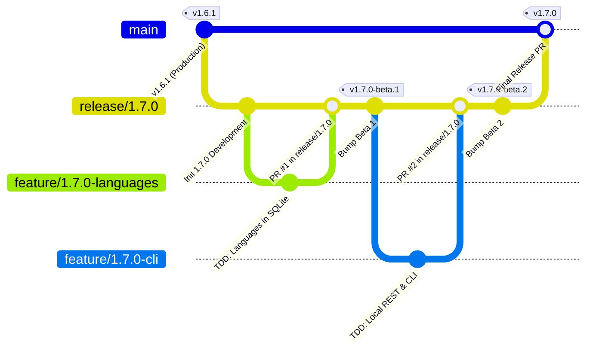

# Guía de canalización de lanzamiento y modelo de ramificación de PokéVault Git

> **Languages / Sprachen:** [🇩🇪 Deutsch](GIT_WORKFLOW_AND_RELEASES.de.md) | [🇬🇧 English](../GIT_WORKFLOW_AND_RELEASES.md) | [🇫🇷 Français](GIT_WORKFLOW_AND_RELEASES.fr.md) | **[🇪🇸 Español](GIT_WORKFLOW_AND_RELEASES.es.md)** | [🇮🇹 Italiano](GIT_WORKFLOW_AND_RELEASES.it.md) | [🇯🇵 日本語](GIT_WORKFLOW_AND_RELEASES.ja.md) | [🇰🇷 한국어](GIT_WORKFLOW_AND_RELEASES.ko.md) | [🇨🇳 简体中文](GIT_WORKFLOW_AND_RELEASES.zh-hans.md) | [🇹🇼 繁體中文](GIT_WORKFLOW_AND_RELEASES.zh-hant.md) | [🇵🇹 Português](GIT_WORKFLOW_AND_RELEASES.pt.md) | [🇳🇱 Nederlands](GIT_WORKFLOW_AND_RELEASES.nl.md) | [🇵🇱 Polski](GIT_WORKFLOW_AND_RELEASES.pl.md) | [🇷🇺 Русский](GIT_WORKFLOW_AND_RELEASES.ru.md)

Este documento describe el modelo de bifurcación oficial de Git, las reglas de protección de bifurcaciones y el proceso automatizado de compilación y lanzamiento para desarrolladores y asistentes de IA.

---

## 1. El modelo de ramificación

PokéVault utiliza una **Estrategia de ramificación de lanzamiento** estructurada:



### Los 3 niveles de sucursales:

| Tipo de sucursal | Nombre / Patrón | Propósito y protección |
| :--- | :--- | :--- |
| **Producción** | `principal` | **Protegido**. Contiene código en vivo publicado exclusivamente estable. Cada fusión aquí corresponde a una versión oficial de la tienda/GitHub. Los empujes directos están deshabilitados. |
| **Estreno / Puesta en escena** | `lanzamiento/<versión>` (por ejemplo, `lanzamiento/1.7.0`) | Rama de preparación para todas las subcaracterísticas de una versión principal. Aquí es donde se realizan las pruebas de integración y se crean **lanzamientos Beta/lanzamientos previos**. |
| **Sucursales destacadas** | `feature/<versión>-<tema>` (por ejemplo, `feature/1.7.0-languages`, `feature/1.7.0-cli`) | Ramas de desarrollo de corta duración para módulos individuales. Siempre bifurque la rama `release/*` correspondiente y vuelva a fusionarse mediante Pull Request. |
| **Revisiones** | `hotfix/<versión>` (por ejemplo, `hotfix/1.6.2`) | Correcciones de errores urgentes para la versión en vivo. Se bifurca en `main` y se fusiona en `main` y `release/*`. |

---

## 2. Configuración de la protección de sucursales de GitHub (paso a paso)

Para evitar envíos accidentales a `main` y garantizar que solo se pueda fusionar código probado minuciosamente, configure reglas de protección de ramas en la interfaz web de GitHub:

### Regla 1: Protección para `main`
1. Abra el repositorio de GitHub en su navegador $\rightarrow$ Haga clic en **Configuración** $\rightarrow$ **Sucursales** (en *Código y automatización*).
2. Haga clic en **Agregar regla de protección de sucursales** (o edite la regla existente para `principal`).
3. **Patrón de nombre de sucursal**: `main`
4. Habilite las siguientes casillas de verificación:
 - [x] **Requerir una solicitud de extracción antes de fusionar**
 - *(Opcional: establezca "Requerir aprobaciones" en 1 si se requieren revisiones de código de equipo, o manténgalo en 0 para desarrollo individual).*
 - [x] **Requerir que se aprueben verificaciones de estado antes de fusionar**
 - [x] **Requerir que las sucursales estén actualizadas antes fusionando**
 - Busque en el cuadro de búsqueda el trabajo de CI: `Flutter Analyse & Test` (o `analizar y probar`) y selecciónelo.
 - [x] **No permitir omitir las configuraciones anteriores** *(garantiza que los administradores no puedan omitir accidentalmente las comprobaciones de CI).*
5. Haga clic en **Guardar cambios** en la parte inferior.

### Regla 2: Protección para `release/*` (Recomendado)
Repita el proceso con:
- **Patrón de nombre de rama**: `release/*`
- [x] **Requerir que se aprueben verificaciones de estado antes de fusionar** (`Flutter Analyse & Test`).
- Esto garantiza que ninguna rama de características con pruebas fallidas pueda ingresar a la rama de preparación de lanzamiento.

---

## 3. Flujo de trabajo de desarrollo diario

### Paso 1: Crear una rama de funciones
Antes de comenzar una nueva tarea, asegúrese de que `release/1.7.0` esté actualizado:
```bash
git checkout release/1.7.0
git pull origin release/1.7.0
git checkout -b feature/1.7.0-languages
```

### Paso 2: Desarrollo con TDD
 estricto según `AGENTS.md`:
1. **Pruebas primero**: escribe casos de prueba en `test/` (por ejemplo, `test/services/language_expansion_test.dart`).
2. **Implementar**: Escriba código de producción mínimo en `lib/` hasta que pasen todas las pruebas.
3. **Verificar**:
 ```bash
   flutter test
   dart analyze --fatal-infos
   ```

### Paso 3: Confirmar y enviar
```bash
git add .
git commit -m "feat(i18n): add 10 franchise languages to pokemon database and dao"
git push -u origin feature/1.7.0-languages
```

### Paso 4: Abrir solicitud de extracción en GitHub
- **Base Branch**: `release/1.7.0`
- **Compare Branch**: `feature/1.7.0-languages`
- GitHub Actions inicia automáticamente el flujo de trabajo `CI Quality Gate` (`.github/workflows/ci.yml`).
- Una vez las comprobaciones pasan $\rightarrow$ Haga clic en **Aplastar y fusionar** (o *Rebase y fusionar*).

---

## 4. Creación de versiones preliminares y betas (multiplataforma)

Una vez que una o más funciones se hayan integrado en `release/1.7.0` y necesiten probarse:

### Método A: Automáticamente mediante etiqueta Git (recomendado)
1. **Versión mejorada** en `release/1.7.0`:
 ```bash
   git checkout release/1.7.0
   git pull origin release/1.7.0
   python tool/bump_version.py beta --commit
   ```
 *(por ejemplo, produce `1.7.0-beta.1+9` en `pubspec.yaml` y confirma el cambio).*

2. **Crear y enviar etiqueta Git**:
 ```bash
   git tag v1.7.0-beta.1
   git push origin release/1.7.0 --tags
   ```

3. **Compilación automatizada en acciones de GitHub**:
 El flujo de trabajo `.github/workflows/release.yml` se inicia automáticamente en los ejecutores de GitHub y compila los 4 paquetes:
 - 📱 `PokeVault_V<versión>.apk`
 - 💻 `PokeVault_V<versión>_Windows.zip`
 - 🐧 `PokeVault_V<versión>.AppImage`
 - 📦 `PokeVault_V<versión>.tar.gz`

4. **Prelanzamiento automatizado de GitHub**:
 - Debido a que la etiqueta contiene `-beta`, GitHub marca automáticamente el lanzamiento como **Prelanzamiento**.
 - Los evaluadores pueden descargar los paquetes de instalación integrados directamente en **Lanzamientos**.
 - El actualizador integrado en la aplicación de PokéVault (`UpdateHelper`) detecta la extensión de archivo apropiada para cada sistema operativo.

### Método B: manualmente a través de GitHub Web UI
1. En el repositorio de GitHub, navegue hasta **Acciones** $\rightarrow$ **Crear y lanzar paquetes multiplataforma**.
2. Haga clic en **Ejecutar flujo de trabajo** a la derecha.
3. Seleccione la rama (por ejemplo, `release/1.7.0`), ingrese la etiqueta de versión (por ejemplo, `v1.7.0-beta.1`) y deje la casilla de verificación *"Marcar como prelanzamiento/beta"* marcada como `true`.
4. Haga clic en **Ejecutar flujo de trabajo**.

---

## 5. Publicación de una versión estable final

Cuando se completen todas las pruebas beta y la versión 1.7.0 esté lista para producción:

1. **Establecer versión estable**:
 ```bash
   git checkout release/1.7.0
   python tool/bump_version.py 1.7.0 --commit
   git push origin release/1.7.0
   ```

2. **Abrir solicitud de extracción desde `release/1.7.0` a `main` y fusionar**:
 - Base: `main` $\leftarrow$ Comparar: `release/1.7.0`.
 - CI Quality Gate se ejecuta y pasa.
 - Fusiona el PR.

3. **Lanzamiento totalmente automatizado a través de acciones de GitHub**:
 - El envío a `main` activa automáticamente `.github/workflows/release.yml`.
 - El extractor de metadatos de lanzamiento (`tool/extract_release_info.py`) extrae:
 - El **Título de lanzamiento** de las comillas en la primera línea de `RELEASE_NOTES.md` (por ejemplo, `The Language Expansion`).
 - La **Etiqueta de versión** de `pubspec.yaml` (por ejemplo, `v1.7.0`).
 - El texto completo en varios idiomas de `RELEASE_NOTES.md` como cuerpo de la versión de GitHub.
 - Los 4 paquetes binarios (Android APK, Windows Zip, Linux Tar.gz y AppImage) se crean y publican como la **Última versión estable** oficial.
 - Inmediatamente después de la creación de la versión, `deploy.yml` implementa la nueva aplicación web en GitHub Pages.
