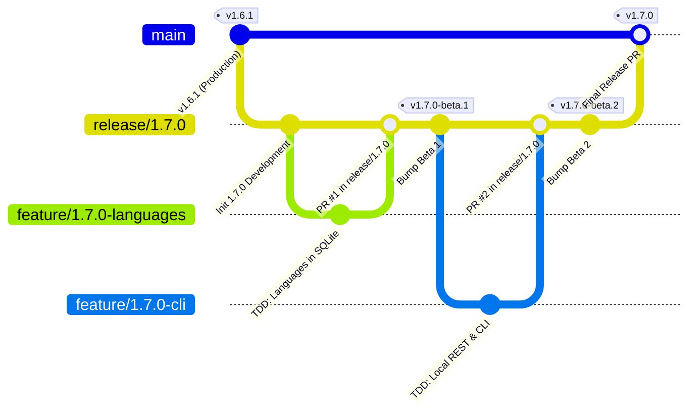

# Modèle de branches Git et guide du pipeline de version de PokéVault

> **Languages / Sprachen:** [🇩🇪 Deutsch](GIT_WORKFLOW_AND_RELEASES.de.md) | [🇬🇧 English](../GIT_WORKFLOW_AND_RELEASES.md) | **[🇫🇷 Français](GIT_WORKFLOW_AND_RELEASES.fr.md)** | [🇪🇸 Español](GIT_WORKFLOW_AND_RELEASES.es.md) | [🇮🇹 Italiano](GIT_WORKFLOW_AND_RELEASES.it.md) | [🇯🇵 日本語](GIT_WORKFLOW_AND_RELEASES.ja.md) | [🇰🇷 한국어](GIT_WORKFLOW_AND_RELEASES.ko.md) | [🇨🇳 简体中文](GIT_WORKFLOW_AND_RELEASES.zh-hans.md) | [🇹🇼 繁體中文](GIT_WORKFLOW_AND_RELEASES.zh-hant.md) | [🇵🇹 Português](GIT_WORKFLOW_AND_RELEASES.pt.md) | [🇳🇱 Nederlands](GIT_WORKFLOW_AND_RELEASES.nl.md) | [🇵🇱 Polski](GIT_WORKFLOW_AND_RELEASES.pl.md) | [🇷🇺 Русский](GIT_WORKFLOW_AND_RELEASES.ru.md)

Ce document décrit le modèle officiel de branchement Git, les règles de protection des branches et le processus automatisé de construction et de déploiement pour les développeurs et les assistants IA.

---

## 1. Le modèle de branchement

PokéVault utilise une **stratégie de branchement de release** structurée :



### Les 3 niveaux de branches :

| Type de branche | Nom / Modèle | Objectif & Protection |
| :--- | :--- | :--- |
| **Production** | `main` | **Protégée**. Contient exclusivement du code stable et publié en production. Chaque fusion ici correspond à une version officielle sur le store / GitHub. Les push directs sont désactivés. |
| **Release / Staging** | `release/<version>` (ex. `release/1.7.0`) | Branche de staging pour toutes les sous-fonctionnalités d'une version majeure. C'est ici que les tests d'intégration sont effectués et que les **versions Beta / Pré-versions** sont créées. |
| **Branches de fonctionnalités** | `feature/<version>-<topic>` (ex. `feature/1.7.0-languages`, `feature/1.7.0-cli`) | Branches de développement de courte durée pour des modules individuels. Toujours créer à partir de la branche `release/*` correspondante et fusionner via Pull Request. |
| **Corrections urgentes** | `hotfix/<version>` (ex. `hotfix/1.6.2`) | Correctifs urgents pour la version en production. Créer à partir de `main` et fusionner dans `main` ainsi que dans `release/*`. |

---

## 2. Configuration de la protection des branches GitHub (Étape par étape)

Pour éviter les poussées accidentelles vers `main` et garantir que seul du code soigneusement testé puisse être fusionné, configurez les règles de protection des branches dans l'interface web de GitHub :

### Règle 1 : Protection pour `main`
1. Ouvrez le référentiel GitHub dans votre navigateur $\rightarrow$ Cliquez sur **Paramètres** $\rightarrow$ **Branches** (sous *Code et automatisation*).
2. Cliquez sur **Ajouter une règle de protection de branche** (ou modifiez la règle existante pour `main`).
3. **Modèle de nom de branche** : `main`
4. Cochez les cases suivantes :
 - [x] **Exiger une pull request avant la fusion**
 - *(Facultatif : définissez "Exiger des approbations" sur 1 si des révisions de code d'équipe sont requises, ou gardez-le à 0 pour le développement en solo).*
 - [x] **Exiger que les vérifications de statut soient réussies avant la fusion**
 - [x] **Exiger que les branches soient à jour avant la fusion fusion**
 - Recherchez dans la zone de recherche le travail CI : `Flutter Analyse & Test` (ou `analyser et tester`) et sélectionnez-le.
 - [x] **Ne pas autoriser le contournement des paramètres ci-dessus** *(garantit que les administrateurs ne peuvent pas contourner accidentellement les contrôles CI).*
5. Cliquez sur **Enregistrer les modifications** en bas.

### Règle 2 : Protection pour `release/*` (Recommandé)
Répétez le processus avec :
- **Modèle de nom de branche** : `release/*`
- [x] **Exiger que les vérifications de statut réussissent avant de fusionner** (`Flutter Analyze & Test`).
- Cela garantit qu’aucune branche de fonctionnalité avec des tests échoués ne peut entrer dans la branche de préproduction release.

---

## 3. Flux de travail de développement quotidien

### Étape 1 : Créer une branche de fonctionnalité
Avant de commencer une nouvelle tâche, assurez-vous que `release/1.7.0` est à jour :
```bash
git checkout release/1.7.0
git pull origin release/1.7.0
git checkout -b feature/1.7.0-languages
```

### Étape 2 : Développement avec TDD strict
Selon `AGENTS.md` :
1. **Tests d'abord** : Écrivez les cas de test dans `test/` (par exemple `test/services/language_expansion_test.dart`).
2. **Implémenter** : Écrivez le code de production minimal dans `lib/` jusqu'à ce que tous les tests réussissent.
3. **Vérifier** :
   ```bash
   flutter test
   dart analyze --fatal-infos
   ```

### Étape 3 : Valider et Pousser
```bash
git add .
git commit -m "feat(i18n): add 9 franchise languages to pokemon database and dao"
git push -u origin feature/1.7.0-languages
```

### Étape 4 : Ouvrir une Pull Request sur GitHub
- **Branche de base** : `release/1.7.0`
- **Branche de comparaison** : `feature/1.7.0-languages`
- GitHub Actions déclenche automatiquement le workflow `CI Quality Gate` (`.github/workflows/ci.yml`).
- Une fois les vérifications passées $
ightarrow$ Cliquez sur **Squash and merge** (ou *Rebase and merge*).

---

## 4. Création de pré-versions et de bêta (multi-plateforme)

Une fois qu'une ou plusieurs fonctionnalités ont été intégrées dans `release/1.7.0` et nécessitent des tests :

### Méthode A : Automatiquement via Git Tag (Recommandé)
1. **Augmenter la version** sur `release/1.7.0` :
   ```bash
   git checkout release/1.7.0
   git pull origin release/1.7.0
   python tool/bump_version.py beta --commit
   ```
   *(par ex. produit `1.7.0-beta.1+9` dans `pubspec.yaml` et valide le changement).*

2. **Créer et pousser un tag Git** :
   ```bash
   git tag v1.7.0-beta.1
   git push origin release/1.7.0 --tags
   ```

3. **Compilation automatisée dans GitHub Actions** :
   Le workflow `.github/workflows/release.yml` démarre automatiquement sur les runners GitHub et compile les 4 packages :
   - 📱 `PokeVault_V<version>.apk`
   - 💻 `PokeVault_V<version>_Windows.zip`
   - 🐧 `PokeVault_V<version>.AppImage`
   - 📦 `PokeVault_V<version>.tar.gz`

4. **Pré-version automatisée sur GitHub** :
   - Parce que le tag contient `-beta`, GitHub marque automatiquement la version comme une **Pré-version**.
   - Les testeurs peuvent télécharger les packages d'installation directement sous **Releases**.
   - Le mise à jour intégrée dans l'application de PokéVault (`UpdateHelper`) détecte l'extension de fichier appropriée pour chaque système d'exploitation.

### Méthode B : Manuellement via l'interface web GitHub
1. Dans le dépôt GitHub, allez dans **Actions** $
ightarrow$ **Build & Release Multi-Platform Packages**.
2. Cliquez sur **Run workflow** à droite.
3. Sélectionnez la branche (par ex. `release/1.7.0`), saisissez le tag de version (par ex. `v1.7.0-beta.1`), et laissez la case *"Mark as pre-release / beta"* cochée sur `true`.
4. Cliquez sur **Run workflow**.

---

## 5. Publication d'une version stable finale

Lorsque tous les tests bêta sont terminés et que la version 1.7.0 est prête pour la production :

1. **Définir la version sur stable** :
   ```bash
   git checkout release/1.7.0
   python tool/bump_version.py 1.7.0 --commit
   git push origin release/1.7.0
   ```

2. **Ouvrir la requête de tirage de 'release/1.7.0' vers 'main' & Merge** :
 - Base : 'main' $\leftarrow$ Comparer : 'release/1.7.0'.
 - CI Quality Gate s’exécute et passes.
 - Fusionner la PR.

3. **Publication entièrement automatisée via GitHub Actions** :
   - Le push vers `main` déclenche automatiquement `.github/workflows/release.yml`.
   - L'extracteur de métadonnées de publication (`tool/extract_release_info.py`) extrait :
     - Le **Titre de la Version** à partir des guillemets sur la première ligne de `RELEASE_NOTES.md` (par ex. `The Language Expansion`).
     - Le **Tag de Version** à partir de `pubspec.yaml` (par ex. `v1.7.0`).
     - Le texte complet multilingue de `RELEASE_NOTES.md` comme contenu de la publication GitHub.
   - Les 4 packages binaires (APK Android, Zip Windows, Tar.gz Linux & AppImage) sont construits et publiés comme **Dernière Version Stable** officielle.
   - Immédiatement après la création de la publication, `deploy.yml` déploie la nouvelle application web sur GitHub Pages.
