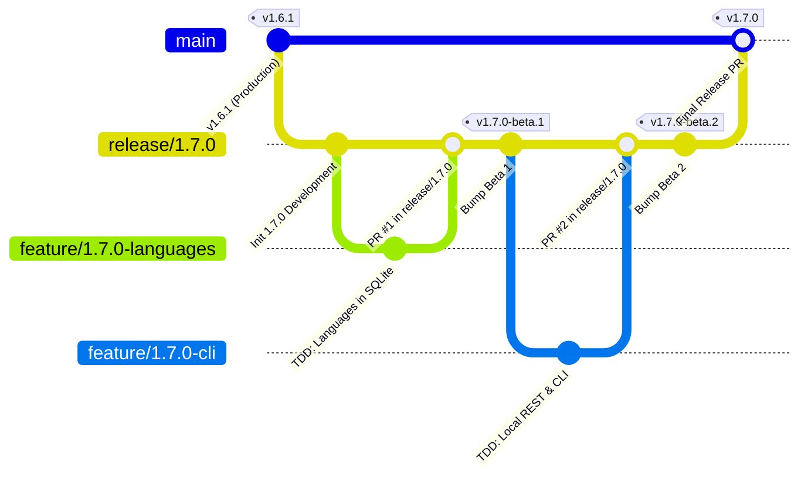

# Guida al modello di ramificazione e alla pipeline di rilascio di PokéVault Git

> **Languages / Sprachen:** [🇩🇪 Deutsch](GIT_WORKFLOW_AND_RELEASES.de.md) | [🇬🇧 English](../GIT_WORKFLOW_AND_RELEASES.md) | [🇫🇷 Français](GIT_WORKFLOW_AND_RELEASES.fr.md) | [🇪🇸 Español](GIT_WORKFLOW_AND_RELEASES.es.md) | **[🇮🇹 Italiano](GIT_WORKFLOW_AND_RELEASES.it.md)** | [🇯🇵 日本語](GIT_WORKFLOW_AND_RELEASES.ja.md) | [🇰🇷 한국어](GIT_WORKFLOW_AND_RELEASES.ko.md) | [🇨🇳 简体中文](GIT_WORKFLOW_AND_RELEASES.zh-hans.md) | [🇹🇼 繁體中文](GIT_WORKFLOW_AND_RELEASES.zh-hant.md) | [🇵🇹 Português](GIT_WORKFLOW_AND_RELEASES.pt.md) | [🇳🇱 Nederlands](GIT_WORKFLOW_AND_RELEASES.nl.md) | [🇵🇱 Polski](GIT_WORKFLOW_AND_RELEASES.pl.md) | [🇷🇺 Русский](GIT_WORKFLOW_AND_RELEASES.ru.md)

Questo documento descrive il modello ufficiale di ramificazione di Git, le regole di protezione dei rami e il processo di creazione e rilascio automatizzato per sviluppatori e assistenti AI.

---

## 1. Il modello della ramificazione

PokéVault utilizza una **strategia di ramificazione del rilascio** strutturata:



### I 3 livelli di diramazione:

| Tipo di filiale | Nome/Modello | Scopo e protezione |
| :--- | :--- | :--- |
| **Produzione** | "principale" | **Protetto**. Contiene esclusivamente codice live pubblicato e stabile. Ogni unione qui corrisponde a una versione ufficiale dello store/GitHub. Le spinte dirette sono disabilitate. |
| **Uscita / Messa in scena** | `release/<versione>` (ad es. `release/1.7.0`) | Ramo di staging per tutte le funzionalità secondarie di una versione principale. È qui che vengono eseguiti i test di integrazione e vengono create le **versioni beta/pre-release**. |
| **Rami di funzionalità** | `feature/<versione>-<argomento>` (ad es. `feature/1.7.0-linguals`, `feature/1.7.0-cli`) | Rami di sviluppo di breve durata per singoli moduli. Si diramano sempre dal ramo `release/*` corrispondente e vengono riuniti nuovamente tramite Pull Request. |
| **Hotfix** | `hotfix/<versione>` (ad es. `hotfix/1.6.2`) | Correzioni di bug urgenti per la versione live. Si diramano da "main" e vengono uniti sia in "main" che in "release/*". |

---

## 2. Configurazione della protezione dei rami GitHub (passo dopo passo)

Per evitare push accidentali a "main" e garantire che solo il codice accuratamente testato possa essere unito, configura le regole di protezione del ramo nell'interfaccia web di GitHub:

### Regola 1: protezione per `main`
1. Apri il repository GitHub nel tuo browser $\rightarrow$ Fai clic su **Impostazioni** $\rightarrow$ **Rami** (sotto *Codice e automazione*).
2. Fai clic su **Aggiungi regola di protezione del ramo** (o modifica la regola esistente per `principale`).
3. **Modello nome ramo**: `main`
4. Abilita le seguenti caselle di controllo:
 - [x] **Richiedi una richiesta pull prima dell'unione**
 - *(Facoltativo: imposta "Richiedi approvazioni" su 1 se sono necessarie revisioni del codice del team o mantienilo a 0 per lo sviluppo solista).*
 - [x] **Richiedi il superamento dei controlli di stato prima dell'unione**
 - [x] **Richiedi che i rami siano aggiornati prima dell'unione**
 - Cerca nella casella di ricerca il lavoro CI: `Flutter Analyse & Test` (o `analyze-and-test`) e selezionalo.
 - [x] **Non consentire di ignorare le impostazioni precedenti** *(garantisce che gli amministratori non possano ignorare accidentalmente i controlli CI).*
5. Fai clic su **Salva modifiche** in basso.

### Regola 2: protezione per `release/*` (consigliato)
Ripeti il processo con:
- **Modello nome ramo**: `release/*`
- [x] **Richiede il superamento dei controlli di stato prima della fusione** (`Flutter Analyse & Test`).
- Ciò garantisce che nessun ramo di funzionalità fallisca i test possono entrare nel ramo di staging del rilascio.

---

## 3. Flusso di lavoro di sviluppo quotidiano

### Passaggio 1: creare un ramo di funzionalità
Prima di iniziare una nuova attività, assicurarsi che `release/1.7.0` sia aggiornato:
```bash
git checkout release/1.7.0
git pull origin release/1.7.0
git checkout -b feature/1.7.0-languages
```

### Passo 2: Sviluppo con rigoroso TDD
Secondo `AGENTS.md`:
1. **Prima i test**: Scrivi i casi di test in `test/` (ad esempio `test/services/lingual_expansion_test.dart`).
2. **Implementa**: scrivi il codice di produzione minimo in `lib/` finché tutti i test non vengono superati.
3. **Verifica**:
 ```bash
   flutter test
   dart analyze --fatal-infos
   ```

### Passaggio 3: conferma e invio
```bash
git add .
git commit -m "feat(i18n): add 9 franchise languages to pokemon database and dao"
git push -u origin feature/1.7.0-languages
```

### Passaggio 4: aprire la richiesta pull su GitHub
- **Base Branch**: `release/1.7.0`
- **Confronta branch**: `feature/1.7.0-linguals`
- GitHub Actions avvia automaticamente il flusso di lavoro `CI Quality Gate` (`.github/workflows/ci.yml`).
- Una volta superati i controlli $\rightarrow$, fai clic su **Squash and merge** (o *Rebase and merge*).

---

## 4. Creazione di pre-release e beta (multipiattaforma)

Una volta che una o più funzionalità sono state integrate nella "release/1.7.0" e necessitano di essere testate:

### Metodo A: automaticamente tramite tag Git (consigliato)
1. **Versione bump** su `release/1.7.0`:
 ```bash
   git checkout release/1.7.0
   git pull origin release/1.7.0
   python tool/bump_version.py beta --commit
   ```
 *(ad esempio produce `1.7.0-beta.1+9` in `pubspec.yaml` e conferma la modifica).*

2. **Crea e invia il tag Git**:
 ```bash
   git tag v1.7.0-beta.1
   git push origin release/1.7.0 --tags
   ```

3. **Creazione automatizzata in azioni GitHub**:
 Il flusso di lavoro `.github/workflows/release.yml` si avvia automaticamente sui runner GitHub e crea tutti e 4 i pacchetti:
 - 📱 `PokeVault_V<version>.apk`
 - 💻 `PokeVault_V<versione>_Windows.zip`
 - 🐧 `PokeVault_V<versione>.AppImage`
 - 📦 `PokeVault_V<versione>.tar.gz`

4. **Pre-release automatizzato di GitHub**:
 - Poiché il tag contiene `-beta`, GitHub contrassegna automaticamente la versione come **Pre-release**.
 - I tester possono scaricare i pacchetti di installazione integrati direttamente in **Releases**.
 - Programma di aggiornamento in-app integrato di PokéVault (`UpdateHelper`) rileva l'estensione di file appropriata per ciascun sistema operativo.

### Metodo B: manualmente tramite GitHub Web UI
1. Nel repository GitHub, vai a **Azioni** $\rightarrow$ **Crea e rilascia pacchetti multipiattaforma**.
2. Fai clic su **Esegui flusso di lavoro** a destra.
3. Seleziona il ramo (ad esempio `release/1.7.0`), inserisci il tag della versione (ad esempio `v1.7.0-beta.1`) e lascia la casella di controllo *"Segna come pre-release / beta"* selezionata come `true`.
4. Fai clic su **Esegui flusso di lavoro**.

---

## 5. Pubblicazione di una versione stabile finale

Una volta completati tutti i beta testing e la versione 1.7.0 è pronta per la produzione:

1. **Imposta la versione su stabile**:
 ```bash
   git checkout release/1.7.0
   python tool/bump_version.py 1.7.0 --commit
   git push origin release/1.7.0
   ```

2. **Apri richiesta pull da `release/1.7.0` a `main` e unisci**:
 - Base: `main` $\leftarrow$ Confronta: `release/1.7.0`.
 - CI Quality Gate viene eseguito e superato.
 - Unisci il PR.

3. **Rilascio completamente automatizzato tramite azioni GitHub**:
 - Il push a `main` attiva automaticamente `.github/workflows/release.yml`.
 - L'estrattore di metadati della versione (`tool/extract_release_info.py`) estrae:
 - Il **Titolo della versione** dalle virgolette sulla prima riga di `RELEASE_NOTES.md` (ad esempio `The Language Expansion`).
 - Il **Tag di versione** da `pubspec.yaml` (ad esempio `v1.7.0`).
 - Il testo multilingue completo da `RELEASE_NOTES.md` come corpo della versione GitHub.
 - Tutti e 4 i pacchetti binari (APK Android, Windows Zip, Linux Tar.gz e AppImage) vengono creati e pubblicati come **ultima versione stabile** ufficiale.
 - Immediatamente dopo la creazione della versione, `deploy.yml` distribuisce la nuova applicazione Web su GitHub Pages.
