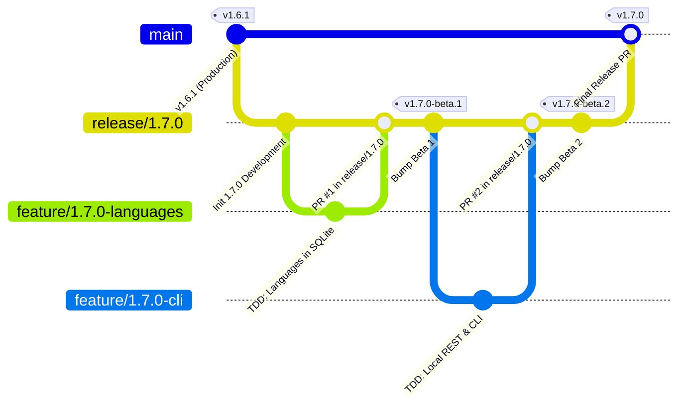

# PokéVault Git ブランチモデル & リリースパイプラインガイド

> **Languages / Sprachen:** [🇩🇪 Deutsch](GIT_WORKFLOW_AND_RELEASES.de.md) | [🇬🇧 English](../GIT_WORKFLOW_AND_RELEASES.md) | [🇫🇷 Français](GIT_WORKFLOW_AND_RELEASES.fr.md) | [🇪🇸 Español](GIT_WORKFLOW_AND_RELEASES.es.md) | [🇮🇹 Italiano](GIT_WORKFLOW_AND_RELEASES.it.md) | **[🇯🇵 日本語](GIT_WORKFLOW_AND_RELEASES.ja.md)** | [🇰🇷 한국어](GIT_WORKFLOW_AND_RELEASES.ko.md) | [🇨🇳 简体中文](GIT_WORKFLOW_AND_RELEASES.zh-hans.md) | [🇹🇼 繁體中文](GIT_WORKFLOW_AND_RELEASES.zh-hant.md) | [🇵🇹 Português](GIT_WORKFLOW_AND_RELEASES.pt.md) | [🇳🇱 Nederlands](GIT_WORKFLOW_AND_RELEASES.nl.md) | [🇵🇱 Polski](GIT_WORKFLOW_AND_RELEASES.pl.md) | [🇷🇺 Русский](GIT_WORKFLOW_AND_RELEASES.ru.md)

このドキュメントでは、公式の Git ブランチ モデル、ブランチ保護ルール、開発者と AI アシスタント向けの自動ビルドとリリースのプロセスについて説明します。

---

## 1. 分岐モデル

PokéVault は構造化された **リリース分岐戦略** を使用します。



### 3 つの分岐レベル:

| ブランチの種類 | 名前 / パターン | 目的と保護 |
| :--- | :--- | :--- |
| **生産** | `メイン` | **保護されています**。 安定した公開されたライブ コードのみが含まれています。 ここでのすべてのマージは、公式ストア/GitHub リリースに対応します。 ダイレクトプッシュは無効になっています。 |
| **リリース/ステージング** | `release/<バージョン>` (例: `release/1.7.0`) | メジャー リリースのすべてのサブ機能のステージング ブランチ。 ここで統合テストが行​​われ、**ベータ リリース/プレリリース**が構築されます。 |
| **機能ブランチ** | `feature/<バージョン>-<トピック>` (例: `feature/1.7.0-langages`、`feature/1.7.0-cli`) | 個々のモジュールの開発ブランチは存続期間が短くなります。 常に対応する `release/*` ブランチから分岐し、プル リクエストを介してマージされます。 |
| **ホットフィックス** | `hotfix/<バージョン>` (例: `hotfix/1.6.2`) | ライブバージョンの緊急バグ修正。 `main` から分岐し、`main` と `release/*` の両方にマージされます。 |

---

## 2. GitHub ブランチ保護のセットアップ (ステップバイステップ)

「main」への誤ったプッシュを防止し、徹底的にテストされたコードのみをマージできるようにするには、GitHub Web インターフェイスでブランチ保護ルールを構成します。

### ルール 1: `main`
1 の保護。 ブラウザで GitHub リポジトリを開きます $\rightarrow$ **設定** $\rightarrow$ **ブランチ** (*コードと自動化*の下) 
2 をクリックします。 [**ブランチ保護ルールの追加**] をクリックします (または、「main」の既存のルールを編集します)。
3。 **ブランチ名のパターン**: `main`
4。 次のチェックボックスを有効にします。
 - [x] **マージ前にプル リクエストが必要**
 - *(オプション: チーム コード レビューが必要な場合は「承認が必要」を 1 に設定し、単独開発の場合は 0 のままにします)。*
 - [x] **マージ前にステータス チェックに合格する必要があります**
 - [x] **ブランチが起動している必要があります マージ前の日付**
 - 検索ボックスで CI ジョブ「Flutter Analyze & Test」 (または「analyze-and-test」) を検索し、選択します。
 - [x] **上記の設定のバイパスを許可しない** * (管理者が誤って CI チェックをバイパスできないようにします)。*
5。 下部にある **変更を保存** をクリックします。

### ルール 2: `release/*` の保護 (推奨)
次のプロセスを繰り返します:
- **ブランチ名パターン**: `release/*`
- [x] **マージ前にステータス チェックに合格する必要があります** (`フラッター分析とテスト`)。
- これにより、失敗する機能ブランチがないことが保証されます。 テストはリリース ステージング ブランチに入ることができます。

---

## 3. 毎日の開発ワークフロー

### ステップ 1: 機能ブランチを作成する
新しいタスクを開始する前に、「release/1.7.0」が最新であることを確認してください:
```bash
git checkout release/1.7.0
git pull origin release/1.7.0
git checkout -b feature/1.7.0-languages
```

### ステップ 2: 厳密な TDD を使用した開発
`AGENTS.md`:
1 によると。 **最初にテスト**: `test/` にテスト ケースを作成します (例: `test/services/ language_expansion_test.dart`)。
2。 **実装**: すべてのテストに合格するまで、最小限の実動コードを `lib/` に記述します。
3。 **確認**:
 ```bash
   flutter test
   dart analyze --fatal-infos
   ```

### ステップ 3: コミットとプッシュ
```bash
git add .
git commit -m "feat(i18n): add 10 franchise languages to pokemon database and dao"
git push -u origin feature/1.7.0-languages
```

### ステップ 4: GitHub でプル リクエストを開く
- **ベース ブランチ**: `release/1.7.0`
- **比較ブランチ**: `feature/1.7.0-langages`
- GitHub Actions によりワークフロー `CI Quality Gate` が自動的に開始されます (`.github/workflows/ci.yml`).
- チェックに合格したら $\rightarrow$ [**スカッシュしてマージ**] (または *リベースしてマージ*) をクリックします。

---

## 4. プレリリースとベータ版の構築 (マルチプラットフォーム)

1 つ以上の機能が「release/1.7.0」に統合され、テストが必要になったら、次のようにします。

### 方法 A: Git タグ経由で自動的に (推奨)
1。 **`release/1.7.0` のバージョンをバンプ**:
 ```bash
   git checkout release/1.7.0
   git pull origin release/1.7.0
   python tool/bump_version.py beta --commit
   ```
 *(例: `pubspec.yaml` で `1.7.0-beta.1+9` を生成し、変更をコミットします)。

2. **Git タグを作成してプッシュ**:
 ```bash
   git tag v1.7.0-beta.1
   git push origin release/1.7.0 --tags
   ```

3. **GitHub アクションの自動ビルド**:
 ワークフロー `.github/workflows/release.yml` が GitHub ランナー上で自動的に開始され、4 つのパッケージすべてをビルドします: 
 - 📱 `PokeVault_V<version>.apk`
 - 💻 `PokeVault_V<バージョン>_Windows.zip`
 - 🐧 `PokeVault_V<バージョン>.AppImage`
 - 📦 `PokeVault_V<バージョン>.tar.gz`

4. **自動化された GitHub プレリリース**:
 - タグに `-beta` が含まれているため、GitHub は自動的にリリースを **プレリリース**としてマークします。
 - テスターはビルドされたインストーラー パッケージを **リリース** の下に直接ダウンロードできます。
 - PokéVault の統合されたアプリ内アップデーター (`UpdateHelper`) 各オペレーティング システムに適切なファイル拡張子を検出します。

### 方法 B: GitHub Web UI
1 を介して手動で。 GitHub リポジトリで、**アクション** $\rightarrow$ **マルチプラットフォーム パッケージのビルドとリリース**.
2 に移動します。 右側の **ワークフローの実行** をクリックします。
3。 ブランチ (例: 「release/1.7.0」) を選択し、バージョン タグ (例: 「v1.7.0-beta.1」) を入力し、*「プレリリース / ベータとしてマークする」* チェックボックスを「true」のままにしておきます。
4。 [**ワークフローの実行**] をクリックします。

---

## 5. 最終安定版リリースの公開

すべてのベータ テストが完了し、バージョン 1.7.0 の運用準備が整うと、次のようになります。

1. **バージョンを安定版に設定**:
 ```bash
   git checkout release/1.7.0
   python tool/bump_version.py 1.7.0 --commit
   git push origin release/1.7.0
   ```

2. **`release/1.7.0` から `main` へのプル リクエストを開き、マージします**:
 - ベース: `main` $\leftarrow$ 比較: `release/1.7.0`.
 - CI 品質ゲートが実行され、合格します。
 - PR をマージします。

3. **GitHub Actions による完全に自動化されたリリース**:
 - `main` へのプッシュにより、自動的に `.github/workflows/release.yml` がトリガーされます。
 - リリース メタデータ エクストラクター (`tool/extract_release_info.py`) は以下を抽出します: 
 - 最初の行の引用符からの **リリース タイトル** 
 - `pubspec.yaml` の **バージョン タグ** (例 `v1.7.0`)。
 - GitHub リリースとしての `RELEASE_NOTES.md` からの完全な多言語テキスト body.
 - 4 つのバイナリ パッケージ (Android APK、Windows Zip、Linux Tar.gz、AppImage) はすべて、公式 **最新の安定版リリース**としてビルドおよび公開されます。
 - リリースの作成直後に、`deploy.yml` が新しい Web アプリケーションを GitHub Pages にデプロイします。
