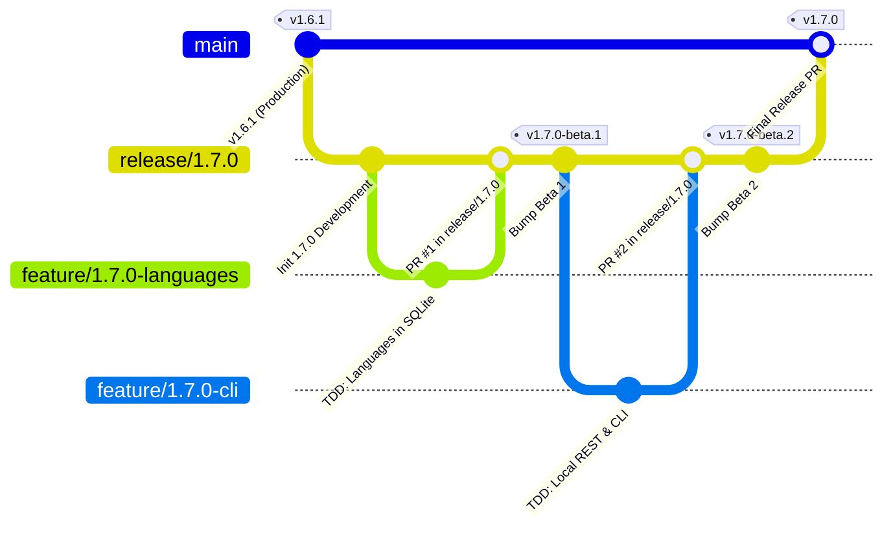

# PokéVault Git 분기 모델 및 릴리스 파이프라인 가이드

> **Languages / Sprachen:** [🇩🇪 Deutsch](GIT_WORKFLOW_AND_RELEASES.de.md) | [🇬🇧 English](../GIT_WORKFLOW_AND_RELEASES.md) | [🇫🇷 Français](GIT_WORKFLOW_AND_RELEASES.fr.md) | [🇪🇸 Español](GIT_WORKFLOW_AND_RELEASES.es.md) | [🇮🇹 Italiano](GIT_WORKFLOW_AND_RELEASES.it.md) | [🇯🇵 日本語](GIT_WORKFLOW_AND_RELEASES.ja.md) | **[🇰🇷 한국어](GIT_WORKFLOW_AND_RELEASES.ko.md)** | [🇨🇳 简体中文](GIT_WORKFLOW_AND_RELEASES.zh-hans.md) | [🇹🇼 繁體中文](GIT_WORKFLOW_AND_RELEASES.zh-hant.md) | [🇵🇹 Português](GIT_WORKFLOW_AND_RELEASES.pt.md) | [🇳🇱 Nederlands](GIT_WORKFLOW_AND_RELEASES.nl.md) | [🇵🇱 Polski](GIT_WORKFLOW_AND_RELEASES.pl.md) | [🇷🇺 Русский](GIT_WORKFLOW_AND_RELEASES.ru.md)

이 문서에서는 공식 Git 분기 모델, 분기 보호 규칙, 개발자 및 AI 보조자를 위한 자동화된 빌드 및 릴리스 프로세스에 대해 설명합니다.

---

## 1. 분기 모델

PokéVault는 구조화된 **릴리스 분기 전략**을 사용합니다.



### 3가지 지점 수준:

| 지점 유형 | 이름 / 패턴 | 목적 및 보호 |
| :--- | :--- | :--- |
| **제작** | `메인` | **보호됨**. 독점적으로 안정적이고 게시된 라이브 코드를 포함합니다. 여기의 모든 병합은 공식 스토어/GitHub 릴리스에 해당합니다. 직접 푸시가 비활성화되었습니다. |
| **릴리스/스테이징** | `릴리스/<버전>`(예: `릴리스/1.7.0`) | 주요 릴리스의 모든 하위 기능에 대한 준비 분기입니다. 통합 테스트가 이루어지고 **베타 릴리스/사전 릴리스**가 빌드되는 곳입니다. |
| **기능 분기** | `feature/<버전>-<주제>`(예: `feature/1.7.0-언어`, `feature/1.7.0-cli`) | 개별 모듈에 대한 단기 개발 분기입니다. 항상 해당 'release/*' 분기에서 분기하고 풀 요청을 통해 다시 병합됩니다. |
| **핫픽스** | `hotfix/<버전>`(예: `hotfix/1.6.2`) | 라이브 버전에 대한 긴급 버그 수정. `main`에서 분기되어 `main`과 `release/*`로 병합됩니다. |

---

## 2. GitHub 분기 보호 설정(단계별)

실수로 'main'에 푸시하는 것을 방지하고 철저하게 테스트된 코드만 병합할 수 있도록 하려면 GitHub 웹 인터페이스에서 분기 보호 규칙을 구성하세요.

### 규칙 1: `main`
1에 대한 보호. 브라우저 $\rightarrow$에서 GitHub 저장소를 엽니다. **설정** $\rightarrow$ **분기**(*코드 및 자동화* 아래)를 클릭합니다.
2. **분기 보호 규칙 추가**를 클릭합니다(또는 `main`에 대한 기존 규칙을 편집).
3. **브랜치 이름 패턴**: `main`
4. 다음 확인란을 활성화합니다.
 - [x] **병합 전 끌어오기 요청 필요**
 - *(선택 사항: 팀 코드 검토가 필요한 경우 "승인 필요"를 1로 설정하거나 단독 개발의 경우 0으로 유지).*
 - [x] **병합 전 상태 확인 통과 필요**
 - [x] **이전에 분기가 최신 상태여야 함 병합**
 - 검색 상자에서 CI 작업 `Flutter Analyze & Test`(또는 `analyze-and-test`)를 검색하여 선택합니다.
 - [x] **위 설정 우회를 허용하지 않습니다** *(관리자가 실수로 CI 검사를 우회할 수 없도록 보장).*
5. 하단에서 **변경사항 저장**을 클릭합니다.

### 규칙 2: `릴리스/*`에 대한 보호(권장)
다음을 사용하여 프로세스를 반복합니다:
- **분기 이름 패턴**: `release/*`
- [x] **병합하기 전에 상태 확인을 통과해야 합니다**(`Flutter 분석 및 테스트`).
- 이는 실패한 테스트가 있는 기능 분기가 릴리스 스테이징 분기에 들어갈 수 없음을 보장합니다.

---

## 3. 일일 개발 작업 흐름

### 1단계: 기능 분기 만들기
새 작업을 시작하기 전에 'release/1.7.0'이 최신인지 확인하세요.
```bash
git checkout release/1.7.0
git pull origin release/1.7.0
git checkout -b feature/1.7.0-languages
```

### 2단계: `AGENTS.md`:
1에 따라 엄격한 TDD
을 사용한 개발. **테스트 우선**: `test/`(예: `test/services/언어_expansion_test.dart`)에 테스트 사례를 작성합니다.
2. **구현**: 모든 테스트가 통과할 때까지 `lib/`에 최소한의 프로덕션 코드를 작성합니다.
3. **확인**:
 ```bash
   flutter test
   dart analyze --fatal-infos
   ```

### 3단계: 커밋 및 푸시
```bash
git add .
git commit -m "feat(i18n): add 10 franchise languages to pokemon database and dao"
git push -u origin feature/1.7.0-languages
```

### 4단계: GitHub에서 끌어오기 요청 열기
- **기본 분기**: `release/1.7.0`
- **분기 비교**: `feature/1.7.0-언어s`
- GitHub Actions는 자동으로 `CI Quality Gate` 워크플로를 시작합니다(`.github/workflows/ci.yml`).
- 검사를 통과하면 $\rightarrow$ 클릭 **스쿼시 및 병합**(또는 *리베이스 및 병합*).

---

## 4. 사전 출시 및 베타 구축(멀티 플랫폼)

하나 이상의 기능이 `release/1.7.0`에 통합되어 테스트가 필요한 경우:

### 방법 A: Git 태그를 통해 자동으로 수행(권장)
1. **범프 버전** `release/1.7.0`:
 ```bash
   git checkout release/1.7.0
   git pull origin release/1.7.0
   python tool/bump_version.py beta --commit
   ```
 *(예: `pubspec.yaml`에서 `1.7.0-beta.1+9`를 생성하고 변경 사항을 커밋합니다.*

2. **Git 태그 생성 및 푸시**:
 ```bash
   git tag v1.7.0-beta.1
   git push origin release/1.7.0 --tags
   ```

3. **GitHub Actions의 자동화된 빌드**:
 워크플로 `.github/workflows/release.yml`은 GitHub 실행기에서 자동으로 시작되고 4개의 패키지를 모두 빌드합니다.
 - 📱 `PokeVault_V<version>.apk`
 - 💻 `PokeVault_V<version>_Windows.zip`
 - 🐧 `PokeVault_V<버전>.AppImage`
 - 📦 `PokeVault_V<버전>.tar.gz`

4. **자동 GitHub 사전 릴리스**:
 - 태그에 `-beta`가 포함되어 있기 때문에 GitHub는 자동으로 릴리스를 **사전 릴리스**로 표시합니다.
 - 테스터는 **릴리스**에서 직접 내장된 설치 프로그램 패키지를 다운로드할 수 있습니다.
 - PokéVault의 통합 인앱 업데이터(`UpdateHelper`)는 각 운영 체제에 적합한 파일 확장자를 감지합니다.

### 방법 B: GitHub 웹 UI
1을 통해 수동으로. GitHub 저장소에서 **작업** $\rightarrow$ **다중 플랫폼 패키지 빌드 및 릴리스**.
2로 이동합니다. 오른쪽의 **워크플로 실행**을 클릭합니다.
3. 브랜치(예: `release/1.7.0`)를 선택하고 버전 태그(예: `v1.7.0-beta.1`)를 입력한 다음 *"사전 릴리스/베타로 표시"* 확인란을 `true`로 선택된 상태로 둡니다.
4. **워크플로 실행**을 클릭합니다.

---

## 5. 최종 안정 릴리스 게시

모든 베타 테스트가 완료되고 버전 1.7.0이 출시될 준비가 되면:

1. **안정적인 버전으로 설정**:
 ```bash
   git checkout release/1.7.0
   python tool/bump_version.py 1.7.0 --commit
   git push origin release/1.7.0
   ```

2. **`release/1.7.0`에서 `main`으로 풀 요청 열기 및 병합**:
 - 기본: `main` $\leftarrow$ 비교: `release/1.7.0`.
 - CI 품질 게이트가 실행되고 통과합니다.
 - PR을 병합합니다.

3. **GitHub Actions를 통한 완전 자동 릴리스**:
 - `main`에 푸시하면 `.github/workflows/release.yml`이 자동으로 트리거됩니다.
 - 릴리스 메타데이터 추출기(`tool/extract_release_info.py`)는 다음을 추출합니다. 
 - `RELEASE_NOTES.md`의 첫 번째 줄에 있는 따옴표의 **릴리스 제목**(예: `언어 확장`).
 - `pubspec.yaml`의 **버전 태그**(예: `v1.7.0`).
 - GitHub 릴리스 본문인 `RELEASE_NOTES.md`의 전체 다국어 텍스트.
 - 4개의 바이너리 패키지(Android APK, Windows Zip, Linux Tar.gz 및 AppImage)가 모두 빌드되어 공식 패키지로 게시됩니다. **최신 안정 릴리스**.
 - 릴리스 생성 직후 `deploy.yml`은 새 웹 애플리케이션을 GitHub 페이지에 배포합니다.
