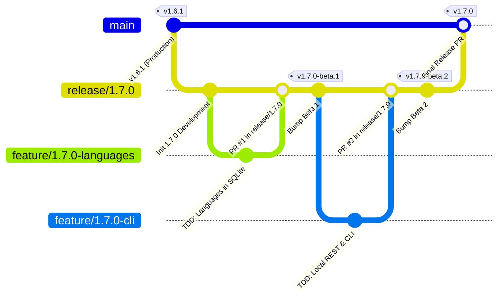

# PokéVault Git-vertakkingsmodel en releasepijplijngids

> **Languages / Sprachen:** [🇩🇪 Deutsch](GIT_WORKFLOW_AND_RELEASES.de.md) | [🇬🇧 English](../GIT_WORKFLOW_AND_RELEASES.md) | [🇫🇷 Français](GIT_WORKFLOW_AND_RELEASES.fr.md) | [🇪🇸 Español](GIT_WORKFLOW_AND_RELEASES.es.md) | [🇮🇹 Italiano](GIT_WORKFLOW_AND_RELEASES.it.md) | [🇯🇵 日本語](GIT_WORKFLOW_AND_RELEASES.ja.md) | [🇰🇷 한국어](GIT_WORKFLOW_AND_RELEASES.ko.md) | [🇨🇳 简体中文](GIT_WORKFLOW_AND_RELEASES.zh-hans.md) | [🇹🇼 繁體中文](GIT_WORKFLOW_AND_RELEASES.zh-hant.md) | [🇵🇹 Português](GIT_WORKFLOW_AND_RELEASES.pt.md) | **[🇳🇱 Nederlands](GIT_WORKFLOW_AND_RELEASES.nl.md)** | [🇵🇱 Polski](GIT_WORKFLOW_AND_RELEASES.pl.md) | [🇷🇺 Русский](GIT_WORKFLOW_AND_RELEASES.ru.md)

Dit document beschrijft het officiële Git-vertakkingsmodel, vertakkingsbeschermingsregels en het geautomatiseerde bouw- en releaseproces voor ontwikkelaars en AI-assistenten.

---

## 1. Het vertakkingsmodel

PokéVault gebruikt een gestructureerde **Release Branching Strategie**:



### De 3 vestigingsniveaus:

| Taktype | Naam / Patroon | Doel en bescherming |
| :--- | :--- | :--- |
| **Productie** | `hoofd` | **Beschermd**. Bevat uitsluitend stabiele, gepubliceerde live code. Elke samenvoeging hier komt overeen met een officiële winkel-/GitHub-release. Direct pushen is uitgeschakeld. |
| **Release / Staging** | `release/<versie>` (bijvoorbeeld `release/1.7.0`) | Staging branch voor alle subfuncties van een grote release. Dit is waar integratietesten plaatsvinden en **bètareleases / pre-releases** worden gebouwd. |
| **Functietakken** | `feature/<versie>-<onderwerp>` (bijvoorbeeld `feature/1.7.0-talen`, `feature/1.7.0-cli`) | Kortstondige ontwikkelingstakken voor individuele modules. Vertak altijd af van de corresponderende `release/*` branch en worden terug samengevoegd via Pull Request. |
| **Hotfixes** | `hotfix/<versie>` (bijvoorbeeld `hotfix/1.6.2`) | Dringende bugfixes voor de live versie. Vertakking van `main` en samengevoegd in zowel `main` als `release/*`. |

---

## 2. GitHub Branch Protection instellen (stap voor stap)

Om onbedoelde push-ups naar `main` te voorkomen en ervoor te zorgen dat alleen grondig geteste code kan worden samengevoegd, configureert u vertakkingsbeschermingsregels in de GitHub-webinterface:

### Regel 1: Bescherming voor `main`
1. Open de GitHub-repository in uw browser $\rightarrow$ Klik op **Instellingen** $\rightarrow$ **Takken** (onder *Code en automatisering*).
2. Klik op **Vertakkingsbeschermingsregel toevoegen** (of bewerk de bestaande regel voor `main`).
3. **Naampatroon filiaal**: `main`
4. Schakel de volgende selectievakjes in:
 - [x] **Vereist een pull-aanvraag vóór het samenvoegen**
 - *(Optioneel: stel "Goedkeuring vereisen" in op 1 als teamcodebeoordelingen vereist zijn, of blijf op 0 voor solo-ontwikkeling).*
 - [x] **Vereisen dat statuscontroles slagen voordat wordt samengevoegd**
 - [x] **Vereisen dat vertakkingen maximaal zijn datum vóór samenvoegen**
 - Zoek in het zoekvak naar de CI-job: `Flutter Analyse & Test` (of `analyze-and-test`) en selecteer deze.
 - [x] **Sta het omzeilen van bovenstaande instellingen niet toe** *(zorgt ervoor dat beheerders niet per ongeluk CI-controles kunnen omzeilen).*
5. Klik onderaan op **Wijzigingen opslaan**.

### Regel 2: Beveiliging voor `release/*` (Aanbevolen)
Herhaal het proces met:
- **Branchnaampatroon**: `release/*`
- [x] **Vereisen dat statuscontroles slagen voordat wordt samengevoegd** (`Flutter Analyse & Test`).
- Dit garandeert dat geen enkele feature branch met falende tests in de release kan komen enscenering tak.

---

## 3. Dagelijkse ontwikkelingsworkflow

### Stap 1: Maak een Feature Branch
Voordat u een nieuwe taak start, zorg ervoor dat `release/1.7.0` up-to-date is:
```bash
git checkout release/1.7.0
git pull origin release/1.7.0
git checkout -b feature/1.7.0-languages
```

### Stap 2: Ontwikkeling met strikte TDD
Volgens `AGENTS.md`:
1. **Eerst testen**: Schrijf testcases in `test/` (bijv. `test/services/lingual_expansion_test.dart`).
2. **Implementeren**: Schrijf minimale productiecode in `lib/` totdat alle tests slagen.
3. **Verifiëren**:
 ```bash
   flutter test
   dart analyze --fatal-infos
   ```

### Stap 3: Vastleggen en pushen
```bash
git add .
git commit -m "feat(i18n): add 9 franchise languages to pokemon database and dao"
git push -u origin feature/1.7.0-languages
```

### Stap 4: Open Pull Request op GitHub
- **Base Branch**: `release/1.7.0`
- **Compare Branch**: `feature/1.7.0-linguals`
- GitHub Actions start automatisch de workflow `CI Quality Gate` (`.github/workflows/ci.yml`).
- Eenmaal gecontroleerd pass $\rightarrow$ Klik op **Pletten en samenvoegen** (of *Opnieuw baseren en samenvoegen*).

---

## 4. Pre-releases en bèta's bouwen (meerdere platforms)

Zodra een of meer functies zijn geïntegreerd in `release/1.7.0` en getest moeten worden:

### Methode A: Automatisch via Git Tag (aanbevolen)
1. **Bumpversie** op `release/1.7.0`:
 ```bash
   git checkout release/1.7.0
   git pull origin release/1.7.0
   python tool/bump_version.py beta --commit
   ```
 *(produceert bijvoorbeeld `1.7.0-beta.1+9` in `pubspec.yaml` en voert de wijziging door).*

2. **Git-tag maken en pushen**:
 ```bash
   git tag v1.7.0-beta.1
   git push origin release/1.7.0 --tags
   ```

3. **Geautomatiseerde build in GitHub-acties**:
 De workflow `.github/workflows/release.yml` start automatisch op GitHub-runners en bouwt alle 4 de pakketten:
 - 📱 `PokeVault_V<versie>.apk`
 - 💻 `PokeVault_V<versie>_Windows.zip`
 - 🐧 `PokeVault_V<versie>.AppImage`
 - 📦 `PokeVault_V<versie>.tar.gz`

4. **Geautomatiseerde GitHub Pre-Release**:
 - Omdat de tag `-beta` bevat, markeert GitHub de release automatisch als een **Pre-release**.
 - Testers kunnen de ingebouwde installatiepakketten direct downloaden onder **Releases**.
 - PokéVault's geïntegreerde in-app updater (`UpdateHelper`) detecteert de juiste bestandsextensie voor elke besturingssysteem systeem.

### Methode B: Handmatig via de GitHub Web UI
1. Navigeer in de GitHub-repository naar **Actions** $\rightarrow$ **Build & Release Multi-Platform Packages**.
2. Klik aan de rechterkant op **Workflow uitvoeren**.
3. Selecteer de branch (bijvoorbeeld `release/1.7.0`), voer de versietag in (bijvoorbeeld `v1.7.0-beta.1`), en laat het selectievakje *"Markeren als pre-release / beta"* aangevinkt als `true`.
4. Klik op **Werkstroom uitvoeren**.

---

## 5. Publicatie van een definitieve stabiele release

Wanneer alle bètatests zijn voltooid en versie 1.7.0 gereed is voor productie:

1. **Versie instellen op stabiel**:
 ```bash
   git checkout release/1.7.0
   python tool/bump_version.py 1.7.0 --commit
   git push origin release/1.7.0
   ```

2. **Open Pull Request van `release/1.7.0` naar `main` & Merge**:
 - Basis: `main` $\leftarrow$ Vergelijk: `release/1.7.0`.
 - CI Quality Gate loopt en passeert.
 - Voeg de PR samen.

3. **Volledig geautomatiseerde vrijgave via GitHub-acties**:
 - De push naar `main` activeert automatisch `.github/workflows/release.yml`.
 - De release-metadata-extractor (`tool/extract_release_info.py`) extraheert:
 - De **Releasetitel** uit de aanhalingstekens op de eerste regel van `RELEASE_NOTES.md` (bijv. `The Language Expansion`).
 - De **Versietag** van `pubspec.yaml` (bijv. `v1.7.0`).
 - De volledige meertalige tekst van `RELEASE_NOTES.md` als de GitHub Release body.
 - Alle 4 binaire pakketten (Android APK, Windows Zip, Linux Tar.gz & AppImage) zijn gebouwd en gepubliceerd als de officiële **Laatste Stabiele Release**.
 - Onmiddellijk na het maken van de release implementeert `deploy.yml` de nieuwe webapplicatie op GitHub Pages.
