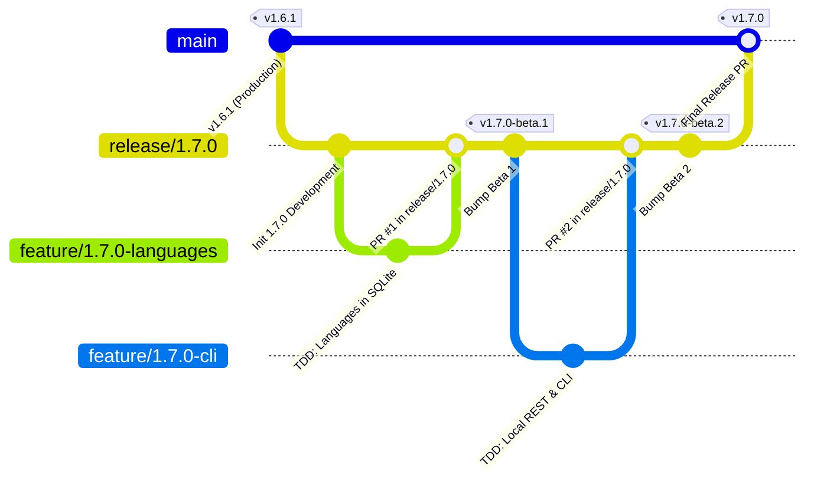

# PokéVault Git Przewodnik po modelach i potokach wydań

> **Languages / Sprachen:** [🇩🇪 Deutsch](GIT_WORKFLOW_AND_RELEASES.de.md) | [🇬🇧 English](../GIT_WORKFLOW_AND_RELEASES.md) | [🇫🇷 Français](GIT_WORKFLOW_AND_RELEASES.fr.md) | [🇪🇸 Español](GIT_WORKFLOW_AND_RELEASES.es.md) | [🇮🇹 Italiano](GIT_WORKFLOW_AND_RELEASES.it.md) | [🇯🇵 日本語](GIT_WORKFLOW_AND_RELEASES.ja.md) | [🇰🇷 한국어](GIT_WORKFLOW_AND_RELEASES.ko.md) | [🇨🇳 简体中文](GIT_WORKFLOW_AND_RELEASES.zh-hans.md) | [🇹🇼 繁體中文](GIT_WORKFLOW_AND_RELEASES.zh-hant.md) | [🇵🇹 Português](GIT_WORKFLOW_AND_RELEASES.pt.md) | [🇳🇱 Nederlands](GIT_WORKFLOW_AND_RELEASES.nl.md) | **[🇵🇱 Polski](GIT_WORKFLOW_AND_RELEASES.pl.md)** | [🇷🇺 Русский](GIT_WORKFLOW_AND_RELEASES.ru.md)

Ten dokument opisuje oficjalny model rozgałęzień Git, zasady ochrony rozgałęzień oraz zautomatyzowany proces kompilacji i wydawania dla programistów i asystentów AI.

---

## 1. Model rozgałęziający

PokéVault korzysta ze zorganizowanej **Strategii rozgałęziania wydań**:



### 3 poziomy oddziałów:

| Typ oddziału | Nazwa / Wzór | Cel i ochrona |
| :--- | :--- | :--- |
| **Produkcja** | `główny` | **Chroniony**. Zawiera wyłącznie stabilny, opublikowany kod na żywo. Każde połączenie tutaj odpowiada oficjalnemu wydaniu sklepu/GitHub. Bezpośrednie wypchnięcia są wyłączone. |
| **Wydanie / Inscenizacja** | `wydanie/<wersja>` (np. `wydanie/1.7.0`) | Gałąź testowa dla wszystkich funkcji podrzędnych wersji głównej. To tutaj przeprowadzane są testy integracyjne i tworzone są **Wersje beta/Wersje wstępne**. |
| **Oddziały fabularne** | `funkcja/<wersja>-<temat>` (np. `funkcja/1.7.0-języki`, `funkcja/1.7.0-cli`) | Krótkotrwałe gałęzie rozwojowe dla poszczególnych modułów. Zawsze rozgałęziaj odpowiednią gałąź `release/*` i łącz z powrotem poprzez żądanie ściągnięcia. |
| **Poprawki** | `poprawka/<wersja>` (np. `poprawka/1.6.2`) | Pilne poprawki błędów wersji live. Odgałęziaj `main` i łącz je w `main` i `release/*`. |

---

## 2. Konfiguracja ochrony oddziału GitHub (krok po kroku)

Aby zapobiec przypadkowym wypchnięciom do `main` i mieć pewność, że można scalić tylko dokładnie przetestowany kod, skonfiguruj reguły ochrony gałęzi w interfejsie internetowym GitHub:

### Zasada 1: Ochrona dla `main`
1. Otwórz repozytorium GitHub w swojej przeglądarce $\rightarrow$ Kliknij **Ustawienia** $\rightarrow$ **Oddziały** (pod *Kod i automatyzacja*).
2. Kliknij **Dodaj regułę ochrony gałęzi** (lub edytuj istniejącą regułę dla `main`).
3. **Wzorzec nazwy gałęzi**: `main`
4. Zaznacz następujące pola wyboru:
 - [x] **Wymagaj żądania ściągnięcia przed połączeniem**
 - *(Opcjonalnie: ustaw opcję „Wymagaj zatwierdzeń” na 1, jeśli wymagane są przeglądy kodu zespołowego, lub pozostaw wartość 0 w przypadku programowania solo).*
 - [x] **Wymagaj sprawdzenia stanu przed połączeniem**
 - [x] **Wymagaj, aby gałęzie były aktualne przed połączeniem**
 - Wyszukaj w polu wyszukiwania zadanie CI: `Flutter Analyze & Test` (lub `analizuj i testuj`) i wybierz je.
 - [x] **Nie zezwalaj na omijanie powyższych ustawień** *(zapewnia, że administratorzy nie mogą przypadkowo ominąć kontroli CI).*
5. Kliknij **Zapisz zmiany** na dole.

### Zasada 2: Ochrona dla `release/*` (zalecane)
Powtórz proces z:
- **Wzorzec nazwy gałęzi**: `release/*`
- [x] **Wymagaj przejścia kontroli stanu przed połączeniem** (`Flutter Analyze & Test`).
- To gwarantuje brak gałęzi funkcji z nieudanymi testami może wejść do gałęzi tymczasowej wydania.

---

## 3. Codzienny przebieg prac rozwojowych

### Krok 1: Utwórz gałąź funkcji
Przed rozpoczęciem nowego zadania upewnij się, że wersja `release/1.7.0` jest aktualna:
```bash
git checkout release/1.7.0
git pull origin release/1.7.0
git checkout -b feature/1.7.0-languages
```

### Krok 2: Rozwój ze ścisłym TDD
Według `AGENTS.md`:
1. **Najpierw testy**: Zapisz przypadki testowe w `test/` (np. `test/services/language_expansion_test.dart`).
2. **Zaimplementuj**: Napisz minimalny kod produkcyjny w `lib/`, aż wszystkie testy zakończą się sukcesem.
3. **Sprawdź**:
 ```bash
   flutter test
   dart analyze --fatal-infos
   ```

### Krok 3: Zatwierdź i wypchnij
```bash
git add .
git commit -m "feat(i18n): add 10 franchise languages to pokemon database and dao"
git push -u origin feature/1.7.0-languages
```

### Krok 4: Otwórz żądanie ściągnięcia na GitHub
- **Base Branch**: `release/1.7.0`
- **Porównaj Branch**: `feature/1.7.0-languages`
- GitHub Actions automatycznie uruchamia przepływ pracy `CI Quality Gate` (`.github/workflows/ci.yml`).
- Po pozytywnym wyniku kontroli $\rightarrow$ Kliknij **Zmiażdż i scal** (lub *Zmień bazę i scal*).

---

## 4. Tworzenie wersji przedpremierowych i wersji beta (wieloplatformowe)

Gdy jedna lub więcej funkcji zostanie zintegrowana z wersją 1.7.0 i wymaga testowania:

### Metoda A: automatycznie za pomocą tagu Git (zalecane)
1. **Wersja podstawowa** w `release/1.7.0`:
 ```bash
   git checkout release/1.7.0
   git pull origin release/1.7.0
   python tool/bump_version.py beta --commit
   ```
 *(np. tworzy `1.7.0-beta.1+9` w `pubspec.yaml` i zatwierdza zmianę).*

2. **Utwórz i wypchnij tag Git**:
 ```bash
   git tag v1.7.0-beta.1
   git push origin release/1.7.0 --tags
   ```

3. **Automatyczne akcje kompilacji w GitHub**:
 Przepływ pracy `.github/workflows/release.yml` uruchamia się automatycznie w modułach GitHub i buduje wszystkie 4 pakiety:
 - 📱 `PokeVault_V<wersja>.apk`
 - 💻 `PokeVault_V<wersja>_Windows.zip`
 - 🐧 `PokeVault_V<wersja>.AppImage`
 - 📦 `PokeVault_V<wersja>.tar.gz`

4. **Automatyczna wersja wstępna GitHub**:
 - Ponieważ tag zawiera `-beta`, GitHub automatycznie oznacza wersję jako **Wersję wstępną**.
 - Testerzy mogą pobrać zbudowane pakiety instalacyjne bezpośrednio w **Wersje**.
 - Zintegrowany aktualizator PokéVault w aplikacji („UpdateHelper”) wykrywa odpowiednie rozszerzenie pliku dla każdego systemu operacyjnego.

### Metoda B: ręcznie za pomocą interfejsu internetowego GitHub
1. W repozytorium GitHub przejdź do **Actions** $\rightarrow$ **Twórz i wydawaj pakiety wieloplatformowe**.
2. Kliknij **Uruchom przepływ pracy** po prawej stronie.
3. Wybierz gałąź (np. `release/1.7.0`), wprowadź znacznik wersji (np. `v1.7.0-beta.1`) i pozostaw pole wyboru *"Oznacz jako wersję wstępną / beta"* zaznaczone jako `true`.
4. Kliknij **Uruchom przepływ pracy**.

---

## 5. Publikacja ostatecznej wersji stabilnej

Kiedy wszystkie testy beta zostaną zakończone i wersja 1.7.0 będzie gotowa do produkcji:

1. **Ustaw wersję na stabilną**:
 ```bash
   git checkout release/1.7.0
   python tool/bump_version.py 1.7.0 --commit
   git push origin release/1.7.0
   ```

2. **Otwórz żądanie ściągnięcia z `release/1.7.0` do `main` i scal**:
 - Podstawa: `main` $\leftarrow$ Porównaj: `release/1.7.0`.
 - Brama jakości CI działa i przechodzi.
 - Scal PR.

3. **W pełni zautomatyzowane wydanie poprzez akcje GitHub**:
 - Przejście do `main` automatycznie uruchamia `.github/workflows/release.yml`.
 - Ekstraktor metadanych wydania (`tool/extract_release_info.py`) wyodrębnia:
 - **Tytuł wydania** z cytatów z pierwszego wiersza `RELEASE_NOTES.md` (np. `The Language Expansion`).
 - **Znacznik wersji** z `pubspec.yaml` (np. `v1.7.0`).
 - Pełny wielojęzyczny tekst z `RELEASE_NOTES.md` w wersji GitHub body.
 - Wszystkie 4 pakiety binarne (Android APK, Windows Zip, Linux Tar.gz i AppImage) zostały zbudowane i opublikowane jako oficjalne **Najnowsze wydanie stabilne**.
 - Natychmiast po utworzeniu wydania `deploy.yml` wdraża nową aplikację internetową na stronach GitHub.
