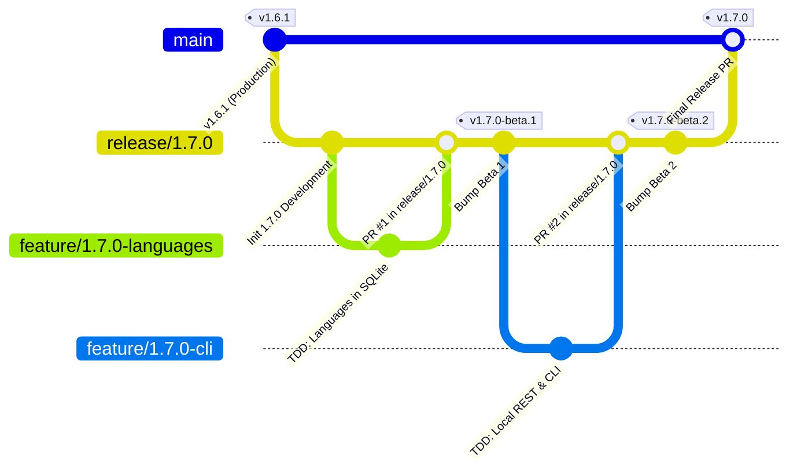

# Modelo de ramificação PokéVault Git e guia de pipeline de lançamento

> **Languages / Sprachen:** [🇩🇪 Deutsch](GIT_WORKFLOW_AND_RELEASES.de.md) | [🇬🇧 English](../GIT_WORKFLOW_AND_RELEASES.md) | [🇫🇷 Français](GIT_WORKFLOW_AND_RELEASES.fr.md) | [🇪🇸 Español](GIT_WORKFLOW_AND_RELEASES.es.md) | [🇮🇹 Italiano](GIT_WORKFLOW_AND_RELEASES.it.md) | [🇯🇵 日本語](GIT_WORKFLOW_AND_RELEASES.ja.md) | [🇰🇷 한국어](GIT_WORKFLOW_AND_RELEASES.ko.md) | [🇨🇳 简体中文](GIT_WORKFLOW_AND_RELEASES.zh-hans.md) | [🇹🇼 繁體中文](GIT_WORKFLOW_AND_RELEASES.zh-hant.md) | **[🇵🇹 Português](GIT_WORKFLOW_AND_RELEASES.pt.md)** | [🇳🇱 Nederlands](GIT_WORKFLOW_AND_RELEASES.nl.md) | [🇵🇱 Polski](GIT_WORKFLOW_AND_RELEASES.pl.md) | [🇷🇺 Русский](GIT_WORKFLOW_AND_RELEASES.ru.md)

Este documento descreve o modelo oficial de ramificação do Git, as regras de proteção de ramificação e o processo automatizado de construção e lançamento para desenvolvedores e assistentes de IA.

---

## 1. O modelo de ramificação

PokéVault usa uma **Estratégia de ramificação de lançamento** estruturada:



### Os 3 níveis de filial:

| Tipo de filial | Nome/Padrão | Finalidade e proteção |
| :--- | :--- | :--- |
| **Produção** | `principal` | **Protegido**. Contém código ativo publicado exclusivamente estável. Cada mesclagem aqui corresponde a um lançamento oficial da loja/GitHub. Os push diretos estão desativados. |
| **Lançamento / Preparação** | `release/<versão>` (por exemplo, `release/1.7.0`) | Ramo de teste para todos os subrecursos de uma versão principal. É aqui que acontecem os testes de integração e **lançamentos beta/pré-lançamentos** são criados. |
| **Ramos de recursos** | `feature/<version>-<topic>` (por exemplo, `feature/1.7.0-idiomas`, `feature/1.7.0-cli`) | Ramos de desenvolvimento de curta duração para módulos individuais. Sempre ramifique o branch `release/*` correspondente e seja mesclado novamente via Pull Request. |
| **Correções** | `hotfix/<versão>` (por exemplo, `hotfix/1.6.2`) | Correções urgentes de bugs para a versão live. Ramificam `main` e são mesclados em `main` e `release/*`. |

---

## 2. Configuração da proteção de ramificação do GitHub (passo a passo)

Para evitar envios acidentais para `main` e garantir que apenas código totalmente testado possa ser mesclado, configure regras de proteção de branch na interface web do GitHub:

### Regra 1: Proteção para `main`
1. Abra o repositório GitHub em seu navegador $\rightarrow$ Clique em **Configurações** $\rightarrow$ **Ramos** (em *Código e automação*).
2. Clique em **Adicionar regra de proteção de ramificação** (ou edite a regra existente para `main`).
3. **Padrão de nome de filial**: `main`
4. Ative as seguintes caixas de seleção:
 - [x] **Exigir uma solicitação pull antes da fusão**
 - *(Opcional: defina "Exigir aprovações" como 1 se revisões de código da equipe forem necessárias ou mantenha 0 para desenvolvimento solo).*
 - [x] **Exigir que as verificações de status sejam aprovadas antes da fusão**
 - [x] **Exigir que as ramificações estejam atualizadas antes mesclagem**
 - Pesquise na caixa de pesquisa o trabalho de CI: `Flutter Analyze & Test` (ou `analyze-and-test`) e selecione-o.
 - [x] **Não permita ignorar as configurações acima** *(garante que os administradores não possam ignorar acidentalmente as verificações de CI).*
5. Clique em **Salvar alterações** na parte inferior.

### Regra 2: Proteção para `release/*` (Recomendado)
Repita o processo com:
- **Padrão de nome de branch**: `release/*`
- [x] **Exigir que verificações de status sejam aprovadas antes da fusão** (`Flutter Analyze & Test`).
- Isso garante que nenhum branch de recurso com testes com falha possa entrar no branch de teste de lançamento.

---

## 3. Fluxo de trabalho de desenvolvimento diário

### Etapa 1: Crie uma ramificação de recurso
Antes de iniciar uma nova tarefa, certifique-se de que `release/1.7.0` esteja atualizado:
```bash
git checkout release/1.7.0
git pull origin release/1.7.0
git checkout -b feature/1.7.0-languages
```

### Etapa 2: Desenvolvimento com TDD
estrito de acordo com `AGENTS.md`:
1. **Testes primeiro**: Escreva casos de teste em `test/` (por exemplo, `test/services/language_expansion_test.dart`).
2. **Implementar**: Escreva o código de produção mínimo em `lib/` até que todos os testes sejam aprovados.
3. **Verificar**:
 ```bash
   flutter test
   dart analyze --fatal-infos
   ```

### Etapa 3: Confirmar e enviar
```bash
git add .
git commit -m "feat(i18n): add 9 franchise languages to pokemon database and dao"
git push -u origin feature/1.7.0-languages
```

### Etapa 4: Abrir solicitação pull no GitHub
- **Base Branch**: `release/1.7.0`
- **Compare Branch**: `feature/1.7.0-languages`
- GitHub Actions inicia automaticamente o fluxo de trabalho `CI Quality Gate` (`.github/workflows/ci.yml`).
- Depois que as verificações forem aprovadas $\rightarrow$ Clique em **Esmagar e mesclar** (ou *Rebasear e mesclar*).

---

## 4. Criação de pré-lançamentos e betas (multiplataforma)

Depois que um ou mais recursos forem integrados ao `release/1.7.0` e precisarem de testes:

### Método A: Automaticamente via Git Tag (recomendado)
1. **Versão Bump** em `release/1.7.0`:
 ```bash
   git checkout release/1.7.0
   git pull origin release/1.7.0
   python tool/bump_version.py beta --commit
   ```
 *(por exemplo, produz `1.7.0-beta.1+9` em `pubspec.yaml` e confirma a alteração).*

2. **Crie e envie a tag Git**:
 ```bash
   git tag v1.7.0-beta.1
   git push origin release/1.7.0 --tags
   ```

3. **Compilação automatizada em ações do GitHub**:
 O fluxo de trabalho `.github/workflows/release.yml` inicia automaticamente nos executores do GitHub e compila todos os 4 pacotes:
 - 📱 `PokeVault_V<version>.apk`
 - 💻 `PokeVault_V<versão>_Windows.zip`
 - 🐧 `PokeVault_V<versão>.AppImage`
 - 📦 `PokeVault_V<versão>.tar.gz`

4. **Pré-lançamento automatizado do GitHub**:
 - Como a tag contém `-beta`, o GitHub marca automaticamente o lançamento como um **Pré-lançamento**.
 - Os testadores podem baixar os pacotes de instalação criados diretamente em **Releases**.
 - O atualizador integrado no aplicativo do PokéVault (`UpdateHelper`) detecta a extensão de arquivo apropriada para cada operação sistema.

### Método B: Manualmente por meio da UI Web do GitHub
1. No repositório GitHub, navegue até **Ações** $\rightarrow$ **Construir e lançar pacotes multiplataforma**.
2. Clique em **Executar fluxo de trabalho** à direita.
3. Selecione o branch (por exemplo, `release/1.7.0`), insira a tag da versão (por exemplo, `v1.7.0-beta.1`) e deixe a caixa de seleção *"Marcar como pré-lançamento / beta"* marcada como `true`.
4. Clique em **Executar fluxo de trabalho**.

---

## 5. Publicando uma versão final estável

Quando todos os testes beta forem concluídos e a versão 1.7.0 estiver pronta para produção:

1. **Defina a versão como estável**:
 ```bash
   git checkout release/1.7.0
   python tool/bump_version.py 1.7.0 --commit
   git push origin release/1.7.0
   ```

2. **Abrir solicitação pull de `release/1.7.0` para `main` e mesclar**:
 - Base: `main` $\leftarrow$ Comparar: `release/1.7.0`.
 - CI Quality Gate é executado e aprovado.
 - Mesclar o PR.

3. **Lançamento totalmente automatizado via GitHub Actions**:
 - O push para `main` aciona automaticamente `.github/workflows/release.yml`.
 - O extrator de metadados de lançamento (`tool/extract_release_info.py`) extrai:
 - O **Título do lançamento** das citações na primeira linha de `RELEASE_NOTES.md` (por exemplo, `The Language Expansion`).
 - A **Tag de versão** de `pubspec.yaml` (por exemplo, `v1.7.0`).
 - O texto multilíngue completo de `RELEASE_NOTES.md` como o corpo da versão do GitHub.
 - Todos os 4 pacotes binários (Android APK, Windows Zip, Linux Tar.gz e AppImage) são criados e publicados como o **Latest Stable Release** oficial.
 - Imediatamente após a criação da versão, `deploy.yml` implanta o novo aplicativo da web nas páginas do GitHub.
