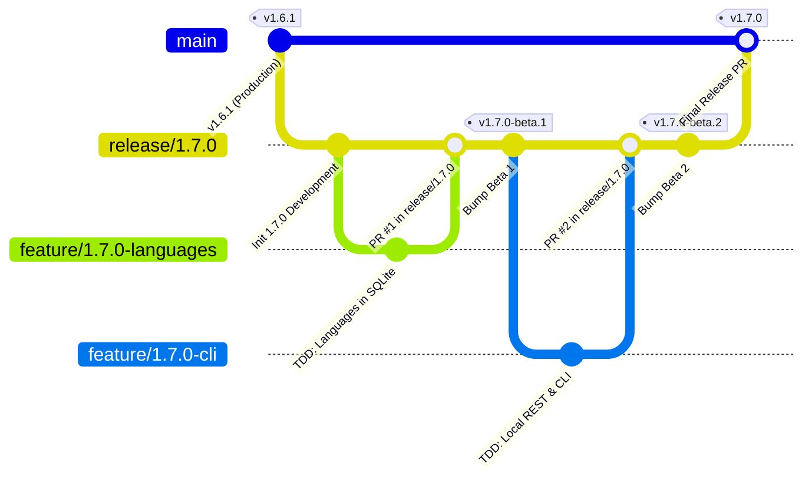

# PokéVault Модель ветвления Git и руководство по конвейеру выпуска

> **Languages / Sprachen:** [🇩🇪 Deutsch](GIT_WORKFLOW_AND_RELEASES.de.md) | [🇬🇧 English](../GIT_WORKFLOW_AND_RELEASES.md) | [🇫🇷 Français](GIT_WORKFLOW_AND_RELEASES.fr.md) | [🇪🇸 Español](GIT_WORKFLOW_AND_RELEASES.es.md) | [🇮🇹 Italiano](GIT_WORKFLOW_AND_RELEASES.it.md) | [🇯🇵 日本語](GIT_WORKFLOW_AND_RELEASES.ja.md) | [🇰🇷 한국어](GIT_WORKFLOW_AND_RELEASES.ko.md) | [🇨🇳 简体中文](GIT_WORKFLOW_AND_RELEASES.zh-hans.md) | [🇹🇼 繁體中文](GIT_WORKFLOW_AND_RELEASES.zh-hant.md) | [🇵🇹 Português](GIT_WORKFLOW_AND_RELEASES.pt.md) | [🇳🇱 Nederlands](GIT_WORKFLOW_AND_RELEASES.nl.md) | [🇵🇱 Polski](GIT_WORKFLOW_AND_RELEASES.pl.md) | **[🇷🇺 Русский](GIT_WORKFLOW_AND_RELEASES.ru.md)**

В этом документе описывается официальная модель ветвления Git, правила защиты веток, а также автоматизированный процесс сборки и выпуска для разработчиков и помощников ИИ.

---

## 1. Модель ветвления

PokéVault использует структурированную **Стратегию ветвления релизов**:



### 3 уровня ветвей:

| Тип филиала | Имя/Шаблон | Назначение и защита |
| :--- | :--- | :--- |
| **Производство** | `главный` | **Защищено**. Содержит исключительно стабильный, опубликованный живой код. Каждое слияние здесь соответствует официальному выпуску магазина/GitHub. Прямые нажатия отключены. |
| **Выпуск/постановка** | `release/<версия>` (например, `release/1.7.0`) | Промежуточная ветка для всех дополнительных функций основного выпуска. Здесь происходит интеграционное тестирование и создаются **бета-релизы/предварительные версии**. |
| **Ветви функций** | `feature/<version>-<topic>` (например, `feature/1.7.0-languages`, `feature/1.7.0-cli`) | Кратковременные ветки разработки для отдельных модулей. Всегда ответвляйтесь от соответствующей ветки `release/*` и объединяйтесь обратно через запрос на включение. |
| **Исправления** | `hotfix/<версия>` (например, `hotfix/1.6.2`) | Срочные исправления ошибок для живой версии. Ответвляются от `main` и объединяются в `main` и `release/*`. |

---

## 2. Настройка защиты ветвей GitHub (шаг за шагом)

Чтобы предотвратить случайные нажатия на `main` и обеспечить возможность объединения только тщательно протестированного кода, настройте правила защиты ветвей в веб-интерфейсе GitHub:

### Правило 1: Защита `main`
1. Откройте репозиторий GitHub в своем браузере. $\rightarrow$ Нажмите **Настройки** $\rightarrow$ **Ветви** (в разделе *Код и автоматизация*).
2. Нажмите **Добавить правило защиты ветки** (или отредактируйте существующее правило для `main`).
3. **Шаблон имени ветки**: `main`
4. Установите следующие флажки: 
 - [x] **Требовать запрос на включение перед слиянием**
 - *(Необязательно: установите для параметра «Требовать одобрения» значение 1, если требуются командные проверки кода, или оставьте значение 0 для индивидуальной разработки).*
 - [x] **Требовать прохождения проверок статуса перед слиянием**
 - [x] **Требовать, чтобы ветки были обновлены перед объединением**
 – Найдите в поле поиска задание CI: `Flutter Analysis & Test` (или `analyze-and-test`) и выберите его.
 - [x] **Не разрешать обходить вышеуказанные настройки** *(гарантирует, что администраторы не смогут случайно обойти проверки CI).*
5. Нажмите **Сохранить изменения** внизу.

### Правило 2: Защита для `release/*` (рекомендуется)
Повторите процесс с помощью:
- **Шаблон имени ветки**: `release/*`
- [x] **Требовать прохождения проверок статуса перед слиянием** («Flutter Analysis & Test»).
- Это гарантирует отсутствие функциональной ветки с неудачными тестами может войти в ветку подготовки выпуска.

---

## 3. Ежедневный рабочий процесс разработки

### Шаг 1. Создайте ветку функций
Перед запуском новой задачи убедитесь, что `release/1.7.0` обновлена:
```bash
git checkout release/1.7.0
git pull origin release/1.7.0
git checkout -b feature/1.7.0-languages
```

### Шаг 2: Разработка со строгим TDD
Согласно `AGENTS.md`:
1. **Сначала тесты**: записывайте тестовые примеры в `test/` (например, `test/services/language_expansion_test.dart`).
2. **Реализовать**: писать минимальный рабочий код в `lib/`, пока все тесты не пройдут.
3. **Проверьте**:
 ```bash
   flutter test
   dart analyze --fatal-infos
   ```

### Шаг 3: Зафиксируйте и нажмите 
```bash
git add .
git commit -m "feat(i18n): add 10 franchise languages to pokemon database and dao"
git push -u origin feature/1.7.0-languages
```

### Шаг 4. Откройте запрос на извлечение на GitHub
- **Базовая ветка**: `release/1.7.0`
- **Сравнить ветку**: `feature/1.7.0-languages`
- GitHub Actions автоматически запускает рабочий процесс `CI Quality Gate` (`.github/workflows/ci.yml`).
- Как только проверки пройдут, $\rightarrow$ Нажмите **Сжать и объединить** (или *Перебазировать и объединить*).

---

## 4. Создание предварительных версий и бета-версий (мультиплатформенность)

Если одна или несколько функций интегрированы в версию 1.7.0 и требуют тестирования:

### Способ А: автоматически через тег Git (рекомендуется)
1. **Увеличенная версия** в `release/1.7.0`:
 ```bash
   git checkout release/1.7.0
   git pull origin release/1.7.0
   python tool/bump_version.py beta --commit
   ```
 *(например, создает `1.7.0-beta.1+9` в `pubspec.yaml` и фиксирует изменения).*

2. **Создайте и отправьте тег Git**:
 ```bash
   git tag v1.7.0-beta.1
   git push origin release/1.7.0 --tags
   ```

3. **Автоматическая сборка в действиях GitHub**:
 Рабочий процесс `.github/workflows/release.yml` автоматически запускается на запусках GitHub и собирает все 4 пакета: 
 - 📱 `PokeVault_V<версия>.apk`
 - 💻 `PokeVault_V<версия>_Windows.zip`
 - 🐧 `PokeVault_V<версия>.AppImage`
 - 📦 `PokeVault_V<версия>.tar.gz`

4. **Автоматическая предварительная версия GitHub**:
 – поскольку тег содержит `-beta`, GitHub автоматически помечает выпуск как **предварительный выпуск**.
 – Тестировщики могут загружать встроенные установочные пакеты непосредственно в раздел **Releases**.
 – встроенное в приложение средство обновления PokéVault. («UpdateHelper») определяет подходящее расширение файла для каждой операционной системы.

### Способ Б: вручную через веб-интерфейс GitHub
1. В репозитории GitHub перейдите к **Действия** $\rightarrow$ **Сборка и выпуск многоплатформенных пакетов**.
2. Нажмите **Запустить рабочий процесс** справа.
3. Выберите ветку (например, `release/1.7.0`), введите тег версии (например, `v1.7.0-beta.1`) и оставьте флажок *"Отметить как предварительную версию/бета"* установленным как `true`.
4. Нажмите **Запустить рабочий процесс**.

---

## 5. Публикация финальной стабильной версии

Когда все бета-тестирование будет завершено и версия 1.7.0 будет готова к выпуску:

1. **Установить стабильную версию**:
 ```bash
   git checkout release/1.7.0
   python tool/bump_version.py 1.7.0 --commit
   git push origin release/1.7.0
   ```

2. **Открыть запрос на включение из `release/1.7.0` в `main` и объединить**:
 - База: `main` $\leftarrow$ Сравните: `release/1.7.0`.
 - CI Quality Gate запускается и проходит.
 - Объединить PR.

3. **Полностью автоматический выпуск с помощью действий GitHub**:
 — нажатие `main` автоматически запускает `.github/workflows/release.yml`.
 – экстрактор метаданных выпуска (`tool/extract_release_info.py`) извлекает:
 — **название выпуска** из первых кавычек строка `RELEASE_NOTES.md` (например, `The Language Expansion`).
 — **Тег версии** из `pubspec.yaml` (например, `v1.7.0`).
 – полный многоязычный текст из `RELEASE_NOTES.md` в качестве тела релиза GitHub.
 — Все 4 двоичных пакета (Android APK, Windows Zip, Linux Tar.gz и AppImage) создаются и публикуются как официальный **последний стабильный выпуск**.
 — сразу после создания выпуска `deploy.yml` развертывает новое веб-приложение на GitHub Pages.
