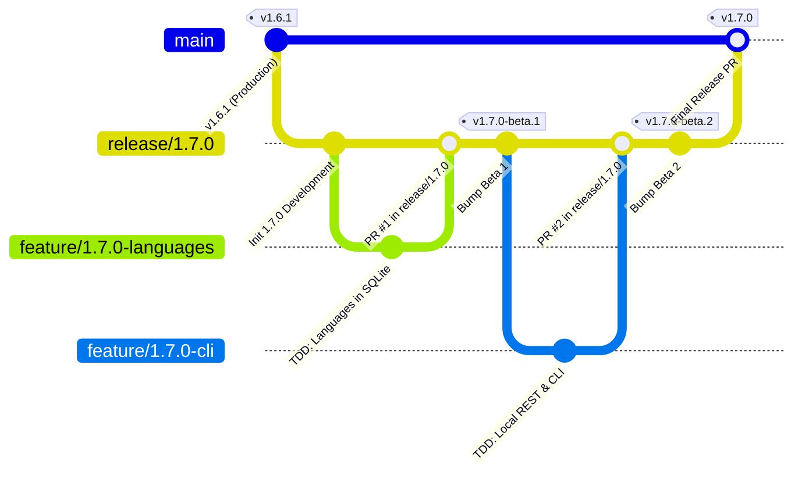

# PokéVault Git 分支模型和发布管道指南

> **Languages / Sprachen:** [🇩🇪 Deutsch](GIT_WORKFLOW_AND_RELEASES.de.md) | [🇬🇧 English](../GIT_WORKFLOW_AND_RELEASES.md) | [🇫🇷 Français](GIT_WORKFLOW_AND_RELEASES.fr.md) | [🇪🇸 Español](GIT_WORKFLOW_AND_RELEASES.es.md) | [🇮🇹 Italiano](GIT_WORKFLOW_AND_RELEASES.it.md) | [🇯🇵 日本語](GIT_WORKFLOW_AND_RELEASES.ja.md) | [🇰🇷 한국어](GIT_WORKFLOW_AND_RELEASES.ko.md) | **[🇨🇳 简体中文](GIT_WORKFLOW_AND_RELEASES.zh-hans.md)** | [🇹🇼 繁體中文](GIT_WORKFLOW_AND_RELEASES.zh-hant.md) | [🇵🇹 Português](GIT_WORKFLOW_AND_RELEASES.pt.md) | [🇳🇱 Nederlands](GIT_WORKFLOW_AND_RELEASES.nl.md) | [🇵🇱 Polski](GIT_WORKFLOW_AND_RELEASES.pl.md) | [🇷🇺 Русский](GIT_WORKFLOW_AND_RELEASES.ru.md)

本文档介绍了官方的Git分支模型、分支保护规则以及开发者和AI助手的自动化构建和发布流程。

---

## 1. 分支模型

PokéVault 使用结构化的**发布分支策略**：



### 3 个分支级别：

| 分支类型| 名称/图案| 目的与保护 |
| :--- | :--- | :--- |
| **生产** | `主要` | **受保护**。 包含完全稳定、已发布的实时代码。 这里的每个合并都对应一个官方商店/GitHub 版本。 直接推送被禁用。 |
| **发布/分期** | `release/<版本>`（例如`release/1.7.0`）| 主要版本的所有子功能的暂存分支。 这是进行集成测试和构建 **Beta 版本/预版本** 的地方。 |
| **功能分支** | `feature/<版本>-<主题>`（例如`feature/1.7.0-languages`、`feature/1.7.0-cli`）| 各个模块的短期开发分支。 始终从相应的“release/*”分支分支出来，并通过拉取请求合并回来。 |
| **修补程序** | `hotfix/<version>`（例如`hotfix/1.6.2`）| 实时版本的紧急错误修复。 从 `main` 分支出来并合并到 `main` 和 `release/*` 中。 |

---

## 2. GitHub 分支保护设置（分步）

为了防止意外推送到“main”并确保只有经过彻底测试的代码才能被合并，请在 GitHub Web 界面中配置分支保护规则：

### 规则 1：保护 `main`
1。 在浏览器中打开 GitHub 存储库 $\rightarrow$ 单击 **设置** $\rightarrow$ **分支**（在 *代码和自动化* 下）.
2。 单击“**添加分支保护规则**”（或编辑“main”的现有规则）.
3。 **分支名称模式**：`main`
4。 启用以下复选框：
 - [x] **在合并之前需要拉取请求**
 - *（可选：如果需要团队代码审查，则将“需要批准”设置为 1，或者在单独开发时保持为 0）。*
 - [x] **需要在合并之前通过状态检查**
 - [x] **要求分支在合并之前保持最新状态 合并**
 - 在搜索框中搜索 CI 作业：“Flutter 分析和测试”（或“分析和测试”）并选择它。
 - [x] **不允许绕过上述设置** *（确保管理员不会意外绕过 CI 检查）。*
5. 单击底部的**保存更改**。

### 规则 2：保护 `release/*`（推荐）
使用以下内容重复该过程：
- **分支名称模式**：`release/*`
- [x] **需要在合并之前通过状态检查**（`Flutter 分析和测试`）。
- 这保证测试失败的功能分支无法进入发布暂存分支。

---

## 3.日常开发工作流程

### 第 1 步：创建功能分支
开始新任务之前，确保 `release/1.7.0` 是最新的：
```bash
git checkout release/1.7.0
git pull origin release/1.7.0
git checkout -b feature/1.7.0-languages
```

### 步骤 2：使用严格的 TDD 进行开发
根据 `AGENTS.md`:
1。 **首先测试**：在 `test/` 中编写测试用例（例如 `test/services/language_expansion_test.dart`）.
2。 **实施**：在“lib/”中编写最少的生产代码，直到所有测试通过。
3。 **验证**：
 ```bash
   flutter test
   dart analyze --fatal-infos
   ```

### 步骤 3：提交并推送
```bash
git add .
git commit -m "feat(i18n): add 10 franchise languages to pokemon database and dao"
git push -u origin feature/1.7.0-languages
```

### 步骤 4：在 GitHub 上打开拉取请求
- **基础分支**：`release/1.7.0`
- **比较分支**：`feature/1.7.0-语言`
- GitHub Actions 会自动启动工作流程`CI Quality Gate` (`.github/workflows/ci.yml`).
- 一旦检查通过 $\rightarrow$ 单击 **压缩并合并**（或*变基并合并*）。

---

## 4. 构建预发布版和 Beta 版（多平台）

一旦一项或多项功能已集成到“release/1.7.0”并需要测试：

### 方法 A：通过 Git 标签自动（推荐）
1。 **在 `release/1.7.0` 上升级版本**：
 ```bash
   git checkout release/1.7.0
   git pull origin release/1.7.0
   python tool/bump_version.py beta --commit
   ```
 *（例如在 `pubspec.yaml` 中生成 `1.7.0-beta.1+9` 并提交更改）。*

2. **创建并推送Git标签**：
 ```bash
   git tag v1.7.0-beta.1
   git push origin release/1.7.0 --tags
   ```

3. **在 GitHub 操作中自动构建**：
 工作流程 `.github/workflows/release.yml` 在 GitHub 运行器上自动启动并构建所有 4 个包：
 - 📱 `PokeVault_V<version>.apk`
 - 💻 `PokeVault_V<version>_Windows.zip`
 - 🐧 `PokeVault_V<版本>.AppImage`
 - 📦 `PokeVault_V<版本>.tar.gz`

4. **自动 GitHub 预发布**：
 - 由于标签包含 `-beta`，GitHub 会自动将版本标记为 **预发布**。
 - 测试人员可以直接在 **发布**下下载构建的安装程序包。
 - PokéVault 的集成应用内更新程序 (`UpdateHelper`) 会检测每个操作系统的适当文件扩展名。

### 方法 B：通过 GitHub Web UI
1 手动进行。 在 GitHub 存储库中，导航到 **操作** $\rightarrow$ **构建和发布多平台包**.
2。 单击右侧的“**运行工作流程**”。
3。 选择分支（例如“release/1.7.0”），输入版本标签（例如“v1.7.0-beta.1”），然后将复选框*“标记为预发布/测试版”*选中为“true”.
4。 单击“**运行工作流程**”。

---

## 5. 发布最终稳定版本

当所有 Beta 测试完成且版本 1.7.0 已准备好投入生产时：

1. **将版本设置为稳定**：
 ```bash
   git checkout release/1.7.0
   python tool/bump_version.py 1.7.0 --commit
   git push origin release/1.7.0
   ```

2. **打开从 `release/1.7.0` 到 `main` 的 Pull 请求并合并**：
 - 基础：`main` $\leftarrow$ 比较：`release/1.7.0`.
 - CI 质量门运行并通过。
 - 合并 PR。

3. **通过 GitHub Actions 全自动发布**：
 - 推送到 `main` 自动触发 `.github/workflows/release.yml`。
 - 发布元数据提取器 (`tool/extract_release_info.py`) 提取：
 - 来自 `RELEASE_NOTES.md` 第一行引号的 **发布标题**（例如 `The Language Expansion`).
 - 来自 `pubspec.yaml` 的 **版本标记** (例如 `v1.7.0`).
 - 来自 `RELEASE_NOTES.md` 的完整多语言文本作为 GitHub 发布正文。
 - 所有 4 个二进制包（Android APK、Windows Zip、Linux Tar.gz 和 AppImage）均作为官方版本构建和发布 **最新稳定版本**.
 - 创建版本后，`deploy.yml` 立即将新的 Web 应用程序部署到 GitHub Pages.
