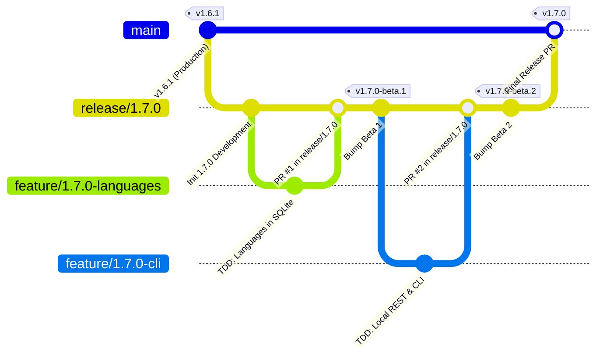

# PokéVault Git 分支模型與發布流程指南

> **Languages / Sprachen:** [🇩🇪 Deutsch](GIT_WORKFLOW_AND_RELEASES.de.md) | [🇬🇧 English](../GIT_WORKFLOW_AND_RELEASES.md) | [🇫🇷 Français](GIT_WORKFLOW_AND_RELEASES.fr.md) | [🇪🇸 Español](GIT_WORKFLOW_AND_RELEASES.es.md) | [🇮🇹 Italiano](GIT_WORKFLOW_AND_RELEASES.it.md) | [🇯🇵 日本語](GIT_WORKFLOW_AND_RELEASES.ja.md) | [🇰🇷 한국어](GIT_WORKFLOW_AND_RELEASES.ko.md) | [🇨🇳 简体中文](GIT_WORKFLOW_AND_RELEASES.zh-hans.md) | **[🇹🇼 繁體中文](GIT_WORKFLOW_AND_RELEASES.zh-hant.md)** | [🇵🇹 Português](GIT_WORKFLOW_AND_RELEASES.pt.md) | [🇳🇱 Nederlands](GIT_WORKFLOW_AND_RELEASES.nl.md) | [🇵🇱 Polski](GIT_WORKFLOW_AND_RELEASES.pl.md) | [🇷🇺 Русский](GIT_WORKFLOW_AND_RELEASES.ru.md)

本文件描述了官方的 Git 分支模型、分支保護規則，以及給開發者和 AI 助手使用的自動化構建與發布流程。

---

## 1. 分支模型

PokéVault 使用一個結構化的 **版本釋出分支策略**：



### 三個分支層級：

| 分支類型 | 名稱 / 模式 | 目的與保護 |
| :--- | :--- | :--- |
| **生產** | `main` | **受保護**。僅包含穩定、已發布的正式代碼。每次合併對應於官方商店 / GitHub 發布。直接推送已被禁用。 |
| **釋出 / 測試** | `release/<version>` (例如 `release/1.7.0`) | 用於主要版本所有子功能的測試分支。這是整合測試進行的地方，也會生成 **Beta 版本 / 預發行版本**。 |
| **功能分支** | `feature/<version>-<topic>` (例如 `feature/1.7.0-languages`, `feature/1.7.0-cli`) | 用於單個模組的短期開發分支。總是從對應的 `release/*` 分支派生，並通過 Pull Request 合併回去。 |
| **緊急修復** | `hotfix/<version>` (例如 `hotfix/1.6.2`) | 緊急修復上線版本的錯誤。從 `main` 分支派生，並合併到 `main` 和 `release/*`。 |

---

## 2. GitHub 分支保護設置（逐步指南）

為了防止意外推送到 `main` 分支，並確保只有經過徹底測試的代碼才能被合併，請在 GitHub 網頁界面中配置分支保護規則：

### Rule 1: Protection for `main`
1. Open the GitHub repository in your browser $\rightarrow$ Click **Settings** $\rightarrow$ **Branches** (under *Code and automation*).
2. Click **Add branch protection rule** (or edit the existing rule for `main`).
3. **Branch name pattern**: `main`
4. Enable the following checkboxes:
   - [x] **Require a pull request before merging**
     - *(Optional: Set "Require approvals" to 1 if team code reviews are required, or keep at 0 for solo development).*
   - [x] **Require status checks to pass before merging**
     - [x] **Require branches to be up to date before merging**
     - Search in the search box for the CI job: `Flutter Analyze & Test` (or `analyze-and-test`) and select it.
   - [x] **Do not allow bypassing the above settings** *(ensures administrators cannot accidentally bypass CI checks).*
5. Click **Save changes** at the bottom.

### 規則 2：對 `release/*` 的保護（建議）
重複以下步驟：
- **分支名稱模式**：`release/*`
- [x] **合併前需通過狀態檢查**（`Flutter Analyze & Test`）。
- 這可保證任何測試失敗的功能分支都無法進入釋出預備分支。

---

## 3. 每日開發工作流程

### 步驟 1：建立功能分支
在開始新任務之前，確保 `release/1.7.0` 是最新的：
```bash
git checkout release/1.7.0
git pull origin release/1.7.0
git checkout -b feature/1.7.0-languages
```

### 步驟 2：嚴格 TDD 開發
根據 `AGENTS.md`：
1. **先寫測試**：在 `test/` 中撰寫測試案例（例如 `test/services/language_expansion_test.dart`）。
2. **實作**：在 `lib/` 中撰寫最少量的生產程式碼，直到所有測試通過。
3. **驗證**：
   ```bash
   flutter test
   dart analyze --fatal-infos
   ```

### 第三步：提交並推送
```bash
git add .
git commit -m "feat(i18n): add 10 franchise languages to pokemon database and dao"
git push -u origin feature/1.7.0-languages
```

### 步驟 4：在 GitHub 上開 Pull Request
- **基礎分支**：`release/1.7.0`
- **比較分支**：`feature/1.7.0-languages`
- GitHub Actions 會自動啟動工作流程 `CI Quality Gate`（`.github/workflows/ci.yml`）。
- 一旦檢查通過 $
ightarrow$ 點擊 **Squash and merge**（或 *Rebase and merge*）。

---

## 4. 建立預發版本與測試版本（多平台）

一旦一個或多個功能已被整合到 `release/1.7.0` 並需要測試時：

### 方法 A：透過 Git 標籤自動完成（推薦）
1. **更新版本**於 `release/1.7.0`：
   ```bash
   git checkout release/1.7.0
   git pull origin release/1.7.0
   python tool/bump_version.py beta --commit
   ```
   *(例如在 `pubspec.yaml` 中產生 `1.7.0-beta.1+9` 並提交更改).*

2. **建立並推送 Git 標籤**：
   ```bash
   git tag v1.7.0-beta.1
   git push origin release/1.7.0 --tags
   ```

3. **GitHub Actions 自動建置**:
   工作流程 `.github/workflows/release.yml` 會在 GitHub 執行器上自動啟動，並建置所有 4 個套件:
   - 📱 `PokeVault_V<version>.apk`
   - 💻 `PokeVault_V<version>_Windows.zip`
   - 🐧 `PokeVault_V<version>.AppImage`
   - 📦 `PokeVault_V<version>.tar.gz`

4. **自動化 GitHub 預發布**：
   - 因為標籤包含 `-beta`，GitHub 會自動將該版本標記為 **預發布**。
   - 測試者可以直接在 **Releases** 下載已建立的安裝程式包。
   - PokéVault 內建的應用程式更新器（`UpdateHelper`）會偵測每個作業系統的適用檔案類型。

### 方法 B：透過 GitHub 網頁介面手動操作
1. 在 GitHub 儲存庫中，導航至 **Actions** $
ightarrow$ **Build & Release Multi-Platform Packages**.
2. 在右側點擊 **Run workflow**.
3. 選擇分支（例如 `release/1.7.0`），輸入版本標籤（例如 `v1.7.0-beta.1`），並保持勾選框 *"Mark as pre-release / beta"* 為 `true`.
4. 點擊 **Run workflow**。

---

## 5. 發布最終穩定版本

當所有測試版測試完成且版本1.7.0準備好投入生產時：

1. **將版本設為穩定**:
   ```bash
   git checkout release/1.7.0
   python tool/bump_version.py 1.7.0 --commit
   git push origin release/1.7.0
   ```

2. **從「release/1.7.0」開啟拉取請求到「main」並合併**：
 - 基礎：'main' $\leftarrow$ 比較：'release/1.7.0'.
 - CI Quality Gate 執行與passes.
 - 合併 PR。

3. **透過 GitHub Actions 完全自動化發布**：
   - 對 `main` 的推送會自動觸發 `.github/workflows/release.yml`。
   - 發布元資料提取工具 (`tool/extract_release_info.py`) 會提取：
     - 從 `RELEASE_NOTES.md` 第一行引號中的文字獲取 **發布標題**（例如 `The Language Expansion`）。
     - 從 `pubspec.yaml` 獲取 **版本標籤**（例如 `v1.7.0`）。
     - 從 `RELEASE_NOTES.md` 提取完整的多語言文本作為 GitHub Release 的正文。
   - 所有 4 個二進位套件（Android APK、Windows Zip、Linux Tar.gz 與 AppImage）將被構建並發布為官方 **最新穩定版本**。
   - 在發布創建後，`deploy.yml` 會將新的網頁應用程式部署到 GitHub Pages。
