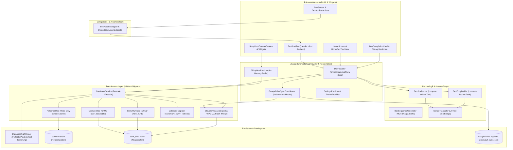

# PokéVault Architecture & System Documentation

> **Languages / Sprachen:** **[🇩🇪 Deutsch](ARCHITECTURE.de.md)** | [🇬🇧 English](../ARCHITECTURE.md) | [🇫🇷 Français](ARCHITECTURE.fr.md) | [🇪🇸 Español](ARCHITECTURE.es.md) | [🇮🇹 Italiano](ARCHITECTURE.it.md) | [🇯🇵 日本語](ARCHITECTURE.ja.md) | [🇰🇷 한국어](ARCHITECTURE.ko.md) | [🇨🇳 简体中文](ARCHITECTURE.zh-hans.md) | [🇹🇼 繁體中文](ARCHITECTURE.zh-hant.md) | [🇵🇹 Português](ARCHITECTURE.pt.md) | [🇳🇱 Nederlands](ARCHITECTURE.nl.md) | [🇵🇱 Polski](ARCHITECTURE.pl.md) | [🇷🇺 Русский](ARCHITECTURE.ru.md)


Dieses Dokument beschreibt die technische Architektur, Datenhaltung, Cloud-Synchronisation, Modularisierung und Code-Standards von **PokéVault**. Es dient Entwicklern und KI-Assistenten als Referenz für Designentscheidungen und Erweiterungen.

> [!TIP]
> **Aktive Roadmap & Nächster Release (v1.7.0):**
> Die vollständige Spezifikation und der Implementierungsplan für das nächste Release **v1.7.0 "The Language Expansion"** (getrennte Sprachen, 10 Franchise-Sprachen, Local REST Server, Multi-Emulator Hunting, Desktop OCR & Mobile PiP-Scanner) befindet sich in [docs/plans/v1_7_0_the_language_expansion.md](../docs/plans/v1_7_0_the_language_expansion.md).
> Der interaktive Prototyp ist verfügbar unter [docs/prototypes/v1_7_0_prototype.html](../docs/prototypes/v1_7_0_prototype.html).

---

## 1. Übersicht & Technologie-Stack

PokéVault ist ein plattformübergreifender Begleiter für Pokémon-Sammler (Living Dex, Formen, Shinies, Bänder & Zeichen, Shiny Hunting).

- **Framework**: [Flutter 3.x](https://flutter.dev/) (Dart SDK `^3.12`)
- **Zielplattformen**: Windows (Desktop), Android, iOS, macOS, Linux, Web
- **Zustandsverwaltung**: [Provider](https://pub.dev/packages/provider) (`DexProvider`, `SettingsProvider`, `ShinyHuntProvider`, `TutorialProvider`, `ThemeProvider`) mit strikter State-Kapselung (`UnmodifiableListView`)
- **Lokalisierung (i18n) & Multi-Language Core (v1.7.0)**:
  - [slang](https://pub.dev/packages/slang) für typsichere UI-Lokalisierung (13 unterstützte Sprachen)
  - Vollständige Entkopplung von **App-UI-Sprache** (`currentLanguage`) und **Pokémon-Franchise-Sprache** (`pokemonLanguage`)
  - Dynamische Sprachregistrierung via `lib/i18n/languages.json` und codegenerierter `LanguageRegistry` (`lib/i18n/language_registry.g.dart`)
  - Multi-Language SQLite Schema mit 9 Franchise-Sprachspalten (`name_<lang>`) in `pokedex.sqlite`
  - Automatisierte Multi-Engine-Übersetzungspipeline (`tool/translate_all.py`) mit MD5-Caching, Token-Maskierung, `locales/`-Dokumentensynchronisation und Slang-Codegenerierung
  - `IsolateTranslator` als schlanke Bridge für UI-freie Hintergrund-Isolate (`compute()`)
- **Persistenz & DAO-Schicht**:
  - SQLite via `sqflite` (Android/iOS) und `sqflite_common_ffi` (Desktop) bzw. `sqflite_common_ffi_web` (Web)
  - Modularisiert in fokussierte Data Access Objects: `PokemonDao`, `UserDexDao`, `ShinyHuntDao`, `CloudSyncDao` und `DatabaseMigrator`
  - `shared_preferences` für App-Einstellungen und Onboarding-Zustände
- **Cloud-Synchronisation**: Google Drive REST API v3 (AppData Folder) via `googleapis` & `googleapis_auth`, koordiniert über den dedizierten `GoogleDriveSyncCoordinator`

---

## 2. Gesamtarchitektur

Das folgende Diagramm visualisiert die geschichtete Architektur von PokéVault, die Trennung von UI-Komponenten über Delegaten, die Entkopplung rechenintensiver Isolate-Tasks und die modulare DAO-Datenbankschicht:



---

## 3. Datenbank-Architektur & DAO-Modell (Dual-SQLite)

PokéVault trennt strikt zwischen unveränderlichen statischen Franchise-Daten und dynamischen Nutzerdaten:

```
┌─────────────────────────────────────────┐       ┌─────────────────────────────────────────┐
│             pokedex.sqlite              │       │            user_data.sqlite             │
│   (Read-Only Referenzdaten / PokemonDao)│       │  (Read-Write Nutzerdaten / UserDexDao)  │
├─────────────────────────────────────────┤       ├─────────────────────────────────────────┤
│ • pokemon (1025+ National Dex)          │       │ • user_dexes (Konfigurationen)          │
│ • forms (Mega, G-Max, Regional)         │       │ • folders (Ordnerhierarchie)            │
│ • encounters & dex_orders               │       │ • folder_structure (Relationen)         │
│ • pokemon_moves & abilities             │       │ • user_pokemon (Status/Shinies)         │
│ • ribbons, marks & catch_rates          │       │ • shiny_hunts (Zähler & Phasen)         │
│ • shiny_locks (502+ globale & lok. Locks│       │                                         │
└─────────────────────────────────────────┘       └─────────────────────────────────────────┘
```

### 3.1 Die Data Access Objects (DAOs)
Der frühere monolithische `DatabaseService` fungiert nun als schlanke Fassade und delegiert alle Operationen an spezialisierte DAOs:
- **`PokemonDao`**: Behandelt alle lesenden Zugriffe auf `pokedex.sqlite`. Kapselt In-Memory-Caches für Pokémon, Attacken, Bänder, Bälle, Formen und Shiny-Locks.
- **`UserDexDao`**: Verantwortlich für alle CRUD-Operationen der Nutzertabellen in `user_data.sqlite` (`user_dexes`, `folders`, `folder_structure`, `user_pokemon`), inklusive verwaister Datensätze (Orphan-Cleanup).
- **`ShinyHuntDao`**: Verwaltet aktive und archivierte Shiny-Hunts, Jagd-Phasen und inkrementelle Zählerstände.
- **`CloudSyncDao`**: Bietet `exportCloudSyncData()` und transaktionales `mergeCloudSyncData()` mit dynamischer `PRAGMA table_info`-Spaltenprüfung für abwärts- und aufwärtskompatiblen Datenabgleich.
- **`DatabaseMigrator`**: Kapselt Schema-Migrationen (v1 bis v29+), Index-Erstellung (`ensureUserDataIndexes`, `ensureAppDatabaseIndexes`) und sichere Downgrade-Routinen.

### 3.2 Portabilität & Pfadauflösung (`DatabasePathHelper`)
Gemäß Repository-Richtlinie liegen Datenbanken portabel im Unterverzeichnis `database/`, **niemals** im Windows-Dokumente-Ordner:
- **Entwicklungsumgebung (Desktop)**: `<project_root>/database/` (erkannt via vorhandene `pubspec.yaml`).
- **Release / Portable Exe (Desktop)**: `<exe_dir>/database/` direkt neben der ausführbaren Datei.
- **Read-Only Fallback**: Falls das Verzeichnis schreibgeschützt ist (z. B. `C:\Program Files`), fällt die App automatisch auf `<application_support_dir>/database/` zurück.
- **Legacy Migration**: Existieren ältere Datenbanken im Dokumente-Ordner, migriert `DatabasePathHelper.migrateLegacyDocumentsDatabasesIfNeeded()` diese transparent, prüft Zeitstempel für Konfliktlösungen und legt Sicherheitskopien (`.bak_<timestamp>`) an.
- **Parallele Test-Isolierung**: Bei automatisierten Testläufen isoliert `DatabasePathHelper` Arbeitsverzeichnisse dynamisch per Prozess-ID (`pokevault_test_dbs/proc_$pid`), um Race Conditions und Lock-Kollisionen bei parallelen Test-Suites auszuschließen.

---

## 4. Zustandsverwaltung, Kapselung & Koordination

### 4.1 State-Kapselung mit `UnmodifiableListView`
In `DexProvider` sind interne Zustände (`_userDexes`, `_folders`) privat geschützt. Öffentliche Getter geben unmodifizierbare Ansichten (`UnmodifiableListView`) zurück. Mutationen erfolgen ausnahmslos über dedizierte Business-Methoden (`createUserDex`, `deleteFolder`, `updatePokemonStatus`), wodurch Seiteneffekte und unkontrollierte In-Memory-Zustandsänderungen verhindert werden.

### 4.2 `GoogleDriveSyncCoordinator`
Die Cloud-Synchronisation ist aus dem `DexProvider` in den eigenständigen `GoogleDriveSyncCoordinator` ausgelagert:
- **Debounced Upload**: Verhindert Server-Überlastung bei schnellen Nutzerinteraktionen durch einen zeitgesteuerten Debouncer.
- **Periodischer Sync**: Konfigurierbarer Intervall-Timer zum Prüfen und Herunterladen von Aktualisierungen anderer Geräte.
- **Lifecycle-Flush**: Bei App-Pausierung (`AppLifecycleState.paused` / `inactive`) werden ungespeicherte Änderungen sofort in die Cloud synchronisiert.
- **Transparente Hook-Kette**: Vor- und Nachbereitungs-Hooks (`registerBeforeUploadHook`, `registerCloudDataMergedHook`) entkoppeln State-Synchronisation von Netzwerkanfragen.

---

## 5. Rechenlogik, Entflechtung & Isolate-Sicherheit

Rechenintensive Operationen sind modularisiert und für Hintergrund-Threads (`compute()`) gehärtet:

1. **`DexBoxPacker`**:
   - Berechnet die Aufteilung von Pokémon-Listen in 30er-PC-Boxen (`generateBoxesIsolateTask`).
   - Unterstützt dynamische Box-Konfigurationen (Kanto, Johto, Living Dex, Formen).
2. **`DexEntryBuilder`**:
   - Generiert `DexDisplayEntry`-Modelle in Hintergrund-Isolates (`buildEntriesIsolateTask`).
3. **`BoxSequenceCalculator`**:
   - Mathematische Berechnungsfunktionen für Multi-Drag, Slot-Swaps, Gap-Closing und boxübergreifendes Verschieben.
4. **`IsolateTranslator` (i18n Bridge)**:
   - Hintergrund-Isolates besitzen keinen Flutter-UI-Kontext (`BuildContext`). `IsolateTranslator` stellt typsichere Übersetzungen für Regionen, Formen und Box-Titel bereit, ohne auf UI-Singletons zuzugreifen.

---

## 6. UI-Modularisierung & Interaktionsmodell

Die Benutzeroberfläche ist in handhabbare, modulare Sub-Widgets aufgeteilt:

### 6.1 `BoxActionDelegate` & `DexBoxView`
Die PC-Box-Ansicht (`DexBoxView`) ist über das `BoxActionDelegate`-Interface von der Anwendungslogik entkoppelt:
- `DexBoxHeader`: Navigation, Box-Titel und Fortschrittsanzeige.
- `DexBoxGrid`: Responsives 6x5-Raster mit automatischer Größenanpassung.
- `DexBoxSlotItem`: Einzelner Pokémon-Slot mit Sprites, Typen-Markern, Shiny-Symbolen und Drag-and-Drop-Feedback.

### 6.2 Modulare Dialoge & Screens
- **Dex Completion Cards**: Aufgeteilt in `CardAppearanceSection`, `CardTogglesSection`, `CardActionsBar` sowie Canvas-Renderer (`CardPainterRenderer`, `CardPokemonMosaic`, `CardStatsSummary`).
- **Shiny Hunt Module**: Aufgeteilt in `HuntCounterControls` (Großanzeige, Buttons), `HuntOddsCard` (Wahrscheinlichkeiten) und `HuntGameMethodSelector` (Edition & Methode).
- **Home Screen**: Navigation getrennt von `HomeDexTreeView` mit Drag-and-Drop-Sortierung.

---

## 7. Offline-Datenbank-Pipeline (`tool/data_pipeline/`)

Die Referenzdatenbank `assets/db/pokedex.sqlite` wird über eine Python-Monorepo-Pipeline generiert:
- **All-in-One Runner**: `python tool/data_pipeline/run_pipeline.py` führt die gesamte Kette (Web-Scraping, Submodule-Updates, Datenbankbau, Multi-Language Sync, Evolutionsbäume, Locks & Indizes) automatisch und deterministisch aus.
- **Einzelne Pipeline-Schritte**:
  1. `python update_data.py`: Lädt aktuelle Web-Dumps (Bulbapedia, Bisafans, PokéWiki), die Legal Matching Pokéballs Tabelle und aktualisiert das PokeAPI Submodul.
  2. `python tool/data_pipeline/build_database.py`: Aggregiert alle Quellen und baut die SQLite-Datenbank.
  3. `python tool/data_pipeline/update_pokemon_languages.py`: Synchronisiert mehrsprachige Speziesnamen für alle 10 offiziellen Franchise-Sprachen aus dem PokeAPI-Submodul in `name_<lang>`-Spalten.
  4. `python tool/data_pipeline/update_evolutions_db.py`: Ergänzt strukturierte Evolutionsbäume aus den PokeAPI-Rohdaten.
  5. `python tool/data_pipeline/update_cap_locks_and_trades.py`: Integriert Shiny-Locks für Kappen-Pikachu, Cosplay-Formen und Tausche.
  6. `python tool/data_pipeline/optimize_databases.py`: Erstellt Covering-Indexes, führt `ANALYZE` und `VACUUM` aus.

Ausführliche Entwickler-Anleitungen befinden sich in [tool/data_pipeline/README.md](../tool/data_pipeline/locales/README.de.md).

---

## 8. Multi-Language & Übersetzungs-Architektur (`tool/translate_all.py`)

PokéVault Release v1.7.0 implementiert eine getrennte Sprachverwaltung und eine automatisierte Lokalisierungs-Pipeline:

### 8.1 Entkoppelte Sprachauswahl
- **UI-Sprache (`currentLanguage`)**: Steuert alle Benutzeroberflächenelemente, Dialoge, Navigationen und Einstellungen (unterstützt 13 Sprachen via `slang`).
- **Pokémon-Sprache (`pokemonLanguage`)**: Steuert Artnamen, Formen und Bänder/Zeichen unabhängig von der UI-Sprache (z. B. deutsches UI mit englischen oder japanischen Pokémon-Namen). Bei der Einstellung `'auto'` wird die Sprache der UI übernommen, sofern offizielle Franchise-Namen existieren; andernfalls greift der englische Fallback (`resolveEffectivePokemonLanguage`).

### 8.2 Konfiguration & Code-Generierung
- **`lib/i18n/languages.json`**: Zentrale JSON-Konfigurationsdatei aller Sprachen mit ISO-Code, Emoji-Flagge, nativem Namen, Franchise-Status (`isPokemonFranchise`) und Slang-Code.
- **`LanguageRegistry` (`lib/i18n/language_registry.g.dart`)**: Vollautomatisch aus `languages.json` durch `translate_all.py` generiert; liefert typsichere Listen und Lookup-Methoden für Flutter-Widgets und Provider.

### 8.3 Automatisierte Übersetzungspipeline
- **Multi-Engine Cascade**: Kostenlose Übersetzungs-Kaskade (Bing $\rightarrow$ Google $\rightarrow$ MyMemory) mit optionaler DeepL-API-Unterstützung (`DEEPL_API_KEY`).
- **Token- & Plural-Schutz**: Maskiert Slang-Parameter (`{name}`, `{count}`), ICU-Plural-Blöcke und Zeilenumbrüche (`\n`) vor der API-Übertragung und stellt sie verlustfrei wieder her.
- **MD5-Caching & Request-Batching**: Cacht Übersetzungen in `tool/.translation_cache.json` mit Anti-Poisoning-Logik und bündelt neue Strings in 30er-Blöcken.
- **`locales/`-Dokumenten-Synchronisation**: Markdown-Dokumentationen werden sauber in `locales/`-Unterordnern gehalten; interne Links und der Kopf-Sprachumschalter werden mit korrekter relativer Tiefe (`../`) dynamisch umgeschrieben. Unterstützt bidirektionale Synchronisation und automatische Quellsprachen-Erkennung (`--source-lang auto`).

---

## 9. Qualitätssicherung & Zero-Tolerance Quality Gate

PokéVault erzwingt höchste Qualitätsstandards durch striktes Test-Driven Development (TDD) und automatisierte Prüfungen:

- **Automatisierte Tests**: Über **1.370 Tests** (`flutter test`) mit **100% Pass-Rate** über Unit-, Widget-, Integrations-, Boundary- und Adversarial-Challenger-Suiten sowie eigenständige Python-Unit-Tests (`test/tool/test_translation_pipeline.py`).
- **Statische Analyse**: `flutter analyze` mit **0 Fehlern, 0 Warnungen und 0 Lints**.
- **Cross-Platform Resilience**: Stresstests für extreme Bildschirmgrößen (z. B. 320x480 bis 4K), Gestenabbruch und Sprachwechsel zur Laufzeit.
- **GitHub Actions CI**: Vollautomatisierte CI-Pipeline bei jedem Commit und Pull Request (`.github/workflows/ci.yml`).
