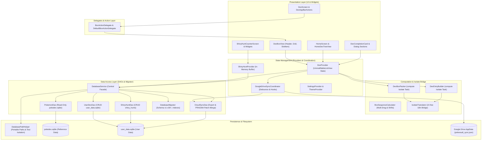

# Arquitectura y Documentación del Sistema de PokéVault

> **Languages / Sprachen:** [🇩🇪 Deutsch](ARCHITECTURE.de.md) | [🇬🇧 English](../ARCHITECTURE.md) | [🇫🇷 Français](ARCHITECTURE.fr.md) | **[🇪🇸 Español](ARCHITECTURE.es.md)** | [🇮🇹 Italiano](ARCHITECTURE.it.md) | [🇯🇵 日本語](ARCHITECTURE.ja.md) | [🇰🇷 한국어](ARCHITECTURE.ko.md) | [🇨🇳 简体中文](ARCHITECTURE.zh-hans.md) | [🇹🇼 繁體中文](ARCHITECTURE.zh-hant.md) | [🇵🇹 Português](ARCHITECTURE.pt.md) | [🇳🇱 Nederlands](ARCHITECTURE.nl.md) | [🇵🇱 Polski](ARCHITECTURE.pl.md) | [🇷🇺 Русский](ARCHITECTURE.ru.md)

Este documento describe la arquitectura técnica, la persistencia de datos, la sincronización en la nube, la modularización y los estándares de código de **PokéVault**. Sirve a los desarrolladores y asistentes de IA como referencia principal para decisiones de diseño y extensiones.

> [!TIP]
> **Hoja de ruta activa y próxima versión (v1.7.0):**
> La especificación completa y la hoja de ruta de implementación para la versión **v1.7.0 "La Expansión del Idioma"** (idiomas desacoplados, 9 idiomas de franquicia, servidor REST API local, caza en múltiples emuladores, OCR de escritorio y escáner de cámara móvil) se encuentran en [docs/plans/v1_7_0_the_language_expansion.md](../docs/plans/v1_7_0_the_language_expansion.md).
> Un prototipo interactivo en HTML está disponible en [docs/prototypes/v1_7_0_prototype.html](../docs/prototypes/v1_7_0_prototype.html).

---

## 1. Descripción general y pila tecnológica

PokéVault es una aplicación complementaria multiplataforma para coleccionistas de Pokémon (Dex Vivo, Formas, Brillantes, Cintas y Marcas, Caza de Brillantes).

- **Marco**: [Flutter 3.x](https://flutter.dev/) (Dart SDK `^3.12`)
- **Plataformas de destino**: Windows (escritorio), Android, iOS, macOS, Linux, Web
- **Administración de estado**: [Proveedor](https://pub.dev/packages/provider) (`DexProvider`, `SettingsProvider`, `ShinyHuntProvider`, `TutorialProvider`, `ThemeProvider`) con encapsulación de estado estricta (`UnmodifiableListView`)
- **Localización (i18n) y núcleo multilingüe (v1.7.0)**:
 - [jerga](https://pub.dev/packages/slang) para localización de UI con seguridad de tipos (13 idiomas admitidos)
 - Desacoplamiento completo de **App UI Language** (`currentLanguage`) y **Pokémon Franchise Language** (`pokemonLanguage`)
 - Registro de idioma dinámico a través de `lib/i18n/languages.json` y generado por código `LanguageRegistry` (`lib/i18n/language_registry.g.dart`)
 - Esquema SQLite multilingüe con 9 columnas de idioma de franquicia (`name_<lang>`) en `pokedex.sqlite`
 - Canal de traducción automatizado multimotor (`tool/translate_all.py`) con almacenamiento en caché MD5, enmascaramiento de tokens, `locales/` sincronización de documentos y compilación de slang
 - `IsolateTranslator` como un puente liviano para aislamientos de fondo independientes de la interfaz de usuario (`compute()`)
- **Capa de persistencia y DAO**:
 - SQLite a través de `sqflite` (Android/iOS), `sqflite_common_ffi` (escritorio) y `sqflite_common_ffi_web` (Web)
 - Modularizado en objetos de acceso a datos enfocados: `PokemonDao`, `UserDexDao`, `ShinyHuntDao`, `CloudSyncDao` y `DatabaseMigrator`
 - `shared_preferences` para la configuración de la aplicación y el estado de incorporación
- **Cloud Sincronización**: Google Drive REST API v3 (carpeta AppData) a través de `googleapis` y `googleapis_auth`, coordinado por el `GoogleDriveSyncCoordinator` dedicado

---

## 2. Arquitectura del Sistema

El siguiente diagrama visualiza la arquitectura en capas de PokéVault, la separación de componentes de UI mediante delegados, la descarga de tareas intensivas en cálculos a isolados y la capa de base de datos DAO modular:



---

## 3. Arquitectura de la Base de Datos y Modelo DAO (Dual-SQLite)

PokéVault distingue estrictamente entre datos de referencia de franquicia estáticos e inmutables y datos dinámicos de seguimiento de usuarios:

```
┌─────────────────────────────────────────┐       ┌─────────────────────────────────────────┐
│             pokedex.sqlite              │       │            user_data.sqlite             │
│   (Read-Only Reference Data/PokemonDao) │       │   (Read-Write User Data / UserDexDao)   │
├─────────────────────────────────────────┤       ├─────────────────────────────────────────┤
│ • pokemon (1025+ National Dex)          │       │ • user_dexes (Configurations)           │
│ • forms (Mega, G-Max, Regional)         │       │ • folders (Folder Hierarchy)            │
│ • encounters & dex_orders               │       │ • folder_structure (Relations)          │
│ • pokemon_moves & abilities             │       │ • user_pokemon (Status/Shinies)         │
│ • ribbons, marks & catch_rates          │       │ • shiny_hunts (Counters & Phases)       │
│ • shiny_locks (502+ global & loc locks) │       │                                         │
└─────────────────────────────────────────┘       └─────────────────────────────────────────┘
```

### 3.1 Objetos de acceso a datos (DAO)
El antiguo `DatabaseService` monolítico sirve como una fachada limpia y delega todas las consultas a DAO especializados:
- **`PokemonDao`**: Maneja todas las operaciones de lectura contra `pokedex.sqlite`. Encapsula cachés en memoria para Pokémon, ataques, cintas, bolas, formas y candados brillantes.
- **`UserDexDao`**: Responsable de todas las operaciones CRUD en tablas de usuario en `user_data.sqlite` (`user_dexes`, `folders`, `folder_structure`, `user_pokemon`), incluida la limpieza de registros huérfanos.
- **`ShinyHuntDao`**: Administra búsquedas shiny activas y archivadas, fases de búsqueda y contramutaciones incrementales.
- **`CloudSyncDao`**: Proporciona `exportCloudSyncData()` y `mergeCloudSyncData()` transaccional con verificación dinámica de columna `PRAGMA table_info` para compatibilidad de esquema bidireccional.
- **`DatabaseMigrator`**: Encapsula migraciones de esquema (v1 a v30+), generación de índices (`ensureUserDataIndexes`, `ensureAppDatabaseIndexes`) y controladores de degradación no destructivos.

### 3.2 Portabilidad y resolución de ruta (`DatabasePathHelper`)
De conformidad con las pautas de calidad del repositorio, las bases de datos se almacenan de forma portátil en el subdirectorio `database/`, **nunca** en la carpeta Documentos del sistema operativo del usuario:
- **Entorno de desarrollo (escritorio)**: `<project_root>/database/` (detectado mediante la presencia de `pubspec.yaml`).
- **Versión/ejecutable portátil (escritorio)**: `<exe_dir>/database/` directamente adyacente al binario de la aplicación.
- **Reserva de solo lectura**: si el directorio de ejecución está protegido contra escritura (por ejemplo, `C:\Program Files`), la aplicación vuelve automáticamente a `<application_support_dir>/database/`.
- **Migración heredada**: si existen bases de datos heredadas en la carpeta Documentos de Windows, `DatabasePathHelper.migrateLegacyDocumentsDatabasesIfNeeded()` las migra de forma transparente, compara las marcas de tiempo de modificación y crea copias de seguridad de seguridad con marca de tiempo (`.bak_<marca de tiempo>`).
- **Aislamiento de prueba paralelo**: durante la ejecución de prueba automatizada, `DatabasePathHelper` aísla las rutas de la base de datos de prueba dinámicamente por ID de proceso (`pokevault_test_dbs/proc_$pid`) para evitar colisiones de bloqueo y condiciones de carrera.

---

## 4. Gestión del Estado, Encapsulación y Coordinación

### 4.1 Encapsulación del estado con `UnmodifiableListView`
En `DexProvider`, las colecciones de estado mutables (`_userDexes`, `_folders`) son privadas. Los getters públicos devuelven vistas de solo lectura no modificables (`UnmodifiableListView`). Las mutaciones de estado ocurren exclusivamente a través de métodos de dominio dedicados (`createUserDex`, `deleteFolder`, `updatePokemonStatus`), lo que previene efectos secundarios y mutaciones en memoria descoordinadas.

### 4.2 `GoogleDriveSyncCoordinator`
La sincronización en la nube se separa de `DexProvider` en el autónomo `GoogleDriveSyncCoordinator`:
- **Carga con retardo (Debounced Upload)**: Evita la limitación de la API y las condiciones de carrera remotas durante clics rápidos del usuario mediante un temporizador de retardo.
- **Sincronización periódica**: Temporizador de fondo configurable para obtener y aplicar actualizaciones desde otros dispositivos.
- **Vaciamiento del ciclo de vida**: Cuando la aplicación se pausa o suspende (`AppLifecycleState.paused` / `inactive`), los cambios no persistidos se envían a Google Drive inmediatamente.
- **Cadena de hooks**: Los hooks de pre- y post-procesamiento (`registerBeforeUploadHook`, `registerCloudDataMergedHook`) desacoplan la sincronización del estado de las llamadas de red.

---

## 5. Lógica de Computación, Separación y Seguridad de Islas

Las operaciones computacionalmente intensivas se modularizan y se refuerzan para la ejecución en segundo plano (`compute()`):

1. **`DexBoxPacker`**:
   - Calcula la distribución de listas de Pokémon en cajas estándar de 30 espacios (`generateBoxesIsolateTask`).
   - Soporta diseños de cajas dinámicos (Kanto, Johto, Living Dex, Form Dex).

2. **`DexEntryBuilder`**:
   - Preconstruye modelos de vista `DexDisplayEntry` dentro de isolados en segundo plano (`buildEntriesIsolateTask`).

3. **`BoxSequenceCalculator`**:
   - Utilidades de cálculo matemático para arrastrar múltiples, intercambio de espacios, cierre de huecos y reubicaciones entre cajas.

4. **`IsolateTranslator` (Puente i18n)**:
   - Los isolados en segundo plano carecen de contextos de interfaz de Flutter (`BuildContext`). `IsolateTranslator` proporciona traducciones de cadenas con seguridad de tipo para regiones, formas y encabezados de cajas sin acceder a singletons de UI.

---

## 6. Modularización de la IU y Modelo de Interacción

La interfaz de usuario se descompone en subwidgets modulares:

### 6.1 `BoxActionDelegate` y `DexBoxView`
La vista de la Caja de PC (`DexBoxView`) está desacoplada de la lógica de negocio a través de la interfaz `BoxActionDelegate`:
- `DexBoxHeader`: Navegación, título de la caja y estadísticas de completitud.
- `DexBoxGrid`: Cuadrícula receptiva de 6x5 con tamaño automático de restricción de la ventana de vista.
- `DexBoxSlotItem`: Casilla individual de Pokémon con sprites, marcadores de tipo, indicadores de shinys y retroalimentación de arrastrar y soltar.

### 6.2 Diálogos y Pantallas Modulares
- **Tarjetas de Compleción del Dex**: Divididas en `CardAppearanceSection`, `CardTogglesSection`, `CardActionsBar` y pintores de lienzo personalizados (`CardPainterRenderer`, `CardPokemonMosaic`, `CardStatsSummary`).
- **Módulo de Búsqueda de Shiny**: Dividido en `HuntCounterControls` (pantalla grande, botones de conteo), `HuntOddsCard` (probabilidades) y `HuntGameMethodSelector` (edición del juego y preajustes de método).
- **Pantalla de Inicio**: Navegación desacoplada de `HomeDexTreeView` con reordenamiento mediante arrastrar y soltar de manera fluida.

---

## 7. Canalización de Base de Datos Offline (`tool/data_pipeline/`)

La base de datos de referencia principal `assets/db/pokedex.sqlite` se compila a través de una canalización de Python:
- **All-in-One Runner**: `python tool/data_pipeline/run_pipeline.py` ejecuta toda la canalización (raspado web, sincronización de submódulos, creación de bases de datos, población en varios idiomas, árboles de evolución, bloqueos brillantes y optimización del índice SQLite). deterministamente.
- **Etapas de canalización**:
 1. `python update_data.py`: descarga volcados de wiki externos, hojas de bolas de coincidencias legales y actualiza el submódulo PokeAPI.
 2. `python tool/data_pipeline/build_database.py`: agrega todas las fuentes y crea SQLite base de datos.
 3. `python tool/data_pipeline/update_pokemon_languages.py`: sincroniza los nombres de especies localizados para los 9 idiomas de franquicia en columnas `name_<lang>`.
 4. `python tool/data_pipeline/update_evolutions_db.py`: inyecta cadenas de evolución estructuradas desde PokeAPI sin procesar records.
 5. `python tool/data_pipeline/update_cap_locks_and_trades.py`: integra candados brillantes para formas de gorras especiales, variantes de cosplay e intercambios en el juego.
 6. `python tool/data_pipeline/optimize_databases.py`: crea índices de cobertura, ejecuta `ANALYZE` y compacta el almacenamiento mediante `VACÍO`.

Instrucciones detalladas para desarrolladores están disponibles en [tool/data_pipeline/README.md](../tool/data_pipeline/locales/README.es.md).

---

## 8. Arquitectura Multi-Idioma y de Traducción (`tool/translate_all.py`)

PokéVault v1.7.0 cuenta con una canalización automática de localización y documentación:

### 8.1 Selección de idioma desacoplada
- **Idioma de la IU (`currentLanguage`)**: Controla todos los elementos de la interfaz, menús, diálogos y configuraciones (admite 13 idiomas a través de `slang`).
- **Idioma de Pokémon (`pokemonLanguage`)**: Controla los nombres, formas y marcas de los Pokémon independientemente del idioma de la IU (por ejemplo, IU en alemán con nombres de Pokémon en inglés o japonés). Cuando se establece en `'auto'`, sigue el idioma de la IU si existen nombres oficiales de la franquicia, recurriendo al inglés si no (`resolveEffectivePokemonLanguage`).

### 8.2 Configuración y Generación de Código
- **`lib/i18n/languages.json`**: Configuración JSON central de todos los idiomas compatibles con códigos ISO, banderas, nombres nativos, estado de franquicia (`isPokemonFranchise`) y códigos de jerga.
- **`LanguageRegistry` (`lib/i18n/language_registry.g.dart`)**: Generado por código a partir de `languages.json` mediante `translate_all.py`, proporcionando listas y métodos de búsqueda con tipado seguro para widgets y proveedores.

### 8.3 Canal de Traducción Automatizado
- **Cascada Multi-Engines**: Cascada de traducción gratuita (Bing $
ightarrow$ Google $
ightarrow$ MyMemory) con soporte opcional de la API de DeepL (`DEEPL_API_KEY`).
- **Protección de Tokens y Plurales**: Enmascara los marcadores de posición de Jerga (`{name}`, `{count}`), plurales ICU y saltos de línea (`\n`) antes de la transmisión, restaurándolos sin pérdida posteriormente.
- **Caché MD5 y Anti-Poisoning**: Almacena en caché las traducciones en `tool/.translation_cache.json` y evita que cadenas de origen fallidas o idénticas contaminen las entradas de caché.
- **Sincronización de Documentos `locales/`**: La documentación en Markdown se mantiene limpia en directorios `locales/` organizados; los enlaces internos relativos y los banners del selector de idioma se reescriben dinámicamente.

---

## 9. Aseguramiento de la Calidad y Puerta de Calidad de Tolerancia Cero

PokéVault aplica estrictos estándares de calidad a través del desarrollo guiado por pruebas (TDD) y puertas de calidad automatizadas:

- **Pruebas Automatizadas**: Más de **1,380+ pruebas** (`flutter test`) con una **tasa de éxito del 100%** en suites de unidad, widget, integración, límite y challenger, además de pruebas unitarias de Python independientes (`test/tool/`).

- **Análisis Estático**: `flutter analyze` y `dart analyze --fatal-infos` con **0 errores, 0 advertencias y 0 lints**.

- **Resiliencia Multiplataforma**: Pruebas de estrés de límites para dimensiones extremas de pantalla (320x480 hasta 4K), cancelaciones rápidas de gestos y cambio de idioma en tiempo de ejecución.

- **GitHub Actions CI**: Puerta de calidad CI automatizada ejecutada en cada commit y solicitud de extracción (`.github/workflows/ci.yml`).
