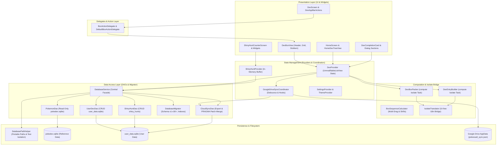

# Architecture et documentation du système de PokéVault

> **Languages / Sprachen:** [🇩🇪 Deutsch](ARCHITECTURE.de.md) | [🇬🇧 English](../ARCHITECTURE.md) | **[🇫🇷 Français](ARCHITECTURE.fr.md)** | [🇪🇸 Español](ARCHITECTURE.es.md) | [🇮🇹 Italiano](ARCHITECTURE.it.md) | [🇯🇵 日本語](ARCHITECTURE.ja.md) | [🇰🇷 한국어](ARCHITECTURE.ko.md) | [🇨🇳 简体中文](ARCHITECTURE.zh-hans.md) | [🇹🇼 繁體中文](ARCHITECTURE.zh-hant.md) | [🇵🇹 Português](ARCHITECTURE.pt.md) | [🇳🇱 Nederlands](ARCHITECTURE.nl.md) | [🇵🇱 Polski](ARCHITECTURE.pl.md) | [🇷🇺 Русский](ARCHITECTURE.ru.md)

Ce document décrit l'architecture technique, la persistance des données, la synchronisation cloud, la modularisation et les normes de code de **PokéVault**. Il sert de référence principale aux développeurs et aux assistants IA pour les décisions de conception et les extensions.

> [!TIP]
> **Feuille de route active et prochaine version (v1.7.0) :**
> La spécification complète et la feuille de route de mise en œuvre pour la version **v1.7.0 "L'Expansion des Langues"** (langues découplées, 9 langues de franchise, serveur REST local, chasse multi-émulateurs, OCR de bureau & scanner de caméra mobile) se trouvent dans [docs/plans/v1_7_0_the_language_expansion.md](../docs/plans/v1_7_0_the_language_expansion.md).
> Un prototype HTML interactif est disponible à [docs/prototypes/v1_7_0_prototype.html](../docs/prototypes/v1_7_0_prototype.html).

---

## 1. Vue d'ensemble et pile technologique

PokéVault est une application compagnon multiplateforme pour les collectionneurs de Pokémon (Dex vivant, Formes, Chromatiques, Rubans et Marques, Chasse aux Chromatiques).

- **Framework** : [Flutter 3.x](https://flutter.dev/) (SDK Dart `^3.12`)
- **Plateformes cibles** : Windows (ordinateur de bureau), Android, iOS, macOS, Linux, Web
- **Gestion de l'état** : [Fournisseur](https://pub.dev/packages/provider) (`DexProvider`, `SettingsProvider`, `ShinyHuntProvider`, `TutorialProvider`, `ThemeProvider`) avec encapsulation d'état stricte (`UnmodifiableListView`)
- **Localisation (i18n) et noyau multilingue (v1.7.0)** :
 - [argot](https://pub.dev/packages/slang) pour la localisation de l'interface utilisateur de type sécurisé (13 langues prises en charge)
 - Découplage complet de la **langue de l'interface utilisateur de l'application** (`currentLanguage`) et de la **langue de franchise Pokémon** (`pokemonLanguage`)
 - Registre de langue dynamique via `lib/i18n/linguals.json` et code généré `LanguageRegistry` (`lib/i18n/lingual_registry.g.dart`)
 - Schéma SQLite multilingue avec 9 colonnes de langue de franchise (`name_<lang>`) dans `pokedex.sqlite`
 - Pipeline de traduction multi-moteur automatisé (`tool/translate_all.py`) avec mise en cache MD5, masquage de jetons, `locales/` synchronisation de documents et compilation d'argot
 - `IsolateTranslator` comme pont léger pour les isolats d'arrière-plan indépendants de l'interface utilisateur (`compute()`)
- **Persistence & DAO Layer**:
 - SQLite via `sqlflite` (Android/iOS), `sqflite_common_ffi` (Bureau) et `sqlflite_common_ffi_web` (Web)
 - Modularisé en objets d'accès aux données ciblés : `PokemonDao`, `UserDexDao`, `ShinyHuntDao`, `CloudSyncDao` et `DatabaseMigrator`
 - `shared_preferences` pour les paramètres d'application et l'intégration state
- **Synchronisation Cloud** : Google Drive REST API v3 (dossier AppData) via `googleapis` et `googleapis_auth`, coordonné par le `GoogleDriveSyncCoordinator` dédié

---

## 2. Architecture du système

Le schéma suivant visualise l'architecture en couches de PokéVault, la séparation des composants UI via des délégués, le délestage des tâches d'isolate gourmandes en calcul, et la couche de base de données DAO modulaire :



---

## 3. Architecture de la base de données et modèle DAO (Double-SQLite)

PokéVault distingue strictement les données de référence de franchise statiques immuables des données dynamiques de suivi des utilisateurs :

```
┌─────────────────────────────────────────┐       ┌─────────────────────────────────────────┐
│             pokedex.sqlite              │       │            user_data.sqlite             │
│   (Read-Only Reference Data/PokemonDao) │       │   (Read-Write User Data / UserDexDao)   │
├─────────────────────────────────────────┤       ├─────────────────────────────────────────┤
│ • pokemon (1025+ National Dex)          │       │ • user_dexes (Configurations)           │
│ • forms (Mega, G-Max, Regional)         │       │ • folders (Folder Hierarchy)            │
│ • encounters & dex_orders               │       │ • folder_structure (Relations)          │
│ • pokemon_moves & abilities             │       │ • user_pokemon (Status/Shinies)         │
│ • ribbons, marks & catch_rates          │       │ • shiny_hunts (Counters & Phases)       │
│ • shiny_locks (502+ global & loc locks) │       │                                         │
└─────────────────────────────────────────┘       └─────────────────────────────────────────┘
```

### 3.1 Objets d'accès aux données (DAO)
L'ancien `DatabaseService` monolithique sert de façade épurée et délègue toutes les requêtes à des DAO spécialisés :
- **`PokemonDao`** : gère toutes les opérations de lecture sur `pokedex.sqlite`. Encapsule les caches en mémoire pour les Pokémon, les attaques, les rubans, les balles, les formulaires et les verrous brillants.
- **`UserDexDao`** : Responsable de toutes les opérations CRUD sur les tables utilisateur dans `user_data.sqlite` (`user_dexes`, `folders`, `folder_structure`, `user_pokemon`), y compris les enregistrements orphelins cleanup.
- **`ShinyHuntDao`** : gère les chasses brillantes actives et archivées, les phases de chasse et les mutations de compteurs incrémentielles.
- **`CloudSyncDao`** : fournit `exportCloudSyncData()` et transactionnel `mergeCloudSyncData()` avec une vérification dynamique de la colonne `PRAGMA table_info` pour une compatibilité de schéma bidirectionnel.
- **`DatabaseMigrator`** : encapsule les migrations de schémas (v1 à v30+), la génération d'index (`ensureUserDataIndexes`, `ensureAppDatabaseIndexes`) et les gestionnaires de rétrogradation non destructifs.

### 3.2 Portabilité et résolution de chemin (`DatabasePathHelper`)
Conformément aux directives de qualité du référentiel, les bases de données sont stockées de manière portable dans le sous-répertoire `database/`, **jamais** dans le dossier Documents du système d'exploitation de l'utilisateur :
- **Environnement de développement (bureau)** : `<racine_projet>/database/` (détecté via la présence de `pubspec.yaml`).
- **Release / Portable Executable (Desktop)** : `<exe_dir>/database/` directement adjacent au binaire de l'application.
- **Read-Only Fallback** : Si le répertoire d'exécution est protégé en écriture (par exemple `C:\Program Files`), l'application revient automatiquement à `<application_support_dir>/database/`.
- **Migration héritée** : si des bases de données héritées existent dans le dossier Documents Windows, `DatabasePathHelper.migrateLegacyDocumentsDatabasesIfNeeded()` les migre de manière transparente, compare les horodatages de modification et crée des sauvegardes de sécurité horodatées (`.bak_<timestamp>`).
- **Parallèle Isolation des tests** : lors de l'exécution automatisée des tests, `DatabasePathHelper` isole dynamiquement les chemins de la base de données de test par ID de processus (`pokevault_test_dbs/proc_$pid`) pour éviter les collisions de verrouillage et les conditions de concurrence.

---

## 4. Gestion d'état, Encapsulation et Coordination

### 4.1 Encapsulation de l'état avec `UnmodifiableListView`
Dans `DexProvider`, les collections d'état mutables (`_userDexes`, `_folders`) sont privées. Les getters publics renvoient des vues en lecture seule et non modifiables (`UnmodifiableListView`). Les mutations de l'état se produisent exclusivement via des méthodes de domaine dédiées (`createUserDex`, `deleteFolder`, `updatePokemonStatus`), empêchant les effets secondaires et les mutations non coordonnées en mémoire.

### 4.2 `GoogleDriveSyncCoordinator`
La synchronisation cloud est séparée de `DexProvider` dans l'`GoogleDriveSyncCoordinator` autonome :
- **Téléversement avec délai** : Empêche la limitation de l'API et les conditions de course à distance lors de clics rapides de l'utilisateur grâce à un temporisateur de délai.
- **Synchronisation périodique** : Minuteur en arrière-plan configurable pour récupérer et appliquer les mises à jour depuis d'autres appareils.
- **Vidage du cycle de vie** : Lorsque l'application est mise en pause ou suspendue (`AppLifecycleState.paused` / `inactive`), les modifications non persistées sont immédiatement enregistrées sur Google Drive.
- **Chaîne de hooks** : Les hooks de pré- et post-traitement (`registerBeforeUploadHook`, `registerCloudDataMergedHook`) découplent la synchronisation d'état des appels réseau.

---

## 5. Logique de calcul, séparation et sécurité de l'isolement

Les opérations intensives en calcul sont modulaires et renforcées pour une exécution en arrière-plan (`compute()`) :

1. **`DexBoxPacker`**:
   - Calcule la distribution des listes de Pokémon dans des boîtes PC standard de 30 emplacements (`generateBoxesIsolateTask`).
   - Prend en charge les mises en page dynamiques des boîtes (Kanto, Johto, Living Dex, Form Dex).
2. **`DexEntryBuilder`**:
   - Pré-construit des modèles de vue `DexDisplayEntry` dans des isolats en arrière-plan (`buildEntriesIsolateTask`).
3. **`BoxSequenceCalculator`**:
   - Outils de calcul mathématique pour le multi-glisser, les échanges de slots, la fermeture des écarts et les relocalisations entre boîtes.
4. **`IsolateTranslator` (pont i18n)**:
   - Les isolats en arrière-plan n'ont pas de contextes Flutter UI (`BuildContext`). `IsolateTranslator` fournit des traductions de chaînes typées pour les régions, les formes et les en-têtes de boîte sans accéder aux singletons UI.

---

## 6. Modularisation de l'UI et Modèle d'Interaction

L'interface utilisateur est décomposée en sous-éléments modulaires :

### 6.1 `BoxActionDelegate` & `DexBoxView`
La vue de la boîte PC (`DexBoxView`) est découplée de la logique métier via l'interface `BoxActionDelegate` :
- `DexBoxHeader` : Navigation, titre de la boîte et statistiques de complétion.
- `DexBoxGrid` : Grille réactive 6x5 avec dimensionnement automatique selon la fenêtre d’affichage.
- `DexBoxSlotItem` : Emplacement individuel de Pokémon avec sprites, marqueurs de type, indicateurs shiny et retour visuel lors du glisser-déposer.

### 6.2 Dialogues et Écrans Modulaires
- **Cartes de Complétion du Dex** : Divisées en `CardAppearanceSection`, `CardTogglesSection`, `CardActionsBar`, et peintres personnalisés de canevas (`CardPainterRenderer`, `CardPokemonMosaic`, `CardStatsSummary`).
- **Module de Chasse Shiny** : Décomposé en `HuntCounterControls` (affichage large, boutons de comptage), `HuntOddsCard` (probabilités), et `HuntGameMethodSelector` (préconfigurations d’édition de jeu et méthode).
- **Écran d’Accueil** : Navigation découplée de `HomeDexTreeView` avec réorganisation par glisser-déposer fluide.

---

## 7. Pipeline de base de données hors ligne (`tool/data_pipeline/`)

La base de données de référence principale `assets/db/pokedex.sqlite` est compilée via un pipeline Python :
- **All-in-One Runner** : `python tool/data_pipeline/run_pipeline.py` exécute l'intégralité du pipeline (web scraping, synchronisation des sous-modules, construction de base de données, population multilingue, arbres d'évolution, verrous brillants et optimisation de l'index SQLite) de manière déterministe.
- **Étapes du pipeline** :
 1. `python update_data.py` : télécharge les dumps wiki externes, les feuilles de correspondance légales et met à jour le sous-module PokeAPI.
 2. `python tool/data_pipeline/build_database.py` : agrège toutes les sources et crée la base de données SQLite.
 3. `python tool/data_pipeline/update_pokemon_linguals.py` : synchronise les noms d'espèces localisés pour les 9 langues de franchise dans les colonnes `name_<lang>`.
 4. `python tool/data_pipeline/update_evolutions_db.py` : injecte des chaînes d'évolution structurées à partir des enregistrements PokeAPI bruts.
 5. `python tool/data_pipeline/update_cap_locks_and_trades.py` : intègre des verrous brillants pour les formes de casquettes spéciales, les variantes de cosplay et les échanges dans le jeu.
 6. `python tool/data_pipeline/optimize_databases.py` : construit des index couvrant, exécute `ANALYZE` et compacte le stockage via `VACUUM`.

Des instructions détaillées pour les développeurs sont disponibles dans [tool/data_pipeline/README.md](../tool/data_pipeline/locales/README.fr.md).

---

## 8. Architecture Multi-Langues et Traduction (`tool/translate_all.py`)

PokéVault v1.7.0 propose une chaîne automatisée de localisation et de documentation :

### 8.1 Sélection de langue découplée
- **Langue de l'interface (`currentLanguage`)** : Contrôle tous les éléments de l'interface, menus, dialogues et réglages (supporte 13 langues via `slang`).
- **Langue des Pokémon (`pokemonLanguage`)** : Contrôle indépendamment les noms, formes et marques des Pokémon par rapport à la langue de l'interface (par ex. interface en allemand avec noms de Pokémon en anglais ou en japonais). Lorsqu'elle est réglée sur `'auto'`, elle suit la langue de l'interface si des noms officiels de la franchise existent, sinon elle revient à l'anglais (`resolveEffectivePokemonLanguage`).

### 8.2 Configuration et génération de code
- **`lib/i18n/languages.json`** : Configuration JSON centrale de toutes les langues prises en charge avec les codes ISO, les drapeaux, les noms natifs, le statut de franchise (`isPokemonFranchise`) et les codes d'argot.
- **`LanguageRegistry` (`lib/i18n/language_registry.g.dart`)** : Généré automatiquement à partir de `languages.json` par `translate_all.py`, fournissant des listes et des méthodes de recherche sûres pour les types pour les widgets et les fournisseurs.

### 8.3 Pipeline de Traduction Automatisée
- **Cascade Multi-Moteurs** : Cascade de traduction gratuite (Bing $
ightarrow$ Google $
ightarrow$ MyMemory) avec support optionnel de l'API DeepL (`DEEPL_API_KEY`).
- **Protection des Tokens et du Pluriel** : Masque les espaces réservés d'argot (`{name}`, `{count}`), les pluriels ICU, et les sauts de ligne (`\n`) avant transmission, puis les restaure sans perte.
- **Caching MD5 & Anti-Poisoning** : Met en cache les traductions dans `tool/.translation_cache.json` et empêche les chaînes sources échouées ou identiques de polluer les entrées du cache.
- **Synchronisation des Documents `locales/`** : La documentation Markdown est maintenue proprement dans des répertoires `locales/` organisés ; les liens internes relatifs et les bannières de changement de langue sont réécrits dynamiquement.

---

## 9. Assurance Qualité & Porte de Qualité Tolérance Zéro

PokéVault applique des normes de qualité strictes grâce au développement piloté par les tests (TDD) et aux passerelles de qualité automatisées :

- **Tests automatisés** : Plus de **1 380 tests** (`flutter test`) avec un **taux de réussite de 100 %** sur les suites unitaires, widgets, intégration, limites et challengers, ainsi que des tests unitaires Python autonomes (`test/tool/`).

- **Analyse statique** : `flutter analyze` et `dart analyze --fatal-infos` avec **0 erreurs, 0 avertissements et 0 lints**.

- **Résilience multiplateforme** : Tests de stress des limites pour des dimensions d’écran extrêmes (320x480 jusqu’à 4K), annulations rapides de gestes et changement de langue en temps réel.

- **CI GitHub Actions** : Passerelle de qualité CI automatisée exécutée à chaque commit et pull request (`.github/workflows/ci.yml`).
