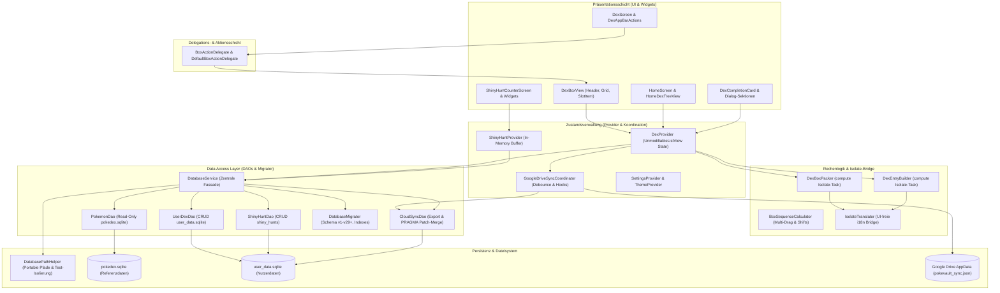

# Architettura PokéVault e documentazione di sistema

> **Languages / Sprachen:** [🇩🇪 Deutsch](ARCHITECTURE.de.md) | [🇬🇧 English](../ARCHITECTURE.md) | [🇫🇷 Français](ARCHITECTURE.fr.md) | [🇪🇸 Español](ARCHITECTURE.es.md) | **[🇮🇹 Italiano](ARCHITECTURE.it.md)** | [🇯🇵 日本語](ARCHITECTURE.ja.md) | [🇰🇷 한국어](ARCHITECTURE.ko.md) | [🇨🇳 简体中文](ARCHITECTURE.zh-hans.md) | [🇹🇼 繁體中文](ARCHITECTURE.zh-hant.md) | [🇵🇹 Português](ARCHITECTURE.pt.md) | [🇳🇱 Nederlands](ARCHITECTURE.nl.md) | [🇵🇱 Polski](ARCHITECTURE.pl.md) | [🇷🇺 Русский](ARCHITECTURE.ru.md)


Questo documento descrive l'architettura tecnica, l'archiviazione dei dati, la sincronizzazione nel cloud, la modularizzazione e gli standard del codice di **PokéVault**. Serve come riferimento per sviluppatori e assistenti AI per decisioni ed estensioni di progettazione.

> [!TIP]
> **Roadmap attiva e prossima versione (v1.7.0):**
> Le specifiche complete e il piano di implementazione per la prossima versione **v1.7.0 "L'espansione linguistica"** (Lingue disconnesse, 10 lingue in franchising, server REST locale, ricerca multi-emulatore, OCR desktop e scanner PiP mobile) si trovano in [docs/plans/v1_7_0_the_language_expansion.md](../docs/plans/v1_7_0_the_language_expansion.md).
> Il prototipo interattivo è disponibile su [docs/prototypes/v1_7_0_prototype.html](../docs/prototypes/v1_7_0_prototype.html).

---

## 1. Panoramica e stack tecnologico

PokéVault è un compagno multipiattaforma per i collezionisti di Pokémon (Living Dex, Forms, Shinies, Bands & Marks, Shiny Hunting).

- **Framework**: [Flutter 3.x](https://flutter.dev/) (Dart SDK `^3.12`)
- **Piattaforme di destinazione**: Windows (desktop), Android, iOS, macOS, Linux, Web
- **Gestione dello stato**: [Provider](https://pub.dev/packages/provider) (`DexProvider`, `SettingsProvider`, `ShinyHuntProvider`, `TutorialProvider`, `ThemeProvider`) con rigido incapsulamento dello stato (`UnmodifyingListView`)
- **Localizzazione (i18n) e Multi-Language Core (v1.7.0)**:
 - [slang](https://pub.dev/packages/slang) per la localizzazione dell'interfaccia utente indipendente dal tipo (13 lingue supportate)
 - Disaccoppiamento completo di **Lingua dell'interfaccia utente dell'app** (`currentLanguage`) e **Pokémon Franchise Language** (`pokemonLanguage`)
 - Registrazione dinamica della lingua tramite `lib/i18n/linguals.json` e codice generato `LanguageRegistry` (`lib/i18n/lingual_registry.g.dart`)
 - Schema SQLite multilingue con 9 colonne di lingue in franchising (`name_<lang>`) in `pokedex.sqlite`
 - Pipeline di traduzione automatizzata multi-motore (`tool/translate_all.py`) con caching MD5, mascheramento dei token, Sincronizzazione di documenti `locales/` e generazione di codice slang
 - `IsolateTranslator` come ponte leggero per isolati in background senza interfaccia utente (`compute()`)
- **Persistenza e livello DAO**:
 - SQLite tramite `sqflite` (Android/iOS) e `sqflite_common_ffi` (desktop) o `sqflite_common_ffi_web` (web)
 - Modularizzato in oggetti di accesso ai dati mirati: `PokemonDao`, `UserDexDao`, `ShinyHuntDao`, `CloudSyncDao` e `DatabaseMigrator`
 - `shared_preferences` per le impostazioni dell'app e gli stati di onboarding
- **Cloud sincronizzazione**: Google Drive REST API v3 (cartella AppData) tramite `googleapis` e `googleapis_auth`, coordinata tramite il `GoogleDriveSyncCoordinator` dedicato

---

## 2. Architettura generale

Il seguente diagramma visualizza l'architettura a strati di PokéVault, la separazione dei componenti dell'interfaccia utente tramite delegati, il disaccoppiamento delle attività di isolamento ad alta intensità di calcolo e il livello del database DAO modulare:



---

## 3. Architettura del database e modello DAO (Dual-SQLite)

PokéVault separa rigorosamente i dati statici immutabili del franchising e i dati dinamici degli utenti:

```
┌─────────────────────────────────────────┐       ┌─────────────────────────────────────────┐
│             pokedex.sqlite              │       │            user_data.sqlite             │
│   (Read-Only Referenzdaten / PokemonDao)│       │  (Read-Write Nutzerdaten / UserDexDao)  │
├─────────────────────────────────────────┤       ├─────────────────────────────────────────┤
│ • pokemon (1025+ National Dex)          │       │ • user_dexes (Konfigurationen)          │
│ • forms (Mega, G-Max, Regional)         │       │ • folders (Ordnerhierarchie)            │
│ • encounters & dex_orders               │       │ • folder_structure (Relationen)         │
│ • pokemon_moves & abilities             │       │ • user_pokemon (Status/Shinies)         │
│ • ribbons, marks & catch_rates          │       │ • shiny_hunts (Zähler & Phasen)         │
│ • shiny_locks (502+ globale & lok. Locks│       │                                         │
└─────────────────────────────────────────┘       └─────────────────────────────────────────┘
```

### 3.1 I Data Access Objects (DAO)
Il precedente `DatabaseService` monolitico ora agisce come una facciata leggera e delega tutte le operazioni a DAO specializzati:
- **`PokemonDao`**: gestisce tutti gli accessi in lettura a `pokedex.sqlite`. Incapsula cache in memoria per Pokémon, attacchi, nastri, palline, forme e lucchetti lucenti.
- **`UserDexDao`**: Responsabile di tutte le operazioni CRUD delle tabelle utente in `user_data.sqlite` (`user_dexes`, `folders`, `folder_structure`, `user_pokemon`), inclusi i record orfani (Orphan cleanup).
- **`ShinyHuntDao`**: gestisce Shiny Hunt attive e archiviate, fasi di caccia e conteggi incrementali.
- **`CloudSyncDao`**: Fornisce `exportCloudSyncData()` e transazionale `mergeCloudSyncData()` con controllo dinamico della colonna `PRAGMA table_info` per la sincronizzazione dei dati compatibile con le versioni precedenti e successive.
- **`DatabaseMigrator`**: incapsula le migrazioni dello schema (da v1 a v29+), la creazione di indici (`ensureUserDataIndexes`, `ensureAppDatabaseIndexes`) e routine di downgrade sicure.

### 3.2 Portabilità e risoluzione del percorso (`DatabasePathHelper`)
Secondo la politica del repository, i database sono posizionati in modo portabile nella sottodirectory `database/`, **mai** nella cartella Documenti di Windows:
- **Ambiente di sviluppo (desktop)**: `<project_root>/database/` (rilevato tramite `pubspec.yaml`).
- **Release / Portable Exe (Desktop)**: `<exe_dir>/database/` proprio accanto al file eseguibile.
- **Read-Only Fallback**: se la directory è di sola lettura (ad esempio `C:\Program Files`), l'app cade automaticamente in `<application_support_dir>/database/` back.
- **Migrazione legacy**: Se nella cartella dei documenti sono presenti database più vecchi, `DatabasePathHelper.migrateLegacyDocumentsDatabasesIfNeeded()` li migra in modo trasparente, controlla i timestamp per la risoluzione dei conflitti e crea copie di backup (`.bak_<timestamp>`).
- **Isolamento test parallelo**: durante l'esecuzione dei test automatizzati, `DatabasePathHelper` isola dinamicamente le directory di lavoro in base all'ID del processo (`pokevault_test_dbs/proc_$pid`) per eliminare le condizioni di competizione e bloccare le collisioni nelle suite di test parallele.

---

## 4. Gestione, incapsulamento e coordinamento dello Stato

### 4.1 Incapsulamento dello stato con `UnmodifyingListView`
In `DexProvider`, gli stati interni (`_userDexes`, `_folders`) sono protetti privatamente. I getter pubblici restituiscono viste non modificabili ("UnmodifyingListView"). Le mutazioni vengono sempre eseguite tramite metodi aziendali dedicati (`createUserDex`, `deleteFolder`, `updatePokemonStatus`), che prevengono effetti collaterali e modifiche incontrollate dello stato della memoria.

### 4.2 `GoogleDriveSyncCoordinator`
La sincronizzazione cloud è esternalizzata da `DexProvider` al `GoogleDriveSyncCoordinator` indipendente:
- **Caricamento con debounce**: Previene il sovraccarico del server durante le interazioni veloci dell'utente attraverso un debouncer controllato a tempo.
- **Sincronizzazione periodica**: timer di intervallo configurabile per il controllo e download di aggiornamenti da altri dispositivi.
- **Lifecycle Flush**: quando l'app è in pausa (`AppLifecycleState.paused` / `inactive`), le modifiche non salvate vengono immediatamente sincronizzate nel cloud.
- **Catena di hook trasparente**: hook di pre e post-elaborazione (`registerBeforeUploadHook`, `registerCloudDataMergedHook`) disaccoppiano la sincronizzazione dello stato dalla rete richieste.

---

## 5. Logica computazionale, separazione e sicurezza isolata

Le operazioni ad alta intensità di calcolo sono modularizzate e rafforzate per i thread in background (`compute()`):

1. **`DexBoxPacker`**:
 - Calcola la divisione degli elenchi di Pokémon in box da 30 PC (`generateBoxesIsolateTask`).
 - Supporta configurazioni di box dinamiche (Kanto, Johto, Living Dex, Forms).
2. **`DexEntryBuilder`**:
 - Genera modelli `DexDisplayEntry` in background isolati (`buildEntriesIsolateTask`).
3. **`BoxSequenceCalculator`**:
 - Funzioni di calcolo matematico per trascinamento multiplo, scambio di slot, chiusura di spazi e spostamento di riquadri incrociati.
4. **`IsolateTranslator` (i18n Bridge)**:
 - Gli isolati in background non hanno un contesto UI Flutter ("BuildContext`). "IsolateTranslator" fornisce traduzioni indipendenti dai tipi per regioni, forme e titoli di riquadri senza accedere ai singleton dell'interfaccia utente.

---

## 6. Modularizzazione dell'interfaccia utente e modello di interazione

L'interfaccia utente è suddivisa in sub-widget gestibili e modulari:

### 6.1 `BoxActionDelegate` & `DexBoxView`
La visualizzazione del box PC (`DexBoxView`) è disaccoppiata dalla logica dell'applicazione tramite l'interfaccia `BoxActionDelegate`:
- `DexBoxHeader`: navigazione, titolo del box e visualizzazione dell'avanzamento.
- `DexBoxGrid`: Responsive Griglia 6x5 con dimensionamento automatico.
- `DexBoxSlotItem`: slot per Pokémon singolo con sprite, indicatori di tipo, icone lucide e feedback drag-and-drop.

### 6.2 Finestre di dialogo e schermate modulari
- **Carte di completamento Dex**: divise in `CardAppearanceSection`, `CardTogglesSection`, `CardActionsBar` e renderer Canvas (`CardPainterRenderer`, `CardPokemonMosaic`, `CardStatsSummary`).
- **Shiny Hunt Module**: diviso in `HuntCounterControls` (display grande, pulsanti), `HuntOddsCard` (probabilità) e `HuntGameMethodSelector` (edizione e metodo).
- **Schermata principale**: navigazione separata da `HomeDexTreeView` con ordinamento drag-and-drop.

---

## 7. Pipeline del database offline (`tool/data_pipeline/`)

Il database di riferimento `assets/db/pokedex.sqlite` viene generato tramite una pipeline monorepo Python:
- **All-in-One Runner**: `python tool/data_pipeline/run_pipeline.py` esegue l'intera catena (web scraping, aggiornamenti dei sottomoduli, costruzione del database, sincronizzazione multilingue, alberi di evoluzione, blocchi e indici) in modo automatico e deterministico da.
- **Passaggi individuali della pipeline**:
 1. `python update_data.py`: carica i dump web correnti (Bulbapedia, Bisafans, PokéWiki), la tabella Legal Matching Pokéballs e aggiorna il sottomodulo PokeAPI.
 2. `python tool/data_pipeline/build_database.py`: aggrega tutte le fonti e crea il Database SQLite.
 3. `python tool/data_pipeline/update_pokemon_lang dati PokeAPI grezzi.
 5. `python tool/data_pipeline/update_cap_locks_and_trades.py`: aggiunge lucchetti lucenti per Cap Pikachu, forme e mestieri cosplay.
 6. `python tool/data_pipeline/optimize_databases.py`: crea indici di copertura, esegue `ANALYZE` e `VACUUM`.

Le istruzioni dettagliate per gli sviluppatori possono essere trovate in [tool/data_pipeline/README.md](../tool/data_pipeline/locales/README.it.md).

---

## 8. Architettura multilingue e di traduzione (`tool/translate_all.py`)

PokéVault Release v1.7.0 implementa una gestione della lingua separata e una pipeline di localizzazione automatizzata:

### 8.1 Selezione della lingua disaccoppiata
- **Lingua dell'interfaccia utente (`currentLanguage`)**: controlla tutti gli elementi dell'interfaccia utente, le finestre di dialogo, la navigazione e le impostazioni (supporta 13 lingue tramite `slang`).
- **Lingua dei Pokemon (`pokemonLanguage`)**: controlla i nomi delle specie, le forme e le bande/caratteri indipendentemente dalla lingua dell'interfaccia utente (ad es. tedesco UI con nomi Pokémon inglesi o giapponesi). Se l'impostazione è "auto", viene adottata la lingua dell'interfaccia utente se esistono nomi di franchising ufficiali; altrimenti avrà effetto il fallback inglese (`resolveEffectivePokemonLanguage`).

### 8.2 Configurazione e generazione del codice
- **`lib/i18n/linguals.json`**: file di configurazione JSON centrale di tutte le lingue con codice ISO, bandiera emoji, nome nativo, stato del franchising (`isPokemonFranchise`) e codice slang.
- **`LanguageRegistry` (`lib/i18n/lingual_registry.g.dart`)**: generato in modo completamente automatico da `linguals.json` da `translate_all.py`; fornisce elenchi indipendenti dai tipi e metodi di ricerca per widget e provider Flutter.

### 8.3 Pipeline di traduzione automatizzata
- **Multi-Engine Cascade**: cascata di traduzione gratuita (Bing $\rightarrow$ Google $\rightarrow$ MyMemory) con supporto API DeepL opzionale (`DEEPL_API_KEY`).
- **Token e protezione plurale**: maschera i parametri slang (`{name}`, `{count}`), ICU plurale di blocchi e righe (`\n`) prima della trasmissione dell'API e li ripristina senza perdite.
- **MD5 Caching e Request Batching**: memorizza nella cache le traduzioni in `tool/.translation_cache.json` con logica anti-avvelenamento e raggruppa nuove stringhe in blocchi di 30.
- **`locales/` documento sincronizzazione**: la documentazione di Markdown è conservata ordinatamente nelle sottocartelle `locales/`; i collegamenti interni e il selettore della lingua dell'intestazione vengono riscritti dinamicamente con la profondità relativa corretta (`../`). Supporta la sincronizzazione bidirezionale e il rilevamento automatico della lingua di origine (`--source-lang auto`).

---

## 9. Garanzia di qualità e cancello di qualità a tolleranza zero

PokéVault applica i più alti standard di qualità attraverso un rigoroso sviluppo basato sui test (TDD) e test automatizzati:

- **Test automatizzati**: Oltre **1.370 test** (`flutter test`) con **100% di successo** su suite di test unitari, widget, integrazione, borderline e sfidanti avversariali, oltre a test unitari Python autonomi (`test/tool/test_translation_pipeline.py`).
- **Analisi statica**: `flutter analyze` con **0 errori, 0 avvertimenti e 0 lint**.
- **Resilienza cross-platform**: Test di stress per dimensioni estreme dello schermo (ad esempio da 320x480 fino a 4K), abbreviazione dei gesti e cambio di lingua in tempo reale.
- **CI con GitHub Actions**: Pipeline CI completamente automatizzata per ogni commit e pull request (`.github/workflows/ci.yml`).