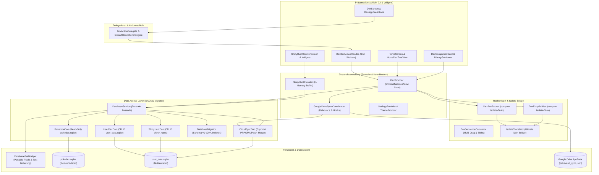

# PokéVault のアーキテクチャとシステムのドキュメント

> **Languages / Sprachen:** [🇩🇪 Deutsch](ARCHITECTURE.de.md) | [🇬🇧 English](../ARCHITECTURE.md) | [🇫🇷 Français](ARCHITECTURE.fr.md) | [🇪🇸 Español](ARCHITECTURE.es.md) | [🇮🇹 Italiano](ARCHITECTURE.it.md) | **[🇯🇵 日本語](ARCHITECTURE.ja.md)** | [🇰🇷 한국어](ARCHITECTURE.ko.md) | [🇨🇳 简体中文](ARCHITECTURE.zh-hans.md) | [🇹🇼 繁體中文](ARCHITECTURE.zh-hant.md) | [🇵🇹 Português](ARCHITECTURE.pt.md) | [🇳🇱 Nederlands](ARCHITECTURE.nl.md) | [🇵🇱 Polski](ARCHITECTURE.pl.md) | [🇷🇺 Русский](ARCHITECTURE.ru.md)


このドキュメントでは、**PokéVault** の技術アーキテクチャ、データ ストレージ、クラウド同期、モジュール化、およびコード標準について説明します。 これは、開発者や AI アシスタントが設計を決定したり拡張したりするためのリファレンスとして機能します。

> [!TIP]
> **アクティブなロードマップと次のリリース (v1.7.0):**
> 次のリリースの完全な仕様と実装計画 **v1.7.0「言語拡張」** (切断された言語、10 のフランチャイズ言語、ローカル REST サーバー、マルチエミュレーター ハンティング、デスクトップ OCR およびモバイル PiP スキャナー) は、次の場所にあります。 [docs/plans/v1_7_0_the_language_expansion.md](../docs/plans/v1_7_0_the_language_expansion.md).
> インタラクティブなプロトタイプは、次の場所で入手できます。 [docs/prototypes/v1_7_0_prototype.html](../docs/prototypes/v1_7_0_prototype.html)。

---

## 1. 概要と技術スタック

PokéVault は、ポケモン コレクター (Living Dex、Forms、Shinies、Bands & Marks、Shiny Hunting) のためのクロスプラットフォームのコンパニオンです。

- **フレームワーク**: [Flutter 3.x](https://flutter.dev/) (Dart SDK `^3.12`)
- **ターゲット プラットフォーム**: Windows (デスクトップ)、Android、iOS、macOS、Linux、Web
- **状態管理**: [プロバイダー](https://pub.dev/packages/provider)厳密な状態カプセル化 (`UnmodifiableListView`) を備えた (`DexProvider`、`SettingsProvider`、`ShinyHuntProvider`、`TutorialProvider`、`ThemeProvider`)
- **ローカリゼーション (i18n) および多言語コア (v1.7.0)**:
 - [slang](https://pub.dev/packages/slang) タイプセーフ UI ローカリゼーション用 (13 言語をサポート)
 - **アプリ UI 言語** (`currentLanguage`) と **Pokémon フランチャイズ言語** (`pokemonLanguage`)
 - `lib/i18n/messages.json` を介した動的言語登録コード生成された `LanguageRegistry` (`lib/i18n/ language_registry.g.dart`)
 - `pokedex.sqlite` 内の 9 つのフランチャイズ言語列 (`name_<lang>`) を持つ多言語 SQLite スキーマ 
 - 自動化されたマルチエンジン翻訳パイプライン(`tool/translate_all.py`) MD5 キャッシュ、トークン マスキング、`locales/` ドキュメント同期、およびスラング コード生成を使用
 - UI フリーのバックグラウンド分離のための軽量ブリッジとしての `IsolateTranslator` (`compute()`)
- **永続性と DAO レイヤー**:
 - SQLite 経由`sqflite` (Android/iOS) および `sqflite_common_ffi` (デスクトップ) または `sqflite_common_ffi_web` (ウェブ)
 - 焦点を絞ったデータ アクセス オブジェクトにモジュール化されています: `PokemonDao`、`UserDexDao`、`ShinyHuntDao`、`CloudSyncDao`、および`DatabaseMigrator`
 - アプリ設定とオンボーディング状態の `shared_preferences`
- **クラウド同期**: `googleapis` および `googleapis_auth` 経由の Google Drive REST API v3 (AppData Folder)、専用の `GoogleDriveSyncCoordinator` 経由で調整

---

## 2. 全体的なアーキテクチャ

次の図は、PokéVault の階層化アーキテクチャ、デリゲートによる UI コンポーネントの分離、計算集約型の Isolate タスクの分離、およびモジュール式 DAO データベース レイヤーを視覚化しています。



---

## 3. データベース アーキテクチャと DAO モデル (デュアル SQLite)

PokéVault は、不変の静的フランチャイズ データと動的ユーザー データを厳密に分離します。

```
┌─────────────────────────────────────────┐       ┌─────────────────────────────────────────┐
│             pokedex.sqlite              │       │            user_data.sqlite             │
│   (Read-Only Referenzdaten / PokemonDao)│       │  (Read-Write Nutzerdaten / UserDexDao)  │
├─────────────────────────────────────────┤       ├─────────────────────────────────────────┤
│ • pokemon (1025+ National Dex)          │       │ • user_dexes (Konfigurationen)          │
│ • forms (Mega, G-Max, Regional)         │       │ • folders (Ordnerhierarchie)            │
│ • encounters & dex_orders               │       │ • folder_structure (Relationen)         │
│ • pokemon_moves & abilities             │       │ • user_pokemon (Status/Shinies)         │
│ • ribbons, marks & catch_rates          │       │ • shiny_hunts (Zähler & Phasen)         │
│ • shiny_locks (502+ globale & lok. Locks│       │                                         │
└─────────────────────────────────────────┘       └─────────────────────────────────────────┘
```

### 3.1 データ アクセス オブジェクト (DAO)
以前のモノリシック `DatabaseService` は軽量のファサードとして機能し、すべての操作を特殊な DAO に委任します:
- **`PokemonDao`**: `pokedex.sqlite` へのすべての読み取りアクセスを処理します。 ポケモン、攻撃、リボン、ボール、シェイプ、光沢のあるロックのメモリ内キャッシュをカプセル化します。
- **`UserDexDao`**: 孤立したレコード (Orphan を含む) `user_data.sqlite` (`user_dexes`、`folders`、`folder_struct`、`user_pokemon`) 内のユーザー テーブルのすべての CRUD 操作を担当します。 
- **`ShinyHuntDao`**: アクティブおよびアーカイブされた光沢のあるハント、ハント フェーズおよび増分カウントを管理します。
- **`CloudSyncDao`**: `exportCloudSyncData()` およびトランザクションの `mergeCloudSyncData()` を提供し、後方および前方互換性のあるデータの動的な `PRAGMA table_info` 列チェックを実行します。 synchronization.
- **`DatabaseMigrator`**: スキーマ移行 (v1 から v29+)、インデックス作成 (`ensureUserDataIndexes`、`ensureAppDatabaseIndexes`)、および安全なダウングレード ルーチンをカプセル化します。

### 3.2 移植性とパス解決 (`DatabasePathHelper`)
リポジトリ ポリシーに従って、データベースは移植可能な状態で `database/` サブディレクトリに配置されます。Windows ドキュメント フォルダには **決して**ありません:
- **開発環境 (デスクトップ)**: `<project_root>/database/` (既存のディレクトリ経由で検出されます) `pubspec.yaml`).
- **リリース/ポータブル Exe (デスクトップ)**: 実行可能ファイルのすぐ隣の `<exe_dir>/database/`。
- **読み取り専用フォールバック**: ディレクトリが読み取り専用の場合 (例: `C:\Program Files`)、アプリは自動的にフォールバックします。 `<application_support_dir>/database/` back.
- **レガシー移行**: ドキュメント フォルダーに古いデータベースが存在する場合、`DatabasePathHelper.mergeLegacyDocumentsDatabasesIfNeeded()` はそれらを透過的に移行し、競合解決のタイムスタンプをチェックし、バックアップ コピー (`.bak_<timestamp>`) を作成します。
- **並列テストの分離**: 自動テストの実行中、`DatabasePathHelper` はプロセス ID (`pokevault_test_dbs/proc_$pid`) によって作業ディレクトリを動的に分離し、並列テスト スイートでの競合状態とロックの衝突を排除します。

---

## 4. 状態管理、カプセル化、調整

### 4.1 `UnmodifiableListView` による状態のカプセル化 
 `DexProvider` では、内部状態 (`_userDexes`、`_folders`) がプライベートに保護されます。 パブリックゲッターは変更不可能なビュー (`UnmodifiableListView`) を返します。 変更は常に専用のビジネス メソッド (`createUserDex`、`deleteFolder`、`updatePokemonStatus`) を介して行われるため、副作用や制御されていないメモリ内状態の変更が防止されます。

### 4.2 `GoogleDriveSyncCoordinator`
クラウド同期は、`DexProvider` から独立した `GoogleDriveSyncCoordinator` にアウトソーシングされます:
- **デバウンス アップロード**: 時間制御されたデバウンサーを通じて、高速なユーザー操作中のサーバーの過負荷を防ぎます。
- **定期同期**: 他のデバイスから更新を確認およびダウンロードするための設定可能な間隔タイマー。
- **ライフサイクル フラッシュ**: アプリが一時停止されると (`AppLifecycleState.paused` / `inactive`)、未保存の変更がすぐにクラウドに同期されます。
- **透過的なフック チェーン**: 前処理フックと後処理フック(`registerBeforeUploadHook`、`registerCloudDataMergedHook`) 状態の同期をネットワーク リクエストから切り離します。

---

## 5. 計算ロジック、セキュリティのバンドル化と分離

計算集約型の操作はモジュール化され、バックグラウンド スレッド (`compute()`) 用に強化されています。

1. **`DexBoxPacker`**:
 - ポケモン リストの 30 PC ボックスへの分割を計算します (`generateBoxesIsolateTask`)。
 - 動的なボックス構成をサポートします (カント、ジョウト、リビング デックス、フォーム)。
2。 **`DexEntryBuilder`**:
 - バックグラウンド分離 (`buildEntriesIsolateTask`) で `DexDisplayEntry` モデルを生成します。 
3。 **`BoxSequenceCalculator`**:
 - マルチドラッグ、スロット スワップ、ギャップ閉鎖、およびクロスボックス移動のための数学的計算関数。
4。 **`IsolateTranslator` (i18n Bridge)**:
 - バックグラウンド分離には Flutter UI コンテキスト (`BuildContext`) がありません。 `IsolateTranslator` は、UI シングルトンにアクセスせずに、領域、図形、およびボックス タイトルのタイプ セーフな変換を提供します。

---

## 6. UIのモジュール化とインタラクションモデル

ユーザー インターフェイスは、管理しやすいモジュール式のサブウィジェットに分割されています。

### 6.1 `BoxActionDelegate` および `DexBoxView`
PC ボックス ビュー (`DexBoxView`) は、`BoxActionDelegate` インターフェイスを介してアプリケーション ロジックから分離されています:
- `DexBoxHeader`: ナビゲーション、ボックス タイトル、進行状況表示。
- `DexBoxGrid`:自動サイズ調整機能を備えた応答性の高い 6x5 グリッド。
- `DexBoxSlotItem`: スプライト、タイプ マーカー、光沢のあるアイコン、ドラッグ アンド ドロップ フィードバックを備えた単一のポケモン スロット。

### 6.2 モジュール式ダイアログと画面
- **Dex 完了カード**: `CardAppearanceSection`、`CardTogglesSection`、`CardActionsBar` およびキャンバス レンダラー (`CardPainterRenderer`、`CardPokemonMosaic`、`CardStatssummary`) に分割されます。
- **Shiny Hunt モジュール**: `HuntCounterControls` (大きなディスプレイ、ボタン)、`HuntOddsCard` (確率)、および `HuntGameMethodSelector` (エディションおよびメソッド) に分割されています。
- **ホーム画面**: ドラッグ アンド ドロップの並べ替えにより、ナビゲーションが `HomeDexTreeView` から分離されました。

---

## 7. オフライン データベース パイプライン (`tool/data_pipeline/`)

参照データベース `assets/db/pokedex.sqlite` は Python モノリポジトリ パイプライン経由で生成されます:
- **オールインワン ランナー**: `python tool/data_pipeline/run_pipeline.py` はチェーン全体 (Web スクレイピング、サブモジュールの更新、データベース構築、多言語同期、進化ツリー、ロックとインデックス) を自動的かつ決定的に実行します。 from.
- **個々のパイプライン ステップ**:
 1. `python update_data.py`: 現在の Web ダンプ (Bulbapedia、Bisafans、PokéWiki)、Legal Matching Mokéballs テーブルをロードし、PokeAPI サブモジュールを更新します。
 2. `python tool/data_pipeline/build_database.py`: すべてのソースを集約し、SQLite データベースを構築します。
 3. `python tool/data_pipeline/update_pokemon_langages.py`: PokeAPI サブモジュールから 9 の公式フランチャイズ言語すべての多言語種名を `name_<lang>` 列に同期します。
 4. `python tool/data_pipeline/update_evolutions_db.py`: 生の PokeAPI データから構造化された進化ツリーを追加します。
 5. `python tool/data_pipeline/update_cap_locks_and_trades.py`: キャップ ピカチュウ、コスプレの形状、トレード用の光沢のあるロックを追加します。
 6. `python tool/data_pipeline/optimize_databases.py`: カバーインデックスを作成し、`ANALYZE` と `VACUUM` を実行します。

開発者の詳細な手順は、[tool/data_pipeline/README.md](../tool/data_pipeline/locales/README.ja.md) にあります。

---

## 8. 多言語および翻訳アーキテクチャ (`tool/translate_all.py`)

PokéVault リリース v1.7.0 は、個別の言語管理と自動ローカリゼーション パイプラインを実装しています。

### 8.1 分離された言語選択
- **UI 言語 (`currentLanguage`)**: すべての UI 要素、ダイアログ、ナビゲーション、設定を制御します (`slang` を介して 13 の言語をサポートします)。
- **ポケモン言語 (`pokemonLanguage`)**: UI 言語とは独立して種の名前、形、およびバンド/文字を制御します (例:英語または日本語のポケモン名が付いたドイツ語の UI)。 設定が「自動」の場合、公式フランチャイズ名が存在する場合は UI の言語が採用されます。 それ以外の場合は、英語のフォールバックが有効になります (`resolveEffectivePokemonLanguage`)。

### 8.2 設定とコード生成
- **`lib/i18n/langages.json`**: ISO コード、絵文字フラグ、ネイティブ名、フランチャイズ ステータス (`isPokemonFranchise`)、スラング コードを含むすべての言語の中央 JSON 設定ファイル。
- **`LanguageRegistry` (`lib/i18n/ language_registry.g.dart`)**: `translate_all.py` によって `langages.json` から完全に自動的に生成されます。 Flutter ウィジェットとプロバイダーのタイプ セーフ リストとルックアップ メソッドを提供します。

### 8.3 自動翻訳パイプライン
- **マルチエンジン カスケード**: オプションの DeepL API サポート (`DEEPL_API_KEY`) を備えた無料翻訳カスケード (Bing $\rightarrow$ Google $\rightarrow$ MyMemory)。
- **トークンと複数形の保護**: スラング パラメーター (`{name}`、 `{count}`)、ICU の複数のブロックと改行 (`\n`) を API 送信前に削除し、損失なく復元します。
- **MD5 キャッシュとリクエストのバッチ処理**: ポイズニング対策ロジックを使用して翻訳を `tool/.translation_cache.json` にキャッシュし、新しい文字列を 30 のブロックにバッチ処理します。
- **`locales/` ドキュメントsynchronization**: Markdown ドキュメントは `locales/` サブフォルダーにきちんと保管されます。 内部リンクとヘッダー言語スイッチャーは、正しい相対的な深さ (`../`) で動的に書き換えられます。 双方向同期と自動ソース言語検出 (`--source-lang auto`) をサポートします。

---

## 9. 品質保証とゼロトレランスの品質ゲート

PokéVault は、厳格なテスト駆動開発 (TDD) と自動テストを通じて最高の品質基準を適用します。

- **自動化テスト**: ユニット、ウィジェット、統合、境界、およびアドバーサリアルチャレンジャースイートに対して **1,370以上のテスト** (`flutter test`) を実行し **100%合格率**、さらに独立した Python ユニットテスト (`test/tool/test_translation_pipeline.py`) も実施。
- **静的解析**: `flutter analyze` で **エラー0件、警告0件、リント0件**。
- **クロスプラットフォーム耐性**: 極端な画面サイズ（例: 320x480 から 4K）、ジェスチャーキャンセル、実行時の言語切替のストレステスト。
- **GitHub Actions CI**: 各コミットおよびプルリクエストで完全自動化された CI パイプライン (`.github/workflows/ci.yml`)。
