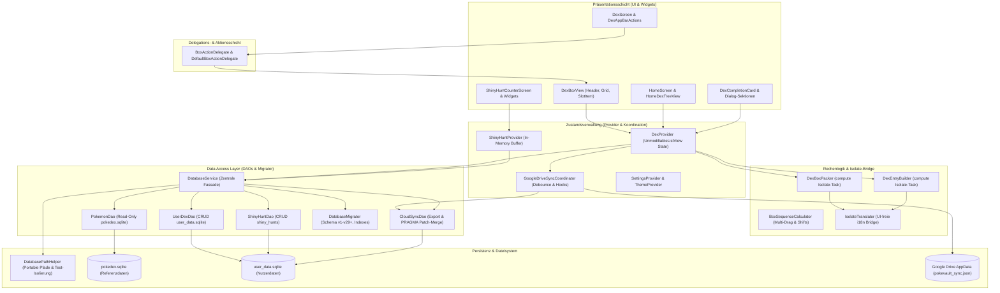

# PokéVault 아키텍처 및 시스템 문서

> **Languages / Sprachen:** [🇩🇪 Deutsch](ARCHITECTURE.de.md) | [🇬🇧 English](../ARCHITECTURE.md) | [🇫🇷 Français](ARCHITECTURE.fr.md) | [🇪🇸 Español](ARCHITECTURE.es.md) | [🇮🇹 Italiano](ARCHITECTURE.it.md) | [🇯🇵 日本語](ARCHITECTURE.ja.md) | **[🇰🇷 한국어](ARCHITECTURE.ko.md)** | [🇨🇳 简体中文](ARCHITECTURE.zh-hans.md) | [🇹🇼 繁體中文](ARCHITECTURE.zh-hant.md) | [🇵🇹 Português](ARCHITECTURE.pt.md) | [🇳🇱 Nederlands](ARCHITECTURE.nl.md) | [🇵🇱 Polski](ARCHITECTURE.pl.md) | [🇷🇺 Русский](ARCHITECTURE.ru.md)


이 문서에서는 **PokéVault**의 기술 아키텍처, 데이터 저장, 클라우드 동기화, 모듈화 및 코드 표준에 대해 설명합니다. 이는 개발자와 AI 보조자가 설계 결정 및 확장을 위한 참고 자료 역할을 합니다.

> [!TIP]
> **활성 로드맵 및 다음 릴리스(v1.7.0):**
> 다음 릴리스에 대한 전체 사양 및 구현 계획 **v1.7.0 "언어 확장"**(연결되지 않은 언어, 10개 프랜차이즈 언어, 로컬 REST 서버, 다중 에뮬레이터 검색, 데스크톱 OCR 및 모바일 PiP 스캐너)은 다음 위치에 있습니다. [docs/plans/v1_7_0_the_language_expansion.md](../docs/plans/v1_7_0_the_language_expansion.md).
> 대화형 프로토타입은 [docs/prototypes/v1_7_0_prototype.html](../docs/prototypes/v1_7_0_prototype.html)에서 사용할 수 있습니다.

---

## 1. 개요 및 기술 스택

PokéVault는 포켓몬 수집가(Living Dex, Forms, Shinies, Bands & Marks, Shiny Hunting)를 위한 크로스 플랫폼 동반자입니다.

- **프레임워크**: [Flutter 3.x](https://flutter.dev/) (Dart SDK `^3.12`)
- **대상 플랫폼**: Windows(데스크톱), Android, iOS, macOS, Linux, Web
- **상태 관리**: [공급자](https://pub.dev/packages/provider) (`DexProvider`, `SettingsProvider`, 엄격한 상태 캡슐화가 포함된 `ShinyHuntProvider`, `TutorialProvider`, `ThemeProvider`(`UnmodifyingListView`)
- **현지화(i18n) 및 다중 언어 코어(v1.7.0)**:
 - 유형이 안전한 UI 현지화를 위한 [속어](https://pub.dev/packages/slang)(13개 언어) 지원)
 - **앱 UI 언어**(`currentLanguage`) 및 **포켓몬 프랜차이즈 언어**(`pokemonLanguage`)의 완전한 분리
 - `lib/i18n/언어s.json` 및 코드 생성 `LanguageRegistry`(`lib/i18n/언어_registry.g.dart`)를 통한 동적 언어 등록
 - `pokedex.sqlite`에 9개의 프랜차이즈 언어 열(`name_<lang>`)이 있는 다중 언어 SQLite 스키마
 - MD5 캐싱, 토큰 마스킹, `locales/` 문서 동기화 및 속어 코드 생성을 갖춘 자동화된 다중 엔진 번역 파이프라인(`tool/translate_all.py`)
 - UI가 없는 백그라운드 격리를 위한 경량 브리지인 `IsolateTranslator` (`compute()`)
- **지속성 및 DAO 레이어**:
 - `sqflite`(Android/iOS) 및 `sqflite_common_ffi`(데스크톱) 또는 `sqflite_common_ffi_web`(웹)을 통한 SQLite
 - 집중된 데이터 액세스 객체로 모듈화됨: `PokemonDao`, `UserDexDao`, `ShinyHuntDao`, `CloudSyncDao` 및 `DatabaseMigrator`
 - 앱 설정 및 온보딩 상태에 대한 `shared_preferences`
- **클라우드 동기화**: 전용 `GoogleDriveSyncCoordinator`를 통해 조정되는 `googleapis` 및 `googleapis_auth`를 통한 Google Drive REST API v3(AppData 폴더)

---

## 2. 전체 아키텍처

다음 다이어그램은 PokéVault의 계층화된 아키텍처, 위임을 통한 UI 구성 요소 분리, 컴퓨팅 집약적인 Isolate 작업의 분리 및 모듈형 DAO 데이터베이스 계층을 시각화합니다.



---

## 3. 데이터베이스 아키텍처 및 DAO 모델(이중 SQLite)

PokéVault는 변경 불가능한 정적 프랜차이즈 데이터와 동적 사용자 데이터를 엄격하게 분리합니다.

```
┌─────────────────────────────────────────┐       ┌─────────────────────────────────────────┐
│             pokedex.sqlite              │       │            user_data.sqlite             │
│   (Read-Only Referenzdaten / PokemonDao)│       │  (Read-Write Nutzerdaten / UserDexDao)  │
├─────────────────────────────────────────┤       ├─────────────────────────────────────────┤
│ • pokemon (1025+ National Dex)          │       │ • user_dexes (Konfigurationen)          │
│ • forms (Mega, G-Max, Regional)         │       │ • folders (Ordnerhierarchie)            │
│ • encounters & dex_orders               │       │ • folder_structure (Relationen)         │
│ • pokemon_moves & abilities             │       │ • user_pokemon (Status/Shinies)         │
│ • ribbons, marks & catch_rates          │       │ • shiny_hunts (Zähler & Phasen)         │
│ • shiny_locks (502+ globale & lok. Locks│       │                                         │
└─────────────────────────────────────────┘       └─────────────────────────────────────────┘
```

### 3.1 데이터 액세스 객체(DAO)
이전의 모놀리식 `DatabaseService`는 이제 경량 파사드 역할을 하며 모든 작업을 특수 DAO에 위임합니다. 
- **`PokemonDao`**: `pokedex.sqlite`에 대한 모든 읽기 액세스를 처리합니다. 포켓몬, 공격, 리본, 공, 모양 및 빛나는 자물쇠에 대한 메모리 내 캐시를 캡슐화합니다.
- **`UserDexDao`**: 고아 레코드(고아 정리)를 포함하여 `user_data.sqlite`(`user_dexes`, `folders`, `folder_structure`, `user_pokemon`)에 있는 사용자 테이블의 모든 CRUD 작업을 담당합니다.
- **`ShinyHuntDao`**: 활성 및 보관된 Shiny 헌트, 헌트 단계 및 증분 카운트를 관리합니다.
- **`CloudSyncDao`**: 이전 버전과 앞으로 호환되는 데이터 동기화를 위해 동적 `PRAGMA table_info` 열 확인을 통해 `exportCloudSyncData()` 및 트랜잭션 `mergeCloudSyncData()`를 제공합니다.
- **`DatabaseMigrator`**: 스키마 마이그레이션을 캡슐화합니다. (v1 ~ v29+), 인덱스 생성(`ensureUserDataIndexes`, `ensureAppDatabaseIndexes`) 및 안전한 다운그레이드 루틴.

### 3.2 이식성 및 경로 확인(`DatabasePathHelper`)
리포지토리 정책에 따라 데이터베이스는 `database/` 하위 디렉터리에 이식 가능하게 위치하며 **절대로** Windows 문서 폴더:
- **개발 환경(데스크톱)**: `<project_root>/database/`(기존을 통해 감지됨) `pubspec.yaml`).
- **릴리스/휴대용 Exe(데스크톱)**: 실행 파일 바로 옆에 있는 `<exe_dir>/database/`.
- **읽기 전용 대체**: 디렉터리가 읽기 전용인 경우(예: `C:\Program Files`) 앱이 자동으로 `<application_support_dir>/database/`로 돌아갑니다.
- **레거시 마이그레이션**: 문서 폴더에 이전 데이터베이스가 있는 경우 `DatabasePathHelper. migrationLegacyDocumentsDatabasesIfNeeded()`는 이를 투명하게 마이그레이션하고 타임스탬프에서 충돌 해결을 확인하고 백업 복사본을 생성합니다(`.bak_<timestamp>`).
- **병렬 테스트 격리**: 자동화된 테스트 실행 중에 `DatabasePathHelper`는 다음을 수행하여 작업 디렉터리를 동적으로 격리합니다. 병렬 테스트 스위트에서 경쟁 조건을 제거하고 충돌을 잠그기 위한 프로세스 ID(`pokevault_test_dbs/proc_$pid`).

---

## 4. 상태 관리, 캡슐화 및 조정

### 4.1 `UnmodifyingListView`를 사용한 상태 캡슐화
`DexProvider`에서는 내부 상태(`_userDexes`, `_folders`)가 비공개로 보호됩니다. 공개 getter는 수정 불가능한 뷰(`UnmodifyingListView`)를 반환합니다. 변형은 항상 전용 비즈니스 메서드(`createUserDex`, `deleteFolder`, `updatePokemonStatus`)를 통해 수행되며, 이는 부작용과 제어되지 않는 메모리 내 상태 변경을 방지합니다.

### 4.2 `GoogleDriveSyncCoordinator`
클라우드 동기화는 `DexProvider`에서 독립적인 `GoogleDriveSyncCoordinator`로 아웃소싱됩니다.
- **디바운스된 업로드**: 시간 제어 디바운서를 통해 빠른 사용자 상호작용 중에 서버 과부하를 방지합니다.
- **정기적 동기화**: 다른 곳에서 업데이트를 확인하고 다운로드하기 위한 구성 가능한 간격 타이머 devices.
- **Lifecycle Flush**: 앱이 일시 중지되면(`AppLifecycleState.paused` / `inactive`) 저장되지 않은 변경 사항이 즉시 클라우드에 동기화됩니다.
- **투명 후크 체인**: 사전 및 사후 처리 후크(`registerBeforeUploadHook`, `registerCloudDataMergedHook`)는 네트워크 요청에서 상태 동기화를 분리합니다.

---

## 5. 계산 논리, 번들링 해제 및 보안 분리

컴퓨팅 집약적인 작업은 백그라운드 스레드(`compute()`)에 대해 모듈화되고 강화되었습니다.

1. **`DexBoxPacker`**:
 - 포켓몬 목록을 30PC 상자로 분할하는 계산합니다(`generateBoxesIsolateTask`).
 - 동적 상자 구성을 지원합니다(Kanto, Johto, Living Dex, Forms).
2. **`DexEntryBuilder`**:
 - 백그라운드 격리(`buildEntriesIsolateTask`)에서 `DexDisplayEntry` 모델을 생성합니다.
3. **`BoxSequenceCalculator`**:
 - 멀티 드래그, 슬롯 교체, 간격 닫기 및 크로스박스 이동을 위한 수학적 계산 기능.
4. **`IsolateTranslator`(i18n Bridge)**:
 - 배경 격리에는 Flutter UI 컨텍스트(`BuildContext`)가 없습니다. 'IsolateTranslator'는 UI 싱글톤에 액세스하지 않고도 영역, 모양 및 상자 제목에 대해 유형이 안전한 번역을 제공합니다.

---

## 6. UI 모듈화 및 상호작용 모델

사용자 인터페이스는 관리 가능한 모듈식 하위 위젯으로 구분됩니다.

### 6.1 `BoxActionDelegate` 및 `DexBoxView`
PC 상자 보기(`DexBoxView`)는 `BoxActionDelegate` 인터페이스를 통해 애플리케이션 로직에서 분리됩니다.
- `DexBoxHeader`: 탐색, 상자 제목 및 진행률 표시.
- `DexBoxGrid`: 반응형 6x5 그리드 자동 크기 조정.
- `DexBoxSlotItem`: 스프라이트, 유형 마커, 반짝이는 아이콘 및 드래그 앤 드롭 피드백이 포함된 단일 포켓몬 슬롯.

### 6.2 모듈형 대화 상자 및 화면
- **Dex 완료 카드**: `CardAppearanceSection`, `CardTogglesSection`, `CardActionsBar` 및 캔버스 렌더러(`CardPainterRenderer`, `CardPokemonMosaic`, `CardStatsSummary`)로 구분됩니다.
- **Shiny Hunt 모듈**: 구분됨 `HuntCounterControls`(대형 디스플레이, 버튼), `HuntOddsCard`(확률) 및 `HuntGameMethodSelector`(에디션 및 방법)로 들어갑니다.
- **홈 화면**: 드래그 앤 드롭 정렬로 `HomeDexTreeView`에서 분리된 탐색입니다.

---

## 7. 오프라인 데이터베이스 파이프라인(`tool/data_pipeline/`)

참조 데이터베이스 `assets/db/pokedex.sqlite`는 Python 모노레포 파이프라인을 통해 생성됩니다:
- **올인원 실행기**: `python tool/data_pipeline/run_pipeline.py`는 전체 체인(웹 스크래핑, 하위 모듈 업데이트, 데이터베이스 구성, 다국어 동기화, 진화 트리, 잠금 및 인덱스)을 자동으로 결정론적으로 실행합니다.
- **개별 파이프라인 단계**:
 1. `python update_data.py`: 현재 웹 덤프(Bulbapedia, Bisafans, PokéWiki), Legal Matching Pokéballs 테이블을 로드하고 PokeAPI 하위 모듈을 업데이트합니다.
 2. `python tool/data_pipeline/build_database.py`: 모든 소스를 집계하고 SQLite 데이터베이스를 구축합니다.
 3. `python tool/data_pipeline/update_pokemon_언어s.py`: PokeAPI 하위 모듈의 9개 공식 프랜차이즈 언어에 대한 다국어 종 이름을 `name_<lang>` 열로 동기화합니다.
 4. `python tool/data_pipeline/update_evolutions_db.py`: 원시 PokeAPI 데이터에서 구조화된 진화 트리를 추가합니다.
 5. `python tool/data_pipeline/update_cap_locks_and_trades.py`: 모자 피카츄, 코스프레 모양 및 거래에 빛나는 잠금 장치를 추가합니다.
 6. `python tool/data_pipeline/optimize_databases.py`: 커버링 인덱스를 생성하고 `ANALYZE` 및 `VACUUM`을 실행합니다.

자세한 개발자 지침은 [tool/data_pipeline/README.md](../tool/data_pipeline/locales/README.ko.md)에서 확인할 수 있습니다.

---

## 8. 다중 언어 및 번역 아키텍처(`tool/translate_all.py`)

PokéVault 릴리스 v1.7.0은 별도의 언어 관리 및 자동화된 현지화 파이프라인을 구현합니다.

### 8.1 분리된 언어 선택
- **UI 언어(`currentLanguage`)**: 모든 UI 요소, 대화 상자, 탐색 및 설정을 제어합니다(`slang`을 통해 13개 언어 지원).
- **포켓몬 언어(`pokemonLanguage`)**: UI 언어와 독립적으로 종 이름, 모양 및 밴드/문자를 제어합니다(예: 독일어 UI와 영어 또는 일본어 포켓몬 이름). 설정이 ``auto''인 경우 공식 프랜차이즈 이름이 있으면 UI 언어가 채택됩니다. 그렇지 않으면 영어 대체가 적용됩니다(`resolveEffectivePokemonLanguage`).

### 8.2 구성 및 코드 생성
- **`lib/i18n/언어s.json`**: ISO 코드, 이모티콘 플래그, 기본 이름, 프랜차이즈 상태(`isPokemonFranchise`) 및 속어 코드가 포함된 모든 언어의 중앙 JSON 구성 파일.
- **`LanguageRegistry`(`lib/i18n/언어_registry.g.dart`)**: 완전 자동으로 생성됨 `translate_all.py`의 `langs.json`에서; Flutter 위젯 및 공급자에 대한 유형 안전 목록과 조회 방법을 제공합니다.

### 8.3 자동 번역 파이프라인
- **다중 엔진 캐스케이드**: 선택적 DeepL API 지원(`DEEPL_API_KEY`)이 포함된 무료 번역 캐스케이드(Bing $\rightarrow$ Google $\rightarrow$ MyMemory).
- **토큰 및 복수형 보호**: 속어 매개변수 마스크(`{name}`, `{count}`), API 전송 전 ICU 복수 블록 및 줄바꿈(`\n`)을 처리하고 손실 없이 복원합니다.
- **MD5 캐싱 및 요청 일괄 처리**: 안티 포이즈닝 논리를 사용하여 `tool/.translation_cache.json`에 번역을 캐시하고 30.
- **`locales/` 문서 동기화 블록으로 새 문자열을 일괄 처리합니다.**: 마크다운 문서가 유지됩니다. `locales/` 하위 폴더에 깔끔하게 정리되어 있습니다. 내부 링크와 헤더 언어 전환기는 올바른 상대 깊이(`../`)로 동적으로 다시 작성됩니다. 양방향 동기화 및 자동 소스 언어 감지(`--source-lang auto`)를 지원합니다.

---

## 9. 품질 보증 및 무관용 품질 게이트

PokéVault는 엄격한 TDD(테스트 기반 개발) 및 자동화된 테스트를 통해 최고 품질 표준을 시행합니다.

- **자동화 테스트**: 단위, 위젯, 통합, 경계 및 적대적 챌린저 수트와 별도의 파이썬 단위 테스트(`test/tool/test_translation_pipeline.py`)를 포함한 **1,370개 이상의 테스트**(`flutter test`)에서 **100% 통과율** 달성.
- **정적 분석**: `flutter analyze`에서 **0개의 오류, 0개의 경고, 0개의 린트**.
- **크로스 플랫폼 내구성**: 극단적인 화면 크기(예: 320x480에서 4K까지), 제스처 중단 및 런타임 언어 전환 스트레스 테스트.
- **GitHub Actions CI**: 모든 커밋 및 풀 리퀘스트에서 완전 자동화된 CI 파이프라인 실행(`.github/workflows/ci.yml`).
