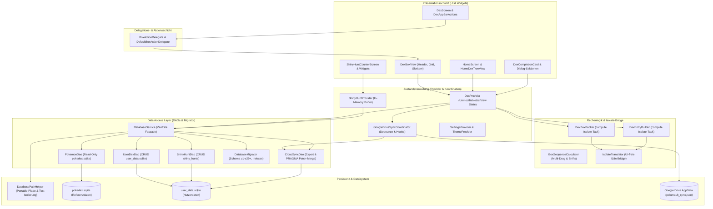

# PokéVault-architectuur en systeemdocumentatie

> **Languages / Sprachen:** [🇩🇪 Deutsch](ARCHITECTURE.de.md) | [🇬🇧 English](../ARCHITECTURE.md) | [🇫🇷 Français](ARCHITECTURE.fr.md) | [🇪🇸 Español](ARCHITECTURE.es.md) | [🇮🇹 Italiano](ARCHITECTURE.it.md) | [🇯🇵 日本語](ARCHITECTURE.ja.md) | [🇰🇷 한국어](ARCHITECTURE.ko.md) | [🇨🇳 简体中文](ARCHITECTURE.zh-hans.md) | [🇹🇼 繁體中文](ARCHITECTURE.zh-hant.md) | [🇵🇹 Português](ARCHITECTURE.pt.md) | **[🇳🇱 Nederlands](ARCHITECTURE.nl.md)** | [🇵🇱 Polski](ARCHITECTURE.pl.md) | [🇷🇺 Русский](ARCHITECTURE.ru.md)


Dit document beschrijft de technische architectuur, gegevensopslag, cloudsynchronisatie, modularisatie en codestandaarden van **PokéVault**. Het dient als referentie voor ontwikkelaars en AI-assistenten voor ontwerpbeslissingen en uitbreidingen.

> [!TIP]
> **Actieve Roadmap & Volgende Release (v1.7.0):**
> Het volledige specificatie- en implementatieplan voor de volgende release **v1.7.0 "The Language Expansion"** (Niet-verbonden Talen, 10 Franchise Talen, Lokale REST Server, Multi-Emulator Hunting, Desktop OCR & Mobile PiP Scanner) bevindt zich in [docs/plans/v1_7_0_the_language_expansion.md](../docs/plans/v1_7_0_the_language_expansion.md).
> Het interactieve prototype is beschikbaar op [docs/prototypes/v1_7_0_prototype.html](../docs/prototypes/v1_7_0_prototype.html).

---

## 1. Overzicht en technologiestapel

PokéVault is een platformonafhankelijke metgezel voor Pokémon-verzamelaars (Living Dex, Forms, Shinies, Bands & Marks, Shiny Hunting).

- **Framework**: [Flutter 3.x](https://flutter.dev/) (Dart SDK `^3.12`)
- **Doelplatforms**: Windows (Desktop), Android, iOS, macOS, Linux, Web
- **Statusbeheer**: [Provider](https://pub.dev/packages/provider) (`DexProvider`, `SettingsProvider`, `ShinyHuntProvider`, `TutorialProvider`, `ThemeProvider`) met strikte inkapseling van de status (`UnmodifiableListView`)
- **Lokalisatie (i18n) en meertalige kern (v1.7.0)**:
 - [jargon](https://pub.dev/packages/slang) voor typeveilige UI-lokalisatie (13 talen ondersteund)
 - Volledige ontkoppeling van **App UI Language** (`currentLanguage`) en **Pokémon Franchise Language** (`pokemonLanguage`)
 - Dynamische taalregistratie via `lib/i18n/linguals.json` en door code gegenereerde `LanguageRegistry` (`lib/i18n/lingual_registry.g.dart`)
 - Meertalig SQLite-schema met 9 franchisetaalkolommen (`name_<lang>`) in `pokedex.sqlite`
 - Geautomatiseerde multi-engine vertaalpijplijn (`tool/translate_all.py`) met MD5-caching, tokenmaskering, `locales/` documentsynchronisatie en jargoncode generatie
 - `IsolateTranslator` als een lichtgewicht brug voor UI-vrije achtergrondisolaten (`compute()`)
- **Persistentie- en DAO-laag**:
 - SQLite via `sqflite` (Android/iOS) en `sqflite_common_ffi` (desktop) of `sqflite_common_ffi_web` (web)
 - Gemoduleerd in gerichte objecten voor gegevenstoegang: `PokemonDao`, `UserDexDao`, `ShinyHuntDao`, `CloudSyncDao` en `DatabaseMigrator`
 - `shared_preferences` voor app-instellingen en onboarding-statussen
- **Cloudsynchronisatie**: Google Drive REST API v3 (AppData Folder) via `googleapis` & `googleapis_auth`, gecoördineerd via de speciale `GoogleDriveSyncCoordinator`

---

## 2. Algemene architectuur

Het volgende diagram visualiseert de gelaagde architectuur van PokéVault, de scheiding van UI-componenten via afgevaardigden, de ontkoppeling van rekenintensieve Isolate-taken en de modulaire DAO-databaselaag:



---

## 3. Databasearchitectuur en DAO-model (Dual-SQLite)

PokéVault maakt een strikte scheiding tussen onveranderlijke statische franchisegegevens en dynamische gebruikersgegevens:

```
┌─────────────────────────────────────────┐       ┌─────────────────────────────────────────┐
│             pokedex.sqlite              │       │            user_data.sqlite             │
│   (Read-Only Referenzdaten / PokemonDao)│       │  (Read-Write Nutzerdaten / UserDexDao)  │
├─────────────────────────────────────────┤       ├─────────────────────────────────────────┤
│ • pokemon (1025+ National Dex)          │       │ • user_dexes (Konfigurationen)          │
│ • forms (Mega, G-Max, Regional)         │       │ • folders (Ordnerhierarchie)            │
│ • encounters & dex_orders               │       │ • folder_structure (Relationen)         │
│ • pokemon_moves & abilities             │       │ • user_pokemon (Status/Shinies)         │
│ • ribbons, marks & catch_rates          │       │ • shiny_hunts (Zähler & Phasen)         │
│ • shiny_locks (502+ globale & lok. Locks│       │                                         │
└─────────────────────────────────────────┘       └─────────────────────────────────────────┘
```

### 3.1 De Data Access Objects (DAO's)
De voormalige monolithische `DatabaseService` fungeert nu als een lichtgewicht gevel en delegeert alle bewerkingen aan gespecialiseerde DAO's:
- **`PokemonDao`**: handelt alle leestoegang tot `pokedex.sqlite` af. Bevat caches in het geheugen voor Pokémon, aanvallen, linten, ballen, vormen en glimmende sloten.
- **`UserDexDao`**: verantwoordelijk voor alle CRUD-bewerkingen van de gebruikerstabellen in `user_data.sqlite` (`user_dexes`, `folders`, `folder_structure`, `user_pokemon`), inclusief verweesde records (weesopruiming).
- **`ShinyHuntDao`**: Beheert actieve en gearchiveerde glanzende jachten, jachtfasen en incrementele tellingen.
- **`CloudSyncDao`**: Biedt `exportCloudSyncData()` en transactionele `mergeCloudSyncData()` met dynamische `PRAGMA table_info` kolomcontrole voor achterwaarts en voorwaarts compatibele gegevenssynchronisatie.
- **`DatabaseMigrator`**: omvat schemamigraties (v1 tot v29+), het maken van indexen (`ensureUserDataIndexes`, `ensureAppDatabaseIndexes`) en veilige downgraderoutines.

### 3.2 Portabiliteit en padresolutie (`DatabasePathHelper`)
Volgens het repositorybeleid bevinden databases zich in de submap `database/`, **nooit** in de map Windows Documenten:
- **Ontwikkelomgeving (desktop)**: `<project_root>/database/` (gedetecteerd via bestaande `pubspec.yaml`).
- **Release / Portable Exe (Desktop)**: `<exe_dir>/database/` direct naast het uitvoerbare bestand.
- **Read-Only Fallback**: Als de map alleen-lezen is (bijvoorbeeld `C:\Program Files`), valt de app automatisch `<application_support_dir>/database/` back.
- **Legacy Migratie**: Als er oudere databases in de documentenmap bestaan, migreert `DatabasePathHelper.migrateLegacyDocumentsDatabasesIfNeeded()` deze transparant, controleert tijdstempels op conflictoplossingen en maakt back-upkopieën (`.bak_<timestamp>`).
- **Parallelle testisolatie**: tijdens geautomatiseerde testuitvoeringen, `DatabasePathHelper` isoleert dynamisch werkmappen op proces-ID (`pokevault_test_dbs/proc_$pid`) om racecondities te elimineren en botsingen in parallelle testsuites te vergrendelen.

---

## 4. Staatsbeheer, inkapseling en coördinatie

### 4.1 Inkapseling van statussen met `UnmodifiableListView`
In `DexProvider` zijn interne statussen (`_userDexes`, `_folders`) privé beveiligd. Publieke getters retourneren niet-wijzigbare weergaven (`UnmodifiableListView`). Mutaties worden altijd uitgevoerd via speciale bedrijfsmethoden (`createUserDex`, `deleteFolder`, `updatePokemonStatus`), die bijwerkingen en ongecontroleerde veranderingen in de geheugenstatus voorkomen.

### 4.2 `GoogleDriveSyncCoordinator`
De cloudsynchronisatie wordt uitbesteed van de `DexProvider` naar de onafhankelijke `GoogleDriveSyncCoordinator`:
- **Debounced Upload**: Voorkomt serveroverbelasting tijdens snelle gebruikersinteracties via een tijdgestuurde debouncer.
- **Periodische synchronisatie**: Configureerbare intervaltimer voor controle en updates downloaden van andere apparaten.
- **Lifecycle Flush**: Wanneer de app wordt gepauzeerd (`AppLifecycleState.paused` / `inactive`), worden niet-opgeslagen wijzigingen onmiddellijk gesynchroniseerd naar de cloud.
- **Transparante hook chain**: Hooks voor en na verwerking (`registerBeforeUploadHook`, `registerCloudDataMergedHook`) ontkoppelen statussynchronisatie van netwerkverzoeken.

---

## 5. Computationele logica, ontbundeling en isolatie van beveiliging

Rekenintensieve bewerkingen zijn gemodulariseerd en versterkt voor achtergrondthreads (`compute()`):

1. **`DexBoxPacker`**:
 - Berekent de verdeling van Pokémon-lijsten in dozen van 30 pc's (`generateBoxesIsolateTask`).
 - Ondersteunt dynamische boxconfiguraties (Kanto, Johto, Living Dex, Forms).
2. **`DexEntryBuilder`**:
 - Genereert `DexDisplayEntry`-modellen in achtergrondisolaten (`buildEntriesIsolateTask`).
3. **`BoxSequenceCalculator`**:
 - Wiskundige berekeningsfuncties voor multi-drag, slot swaps, gap close en cross-box moves.
4. **`IsolateTranslator` (i18n Bridge)**:
 - Achtergrondisolaten hebben geen Flutter UI-context (`BuildContext`). `IsolateTranslator` biedt typeveilige vertalingen voor regio's, vormen en boxtitels zonder toegang tot UI-singletons.

---

## 6. UI-modularisatie en interactiemodel

De gebruikersinterface is onderverdeeld in beheersbare, modulaire subwidgets:

### 6.1 `BoxActionDelegate` & `DexBoxView`
De pc-boxweergave (`DexBoxView`) wordt losgekoppeld van de applicatielogica via de `BoxActionDelegate`-interface:
- `DexBoxHeader`: navigatie, boxtitel en voortgangsweergave.
- `DexBoxGrid`: responsief 6x5-raster met auto-sizing.
- `DexBoxSlotItem`: Slot voor één Pokémon met sprites, typemarkeringen, glanzende pictogrammen en feedback via slepen en neerzetten.

### 6.2 Modulaire dialogen en schermen
- **Dex Completion Cards**: Verdeeld in `CardAppearanceSection`, `CardTogglesSection`, `CardActionsBar` en canvas renderer (`CardPainterRenderer`, `CardPokemonMosaic`, `CardStatsSummary`).
- **Shiny Hunt Module**: Verdeeld in `HuntCounterControls` (groot display, knoppen), `HuntOddsCard` (kansen) en `HuntGameMethodSelector` (editie en methode).
- **Startscherm**: navigatie gescheiden van `HomeDexTreeView` met sorteren via slepen en neerzetten.

---

## 7. Offline databasepijplijn (`tool/data_pipeline/`)

De referentiedatabase `assets/db/pokedex.sqlite` wordt gegenereerd via een Python monorepo-pijplijn:
- **All-in-One Runner**: `python tool/data_pipeline/run_pipeline.py` voert de hele keten (webscraping, submodule-updates, databaseconstructie, meertalige synchronisatie, evolutiebomen, vergrendelingen en indices) automatisch en deterministisch uit vanaf.
- **Individuele pijplijnstappen**:
 1. `python update_data.py`: Laadt huidige webdumps (Bulbapedia, Bisafans, PokéWiki), de Legal Matching Pokéballs-tabel en werkt de PokeAPI-submodule bij.
 2. `python tool/data_pipeline/build_database.py`: Aggregaat alle bronnen en bouwt de SQLite database.
 3. `python tool/data_pipeline/update_pokemon_linguals.py`: Synchroniseert meertalige soortnamen voor alle 10 officiële franchisetalen uit de PokeAPI-submodule in `name_<lang>` kolommen.
 4. `python tool/data_pipeline/update_evolutions_db.py`: Voegt gestructureerde evolutiebomen toe uit de onbewerkte versie PokeAPI data.
 5. `python tool/data_pipeline/update_cap_locks_and_trades.py`: Voegt glimmende sloten toe voor cap Pikachu, cosplayvormen en transacties.
 6. `python tool/data_pipeline/optimize_databases.py`: Creëert dekkingsindexen, voert `ANALYZE` en `VACUUM` uit.

Gedetailleerde ontwikkelaarsinstructies zijn te vinden in [tool/data_pipeline/README.md](../tool/data_pipeline/locales/README.nl.md).

---

## 8. Meertalige en vertaalarchitectuur (`tool/translate_all.py`)

PokéVault Release v1.7.0 implementeert afzonderlijk taalbeheer en een geautomatiseerde lokalisatiepijplijn:

### 8.1 Ontkoppelde taalselectie
- **UI-taal (`currentLanguage`)**: Beheert alle UI-elementen, dialogen, navigatie en instellingen (ondersteunt 13 talen via `jargon`).
- **Pokémon-taal (`pokemonLanguage`)**: Beheert soortnamen, vormen en banden/tekens onafhankelijk van de UI-taal (bijv. Duitse UI met Engels of Japanse Pokémon-namen). Als de instelling ``auto'` is, wordt de taal van de gebruikersinterface overgenomen als er officiële franchisenamen bestaan; anders wordt de Engelse fallback van kracht (`resolveEffectivePokemonLanguage`).

### 8.2 Configuratie en code genereren
- **`lib/i18n/linguals.json`**: Centraal JSON-configuratiebestand van alle talen met ISO-code, emoji-vlag, native naam, franchisestatus (`isPokemonFranchise`) en slangcode.
- **`LanguageRegistry` (`lib/i18n/lingual_registry.g.dart`)**: volledig automatisch gegenereerd van `talen.json` door `translate_all.py`; biedt typeveilige lijsten en opzoekmethoden voor Flutter-widgets en providers.

### 8.3 Geautomatiseerde vertaalpijplijn
- **Multi-Engine Cascade**: Gratis vertaalcascade (Bing $\rightarrow$ Google $\rightarrow$ MyMemory) met optionele DeepL API-ondersteuning (`DEEPL_API_KEY`).
- **Token- en meervoudige bescherming**: Maskert jargonparameters (`{name}`, `{count}`), ICU meervoudige blokken en nieuwe regels (`\n`) vóór API-verzending en herstelt ze zonder verlies.
- **MD5 Caching & Request Batching**: Cache vertalingen in `tool/.translation_cache.json` met anti-vergiftigingslogica en batches nieuwe strings in blokken van 30.
- **`locales/` documentsynchronisatie**: Markdown documentatie wordt netjes bewaard in de submappen `locales/`; interne links en de header-taalwisselaar worden dynamisch herschreven met de juiste relatieve diepte (`../`). Ondersteunt bidirectionele synchronisatie en automatische brontaaldetectie (`--source-lang auto`).

---

## 9. Kwaliteitsborging en nultolerantie-kwaliteitspoort

PokéVault handhaaft de hoogste kwaliteitsnormen door middel van strikte Test-Driven Development (TDD) en geautomatiseerd testen:

- **Geautomatiseerde tests**: Meer dan **1.370 tests** (`flutter test`) met een **100% slaagpercentage** via unit-, widget-, integratie-, grens- en adversarial-challenger-suites, evenals zelfstandige Python-unit-tests (`test/tool/test_translation_pipeline.py`).
- **Statische analyse**: `flutter analyze` met **0 fouten, 0 waarschuwingen en 0 lints**.
- **Cross-platform veerkracht**: stresstests voor extreme schermformaten (bijv. 320x480 tot 4K), gebaaronderbreking en spraakwissel tijdens runtime.
- **GitHub Actions CI**: Volledig geautomatiseerde CI-pijplijn bij elke commit en pull request (`.github/workflows/ci.yml`).
