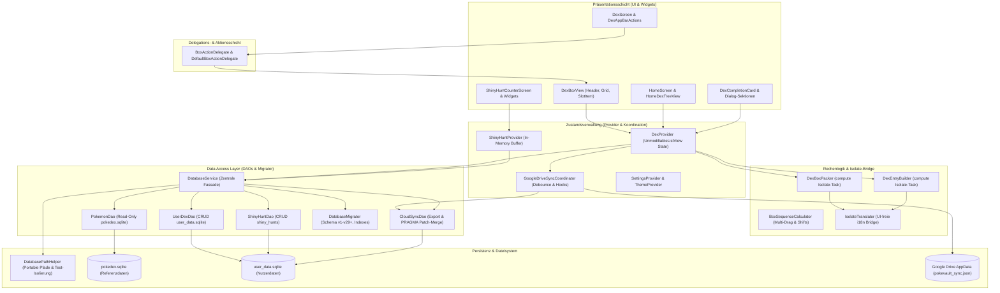

# Dokumentacja architektury i systemu PokéVault

> **Languages / Sprachen:** [🇩🇪 Deutsch](ARCHITECTURE.de.md) | [🇬🇧 English](../ARCHITECTURE.md) | [🇫🇷 Français](ARCHITECTURE.fr.md) | [🇪🇸 Español](ARCHITECTURE.es.md) | [🇮🇹 Italiano](ARCHITECTURE.it.md) | [🇯🇵 日本語](ARCHITECTURE.ja.md) | [🇰🇷 한국어](ARCHITECTURE.ko.md) | [🇨🇳 简体中文](ARCHITECTURE.zh-hans.md) | [🇹🇼 繁體中文](ARCHITECTURE.zh-hant.md) | [🇵🇹 Português](ARCHITECTURE.pt.md) | [🇳🇱 Nederlands](ARCHITECTURE.nl.md) | **[🇵🇱 Polski](ARCHITECTURE.pl.md)** | [🇷🇺 Русский](ARCHITECTURE.ru.md)


Ten dokument opisuje architekturę techniczną, przechowywanie danych, synchronizację w chmurze, modularyzację i standardy kodowania **PokéVault**. Służy jako punkt odniesienia dla programistów i asystentów AI przy podejmowaniu decyzji projektowych i rozszerzeniach.

> [!TIP]
> **Aktywny plan działania i następna wersja (v1.7.0):**
> Pełna specyfikacja i plan wdrożenia dla następnej wersji **v1.7.0 „Rozszerzenie języka”** (rozłączone języki, 10 języków franczyzowych, lokalny serwer REST, wyszukiwanie wielu emulatorów, stacjonarny OCR i mobilny skaner PiP) znajduje się w [docs/plans/v1_7_0_the_language_expansion.md](../docs/plans/v1_7_0_the_language_expansion.md).
> Interaktywny prototyp jest dostępny pod adresem [docs/prototypes/v1_7_0_prototype.html](../docs/prototypes/v1_7_0_prototype.html).

---

## 1. Przegląd i stos technologii

PokéVault to wieloplatformowy towarzysz dla kolekcjonerów Pokémonów (Living Dex, Forms, Shinies, Bands & Marks, Shiny Hunting).

- **Framework**: [Flutter 3.x](https://flutter.dev/) (Dart SDK `^3.12`)
- **Platformy docelowe**: Windows (komputer stacjonarny), Android, iOS, macOS, Linux, Web
- **Zarządzanie stanem**: [Dostawca](https://pub.dev/packages/provider) (`DexProvider`, `SettingsProvider`, `ShinyHuntProvider`, `TutorialProvider`, `ThemeProvider`) ze ścisłą enkapsulacją stanu (`UnmodifyingListView`)
- **Lokalizacja (i18n) i rdzeń wielojęzyczny (v1.7.0)**:
 - [slang](https://pub.dev/packages/slang) dla bezpiecznej lokalizacji interfejsu użytkownika (obsługiwane 13 języków)
 - Całkowite oddzielenie **języka interfejsu aplikacji** (`currentLanguage`) i **języka franczyzy Pokémon** (`pokemonLanguage`)
 - dynamiczna rejestracja języka poprzez `lib/i18n/languages.json` i wygenerowany kodowo `LanguageRegistry` (`lib/i18n/language_registry.g.dart`)
 - Wielojęzyczny schemat SQLite z 9 kolumnami języka franczyzowego (`name_<lang>`) w `pokedex.sqlite`
 - Zautomatyzowany potok tłumaczeń wielosilnikowych (`tool/translate_all.py`) z Buforowanie MD5, maskowanie tokenów, synchronizacja dokumentów `locales/` i generowanie kodu slangowego
 - `IsolateTranslator` jako lekki most dla izolacji tła bez interfejsu użytkownika (`compute()`)
- **Trwałość i warstwa DAO**:
 - SQLite przez `sqflite` (Android/iOS) i `sqflite_common_ffi` (komputer stacjonarny) lub `sqflite_common_ffi_web` (internet)
 - Zmodularyzowane w skupione obiekty dostępu do danych: `PokemonDao`, `UserDexDao`, `ShinyHuntDao`, `CloudSyncDao` i `DatabaseMigrator`
 - `shared_preferences` dla ustawień aplikacji i stanów dołączania 
- **Synchronizacja z chmurą**: Google Drive REST API v3 (AppData Folder) przez `googleapis` i `googleapis_auth`, koordynowane przez dedykowanego `GoogleDriveSyncCoordinator`

---

## 2. Ogólna architektura

Poniższy diagram ilustruje warstwową architekturę PokéVault, separację komponentów interfejsu użytkownika za pośrednictwem delegatów, oddzielenie zadań izolujących wymagających dużej mocy obliczeniowej oraz modułową warstwę bazy danych DAO:



---

## 3. Architektura bazy danych i model DAO (Dual-SQLite)

PokéVault ściśle oddziela niezmienne, statyczne dane franczyzowe i dynamiczne dane użytkownika:

```
┌─────────────────────────────────────────┐       ┌─────────────────────────────────────────┐
│             pokedex.sqlite              │       │            user_data.sqlite             │
│   (Read-Only Referenzdaten / PokemonDao)│       │  (Read-Write Nutzerdaten / UserDexDao)  │
├─────────────────────────────────────────┤       ├─────────────────────────────────────────┤
│ • pokemon (1025+ National Dex)          │       │ • user_dexes (Konfigurationen)          │
│ • forms (Mega, G-Max, Regional)         │       │ • folders (Ordnerhierarchie)            │
│ • encounters & dex_orders               │       │ • folder_structure (Relationen)         │
│ • pokemon_moves & abilities             │       │ • user_pokemon (Status/Shinies)         │
│ • ribbons, marks & catch_rates          │       │ • shiny_hunts (Zähler & Phasen)         │
│ • shiny_locks (502+ globale & lok. Locks│       │                                         │
└─────────────────────────────────────────┘       └─────────────────────────────────────────┘
```

### 3.1 Obiekty dostępu do danych (DAO)
Poprzedni monolityczny `DatabaseService` działa teraz jako lekka fasada i deleguje wszystkie operacje do wyspecjalizowanych DAO:
- **`PokemonDao`**: Obsługuje cały dostęp do odczytu do `pokedex.sqlite`. Hermetyzuje pamięci podręczne w pamięci dla Pokémonów, ataków, wstążek, kulek, kształtów i błyszczących zamków.
- **`UserDexDao`**: Odpowiedzialny za wszystkie operacje CRUD na tabelach użytkowników w `user_data.sqlite` (`user_dexes`, `folders`, `folder_structure`, `user_pokemon`), w tym osierocone rekordy (Orphan cleanup).
- **`ShinyHuntDao`**: Zarządza aktywnymi i zarchiwizowanymi, błyszczącymi wyszukiwaniami, fazami wyszukiwania i przyrostowymi liczbami.
- **`CloudSyncDao`**: Zapewnia `exportCloudSyncData()` i transakcyjne `mergeCloudSyncData()` z dynamicznym sprawdzaniem kolumny `PRAGMA table_info` pod kątem zgodności wstecz i do przodu synchronization.
- **`DatabaseMigrator`**: Hermetyzuje migracje schematów (v1 do v29+), tworzenie indeksów (`ensureUserDataIndexes`, `ensureAppDatabaseIndexes`) i procedury bezpiecznego obniżania wersji.

### 3.2 Przenośność i rozpoznawanie ścieżek (`DatabasePathHelper`)
Zgodnie z polityką repozytorium, bazy danych są przenośnie zlokalizowane w podkatalogu `database/`, **nigdy** w folderze Dokumenty Windows:
- **Środowisko programistyczne (pulpit)**: `<project_root>/database/` (wykryte przez istniejące `pubspec.yaml`).
- **Release / Portable Exe (Desktop)**: `<exe_dir>/database/` tuż obok pliku wykonywalnego.
- **Read-Only Fallback**: Jeśli katalog jest tylko do odczytu (np. `C:\Program Files`), aplikacja zostanie automatycznie usunięta `<application_support_dir>/database/` back.
- **Migracja starszych wersji**: Jeśli w folderze dokumentów znajdują się starsze bazy danych, `DatabasePathHelper.migrateLegacyDocumentsDatabasesIfNeeded()` migruje je w sposób przezroczysty, sprawdza znaczniki czasu pod kątem rozwiązywania konfliktów i tworzy kopie zapasowe (`.bak_<timestamp>`).
- **Izolacja testu równoległego**: Podczas automatycznych testów `DatabasePathHelper` dynamicznie izoluje katalogi robocze według identyfikatora procesu (`pokevault_test_dbs/proc_$pid`), aby wyeliminować warunki wyścigu i zablokować kolizje w równoległych zestawach testów.

---

## 4. Zarządzanie stanem, hermetyzacja i koordynacja

### 4.1 Hermetyzacja stanu za pomocą `UnmodifyingListView`
W `DexProvider` stany wewnętrzne (`_userDexes`, `_folders`) są chronione prywatnie. Publiczne moduły pobierające zwracają widoki, których nie można modyfikować („UnmodifyingListView”). Mutacje zawsze wykonywane są poprzez dedykowane metody biznesowe (`createUserDex`, `deleteFolder`, `updatePokemonStatus`), co zapobiega efektom ubocznym i niekontrolowanym zmianom stanu w pamięci.

### 4.2 `GoogleDriveSyncCoordinator`
Synchronizacja w chmurze jest zlecana przez `DexProvider` niezależnemu `GoogleDriveSyncCoordinator`:
- **Odrzucone przesyłanie**: Zapobiega przeciążeniu serwera podczas szybkich interakcji użytkownika poprzez kontrolowany czasowo debouncer.
- **Okresowa synchronizacja**: Konfigurowalny timer interwałowy do sprawdzania i pobierania aktualizacji z innych urządzeń.
- **Lifecycle Flush**: Gdy aplikacja jest wstrzymana („AppLifecycleState.paused` / `inactive`), niezapisane zmiany są natychmiast synchronizowane z chmurą.
- **Przezroczysty łańcuch haków**: Haki przed i po przetwarzaniu (`registerBeforeUploadHook`, `registerCloudDataMergedHook`) oddziela synchronizację stanu od żądań sieciowych.

---

## 5. Logika obliczeniowa, rozdzielanie i izolowanie zabezpieczeń

Operacje wymagające dużej mocy obliczeniowej są modułowe i wzmocnione pod kątem wątków w tle („compute()”):

1. **`DexBoxPacker`**:
 - Oblicza podział list Pokémon na pudełka na 30 komputerów (`generateBoxesIsolateTask`).
 - Obsługuje dynamiczne konfiguracje skrzynek (Kanto, Johto, Living Dex, Forms).
2. **`DexEntryBuilder`**:
 - Generuje modele `DexDisplayEntry` w izolatach tła (`buildEntriesIsolateTask`).
3. **`BoxSequenceCalculator`**:
 - Funkcje obliczeń matematycznych dla przeciągania wielokrotnego, zamiany gniazd, zamykania przerw i przenoszenia między polami.
4. **`IsolateTranslator` (most i18n)**:
 - Izolaty w tle nie mają kontekstu interfejsu Flutter (`BuildContext`). `IsolateTranslator` zapewnia bezpieczne dla typu tłumaczenia regionów, kształtów i tytułów pudełek bez konieczności uzyskiwania dostępu do singletonów interfejsu użytkownika.

---

## 6. Modularyzacja interfejsu użytkownika i model interakcji

Interfejs użytkownika jest podzielony na łatwe w zarządzaniu, modułowe podwidżety:

### 6.1 `BoxActionDelegate` & `DexBoxView`
Widok komputera PC (`DexBoxView`) jest oddzielony od logiki aplikacji poprzez interfejs `BoxActionDelegate`:
- `DexBoxHeader`: nawigacja, tytuł pudełka i wyświetlanie postępu.
- `DexBoxGrid`: Responsywna siatka 6x5 z automatycznym dopasowywaniem rozmiaru.
- `DexBoxSlotItem`: Pojedynczy automat Pokémon ze sprite'ami, znacznikami typu, błyszczącymi ikonami i funkcją „przeciągnij i upuść”.

### 6.2 Modułowe okna dialogowe i ekrany
- **Karty ukończenia Dex**: Podzielone na `CardAppearanceSection`, `CardTogglesSection`, `CardActionsBar` i moduł renderujący płótno (`CardPainterRenderer`, `CardPokemonMosaic`, `CardStatsSummary`).
- **Moduł Shiny Hunt**: Podzielony na `HuntCounterControls` (duży wyświetlacz, przyciski), `HuntOddsCard` (prawdopodobieństwa) i `HuntGameMethodSelector` (edycja i metoda).
- **Ekran główny**: Nawigacja oddzielona od `HomeDexTreeView` z sortowaniem metodą „przeciągnij i upuść”.

---

## 7. Potok bazy danych offline (`tool/data_pipeline/`)

Referencyjna baza danych `assets/db/pokedex.sqlite` jest generowana poprzez potok monorepo Pythona:
- **All-in-One Runner**: `python Tool/data_pipeline/run_pipeline.py` uruchamia cały łańcuch (przeszukiwanie sieci, aktualizacje submodułów, tworzenie baz danych, synchronizacja wielu języków, drzewa ewolucji, blokady i indeksy) automatycznie i deterministycznie from.
- **Poszczególne kroki potoku**:
 1. `python update_data.py`: Ładuje aktualne zrzuty internetowe (Bulbapedia, Bisafans, PokéWiki), tabelę Legal Matching Pokéballs i aktualizuje podmoduł PokeAPI.
 2. `python Tool/data_pipeline/build_database.py`: Agreguje wszystkie źródła i buduje bazę danych SQLite.
 3. `python Tool/data_pipeline/update_pokemon_languages.py`: Synchronizuje wielojęzyczne nazwy gatunków dla wszystkich 9 oficjalnych języków franczyzowych z podmodułu PokeAPI w kolumnach `name_<lang>`.
 4. `python Tool/data_pipeline/update_evolutions_db.py`: Dodaje uporządkowane drzewa ewolucji z surowych danych PokeAPI.
 5. `python Tool/data_pipeline/update_cap_locks_and_trades.py`: Dodaje błyszczące zamki dla czapki Pikachu, kształtów cosplay i transakcji.
 6. `python Tool/data_pipeline/optimize_databases.py`: Tworzy indeksy pokrywające, uruchamia `ANALYZE` i `VACUUM`.

Szczegółowe instrukcje dla programistów można znaleźć w [tool/data_pipeline/README.md](../tool/data_pipeline/locales/README.pl.md).

---

## 8. Architektura wielojęzyczna i tłumaczeniowa (`tool/translate_all.py`)

PokéVault Release v1.7.0 implementuje oddzielne zarządzanie językami i zautomatyzowany potok lokalizacji:

### 8.1 Oddzielny wybór języka
- **Język interfejsu użytkownika („currentLanguage”)**: Kontroluje wszystkie elementy interfejsu użytkownika, okna dialogowe, nawigację i ustawienia (obsługuje 13 języków poprzez „slang”).
- **Język Pokémon („pokemonLanguage”)**: Kontroluje nazwy gatunków, kształty i pasma/znaki niezależnie od języka interfejsu użytkownika (np. niemiecki interfejs użytkownika z angielskimi lub japońskimi nazwami Pokémonów). Jeśli ustawienie to „auto”, język interfejsu użytkownika zostanie przyjęty, jeśli istnieją oficjalne nazwy franczyzowe; w przeciwnym razie zacznie obowiązywać angielskie rozwiązanie zastępcze („resolveEffectivePokemonLanguage”).

### 8.2 Konfiguracja i generowanie kodu
- **`lib/i18n/languages.json`**: Centralny plik konfiguracyjny JSON dla wszystkich języków z kodem ISO, flagą emoji, nazwą natywną, statusem franczyzy („isPokemonFranchise`) i kodem slangu.
- **`LanguageRegistry` (`lib/i18n/language_registry.g.dart`)**: Wygenerowane w pełni automatycznie z `languages.json` przez `translate_all.py`; udostępnia bezpieczne listy i metody wyszukiwania widżetów i dostawców Flutter.

### 8.3 Zautomatyzowany potok tłumaczeń
- **Kaskada wielosilnikowa**: Darmowa kaskada tłumaczeń (Bing $\rightarrow$ Google $\rightarrow$ MyMemory) z opcjonalną obsługą API DeepL (`DEEPL_API_KEY`).
- **Ochrona tokenów i liczby mnogiej**: Parametry slangu maski (`{name}`, `{count}`), liczba mnoga bloków ICU i znaków nowej linii (`\n`) przed transmisją API i przywraca je bez strat.
- **Buforowanie MD5 i grupowanie żądań**: Buforuje tłumaczenia w `tool/.translation_cache.json` z logiką zapobiegającą zatruciom i grupuje nowe ciągi w blokach 30.
- **`locales/` synchronizacja dokumentów**: Dokumentacja Markdown jest starannie przechowywana w podfolderach `locales/`; linki wewnętrzne i przełącznik języka nagłówka są dynamicznie przepisywane z odpowiednią względną głębokością (`../`). Obsługuje dwukierunkową synchronizację i automatyczne wykrywanie języka źródłowego (`--source-lang auto`).

---

## 9. Zapewnienie jakości i bramka jakości o zerowej tolerancji

PokéVault egzekwuje najwyższe standardy jakości poprzez rygorystyczny rozwój oparty na testach (TDD) i testy automatyczne:

- **Testy zautomatyzowane**: Ponad **1.370 testów** (`flutter test`) z **100% wskaźnikiem zdawalności** obejmujących jednostkowe, widgetowe, integracyjne, graniczne i przeciwnikowe zestawy testów oraz niezależne testy jednostkowe Pythona (`test/tool/test_translation_pipeline.py`).
- **Analiza statyczna**: `flutter analyze` z **0 błędami, 0 ostrzeżeniami i 0 lintami**.
- **Odporność cross-platformowa**: Testy obciążeniowe dla ekstremalnych rozmiarów ekranów (np. 320x480 do 4K), przerywanie gestów i zmiana języka w czasie działania.
- **GitHub Actions CI**: W pełni zautomatyzowana pipeline CI przy każdym commicie i pull requeście (`.github/workflows/ci.yml`).
