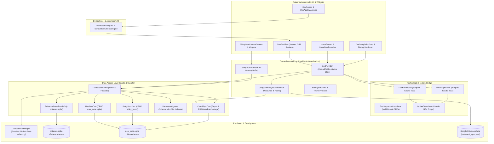

# Arquitetura PokéVault e documentação do sistema

> **Languages / Sprachen:** [🇩🇪 Deutsch](ARCHITECTURE.de.md) | [🇬🇧 English](../ARCHITECTURE.md) | [🇫🇷 Français](ARCHITECTURE.fr.md) | [🇪🇸 Español](ARCHITECTURE.es.md) | [🇮🇹 Italiano](ARCHITECTURE.it.md) | [🇯🇵 日本語](ARCHITECTURE.ja.md) | [🇰🇷 한국어](ARCHITECTURE.ko.md) | [🇨🇳 简体中文](ARCHITECTURE.zh-hans.md) | [🇹🇼 繁體中文](ARCHITECTURE.zh-hant.md) | **[🇵🇹 Português](ARCHITECTURE.pt.md)** | [🇳🇱 Nederlands](ARCHITECTURE.nl.md) | [🇵🇱 Polski](ARCHITECTURE.pl.md) | [🇷🇺 Русский](ARCHITECTURE.ru.md)


Este documento descreve a arquitetura técnica, armazenamento de dados, sincronização em nuvem, modularização e padrões de código do **PokéVault**. Ele serve como referência para desenvolvedores e assistentes de IA para decisões de design e extensões.

> [!TIP]
> **Roteiro ativo e próximo lançamento (v1.7.0):**
> A especificação completa e o plano de implementação para o próximo lançamento **v1.7.0 "The Language Expansion"** (Idiomas desconectados, 10 idiomas de franquia, servidor REST local, busca de vários emuladores, OCR de desktop e scanner PiP móvel) está localizado em [docs/plans/v1_7_0_the_language_expansion.md](../docs/plans/v1_7_0_the_language_expansion.md).
> O protótipo interativo está disponível em [docs/prototypes/v1_7_0_prototype.html](../docs/prototypes/v1_7_0_prototype.html).

---

## 1. Visão geral e pilha de tecnologia

PokéVault é um companheiro multiplataforma para colecionadores de Pokémon (Living Dex, Forms, Shinies, Bands & Marks, Shiny Hunting).

- **Framework**: [Flutter 3.x](https://flutter.dev/) (Dart SDK `^3.12`)
- **Plataformas de destino**: Windows (Desktop), Android, iOS, macOS, Linux, Web
- **Gerenciamento de estado**: [Provedor](https://pub.dev/packages/provider) (`DexProvider`, `SettingsProvider`, `ShinyHuntProvider`, `TutorialProvider`, `ThemeProvider`) com encapsulamento de estado estrito (`UnmodifiableListView`)
- **Localização (i18n) e núcleo multilíngue (v1.7.0)**:
 - [gíria](https://pub.dev/packages/slang) para localização de UI com segurança de tipo (13 idiomas suportados)
 - Separação completa de **App UI Language** (`currentLanguage`) e **Pokémon Franchise Language** (`pokemonLanguage`)
 - Registro de idioma dinâmico via `lib/i18n/languages.json` e gerado por código `LanguageRegistry` (`lib/i18n/language_registry.g.dart`)
 - Esquema SQLite multilíngue com 9 colunas de idioma de franquia (`name_<lang>`) em `pokedex.sqlite`
 - Pipeline de tradução automatizada multi-motor (`tool/translate_all.py`) com cache MD5, mascaramento de token, sincronização de documentos `locales/` e geração de código de gíria
 - `IsolateTranslator` como uma ponte leve para isolados de fundo sem UI (`compute()`)
- **Camada de persistência e DAO**:
 - SQLite via `sqflite` (Android/iOS) e `sqflite_common_ffi` (desktop) ou `sqflite_common_ffi_web` (web)
 - Modularizado em objetos de acesso a dados focados: `PokemonDao`, `UserDexDao`, `ShinyHuntDao`, `CloudSyncDao` e `DatabaseMigrator`
 - `shared_preferences` para configurações de aplicativos e estados de integração
- **Sincronização em nuvem**: Google Drive REST API v3 (AppData Folder) via `googleapis` e `googleapis_auth`, coordenados por meio do `GoogleDriveSyncCoordinator` dedicado

---

## 2. Arquitetura geral

O diagrama a seguir visualiza a arquitetura em camadas do PokéVault, a separação dos componentes da UI por meio de delegados, a dissociação das tarefas Isolate com uso intensivo de computação e a camada modular do banco de dados DAO:



---

## 3. Arquitetura de banco de dados e modelo DAO (Dual-SQLite)

O PokéVault separa estritamente os dados estáticos imutáveis da franquia e os dados dinâmicos do usuário:

```
┌─────────────────────────────────────────┐       ┌─────────────────────────────────────────┐
│             pokedex.sqlite              │       │            user_data.sqlite             │
│   (Read-Only Referenzdaten / PokemonDao)│       │  (Read-Write Nutzerdaten / UserDexDao)  │
├─────────────────────────────────────────┤       ├─────────────────────────────────────────┤
│ • pokemon (1025+ National Dex)          │       │ • user_dexes (Konfigurationen)          │
│ • forms (Mega, G-Max, Regional)         │       │ • folders (Ordnerhierarchie)            │
│ • encounters & dex_orders               │       │ • folder_structure (Relationen)         │
│ • pokemon_moves & abilities             │       │ • user_pokemon (Status/Shinies)         │
│ • ribbons, marks & catch_rates          │       │ • shiny_hunts (Zähler & Phasen)         │
│ • shiny_locks (502+ globale & lok. Locks│       │                                         │
└─────────────────────────────────────────┘       └─────────────────────────────────────────┘
```

### 3.1 Os Data Access Objects (DAOs)
O antigo monolítico `DatabaseService` agora atua como uma fachada leve e delega todas as operações a DAOs especializados:
- **`PokemonDao`**: Lida com todo o acesso de leitura ao `pokedex.sqlite`. Encapsula caches na memória para Pokémon, ataques, fitas, bolas, formas e bloqueios brilhantes.
- **`UserDexDao`**: Responsável por todas as operações CRUD das tabelas de usuários em `user_data.sqlite` (`user_dexes`, `folders`, `folder_structure`, `user_pokemon`), incluindo registros órfãos (limpeza de órfãos).
- **`ShinyHuntDao`**: Gerencia buscas brilhantes ativas e arquivadas, fases de caça e contagens incrementais.
- **`CloudSyncDao`**: Fornece `exportCloudSyncData()` e `mergeCloudSyncData()` transacional com verificação de coluna dinâmica `PRAGMA table_info` para sincronização de dados compatível com versões anteriores e futuras.
- **`DatabaseMigrator`**: Encapsula o esquema migrações (v1 a v29+), criação de índices (`ensureUserDataIndexes`, `ensureAppDatabaseIndexes`) e rotinas de downgrade seguras.

### 3.2 Portabilidade e resolução de caminho (`DatabasePathHelper`)
De acordo com a política do repositório, os bancos de dados são portáveis localizados no subdiretório `database/`, **nunca** na pasta Documentos do Windows:
- **Ambiente de desenvolvimento (desktop)**: `<project_root>/database/` (detectado via existente `pubspec.yaml`).
- **Release / Portable Exe (Desktop)**: `<exe_dir>/database/` ao lado do arquivo executável.
- **Read-Only Fallback**: Se o diretório for somente leitura (por exemplo, `C:\Program Files`), o aplicativo cai automaticamente `<application_support_dir>/database/` back.
- **Migração legada**: Se bancos de dados mais antigos existirem na pasta de documentos, `DatabasePathHelper.migrateLegacyDocumentsDatabasesIfNeeded()` os migrará de forma transparente, verificará os carimbos de data e hora para resoluções de conflitos e criará cópias de backup (`.bak_<timestamp>`).
- **Isolamento de teste paralelo**: durante execuções de testes automatizados, `DatabasePathHelper` isola dinamicamente diretórios de trabalho por ID de processo (`pokevault_test_dbs/proc_$pid`) para eliminar condições de corrida e bloquear colisões em conjuntos de testes paralelos.

---

## 4. Gestão de estado, encapsulamento e coordenação

### 4.1 Encapsulamento de estado com `UnmodifiableListView`
Em `DexProvider`, os estados internos (`_userDexes`, `_folders`) são protegidos de forma privada. Getters públicos retornam visualizações não modificáveis ​​(`UnmodifiableListView`). As mutações são sempre feitas através de métodos de negócios dedicados (`createUserDex`, `deleteFolder`, `updatePokemonStatus`), o que evita efeitos colaterais e mudanças descontroladas de estado na memória.

### 4.2 `GoogleDriveSyncCoordinator`
A sincronização na nuvem é terceirizada do `DexProvider` para o `GoogleDriveSyncCoordinator` independente:
- **Upload debounced**: evita a sobrecarga do servidor durante interações rápidas do usuário por meio de um debouncer controlado por tempo.
- **Sincronização periódica**: temporizador de intervalo configurável para verificando e baixando atualizações de outros dispositivos.
- **Lifecycle Flush**: Quando o aplicativo é pausado (`AppLifecycleState.paused` / `inactive`), as alterações não salvas são imediatamente sincronizadas com a nuvem.
- **Cadeia de gancho transparente**: Ganchos de pré e pós-processamento (`registerBeforeUploadHook`, `registerCloudDataMergedHook`) desacoplam a sincronização de estado da rede solicitações.

---

## 5. Lógica computacional, desagregação e segurança isolada

Operações com uso intensivo de computação são modularizadas e reforçadas para threads em segundo plano (`compute()`):

1. **`DexBoxPacker`**:
 - Calcula a divisão de listas de Pokémon em caixas de 30 PCs (`generateBoxesIsolateTask`).
 - Suporta configurações de caixas dinâmicas (Kanto, Johto, Living Dex, Forms).
2. **`DexEntryBuilder`**:
 - Gera modelos `DexDisplayEntry` em isolados de fundo (`buildEntriesIsolateTask`).
3. **`BoxSequenceCalculator`**:
 - Funções de cálculo matemático para multi-drag, trocas de slots, fechamento de gap e movimentação de caixa cruzada.
4. **`IsolateTranslator` (i18n Bridge)**:
 - Os isolados de fundo não têm um contexto de UI Flutter (`BuildContext`). `IsolateTranslator` fornece traduções com segurança de digitação para regiões, formas e títulos de caixas sem acessar singletons de UI.

---

## 6. Modularização da UI e modelo de interação

A interface do usuário é dividida em subwidgets modulares e gerenciáveis:

### 6.1 `BoxActionDelegate` & `DexBoxView`
A visualização da caixa do PC (`DexBoxView`) é desacoplada da lógica da aplicação através da interface `BoxActionDelegate`:
- `DexBoxHeader`: navegação, título da caixa e exibição de progresso.
- `DexBoxGrid`: grade 6x5 responsiva com auto-sizing.
- `DexBoxSlotItem`: slot de Pokémon único com sprites, marcadores de tipo, ícones brilhantes e feedback de arrastar e soltar.

### 6.2 Diálogos e telas modulares
- **Cartões de conclusão de Dex**: divididos em `CardAppearanceSection`, `CardTogglesSection`, `CardActionsBar` e renderizador de tela (`CardPainterRenderer`, `CardPokemonMosaic`, `CardStatsSummary`).
- **Shiny Hunt Módulo**: Dividido em `HuntCounterControls` (tela grande, botões), `HuntOddsCard` (probabilidades) e `HuntGameMethodSelector` (edição e método).
- **Tela inicial**: Navegação separada de `HomeDexTreeView` com classificação arrastar e soltar.

---

## 7. Pipeline de banco de dados offline (`tool/data_pipeline/`)

O banco de dados de referência `assets/db/pokedex.sqlite` é gerado por meio de um pipeline monorepo Python:
- **All-in-One Runner**: `python tool/data_pipeline/run_pipeline.py` executa toda a cadeia (web scraping, atualizações de submódulos, construção de banco de dados, sincronização multilíngue, árvores de evolução, bloqueios e índices) de forma automática e determinística a partir de.
- **Etapas individuais do pipeline**:
 1. `python update_data.py`: Carrega os web dumps atuais (Bulbapedia, Bisafans, PokéWiki), a tabela de Pokéballs de correspondência legal e atualiza o submódulo PokeAPI.
 2. `python tool/data_pipeline/build_database.py`: Agrega todas as fontes e constrói o SQLite banco de dados.
 3. `python tool/data_pipeline/update_pokemon_languages.py`: Sincroniza nomes de espécies multilíngues para todos os 10 idiomas oficiais da franquia do submódulo PokeAPI em colunas `name_<lang>`.
 4. `python tool/data_pipeline/update_evolutions_db.py`: Adiciona árvores de evolução estruturadas do PokeAPI bruto data.
 5. `python tool/data_pipeline/update_cap_locks_and_trades.py`: Adiciona bloqueios brilhantes para boné Pikachu, formas de cosplay e negociações.
 6. `python tool/data_pipeline/optimize_databases.py`: Cria índices de cobertura, executa `ANALYZE` e `VACUUM`.

Instruções detalhadas para o desenvolvedor podem ser encontradas em [tool/data_pipeline/README.md](../tool/data_pipeline/locales/README.pt.md).

---

## 8. Arquitetura multilíngue e de tradução (`tool/translate_all.py`)

O PokéVault Release v1.7.0 implementa gerenciamento de idioma separado e um pipeline de localização automatizado:

### 8.1 Seleção de idioma dissociada
- **Idioma da UI (`currentLanguage`)**: Controla todos os elementos da UI, caixas de diálogo, navegação e configurações (suporta 13 idiomas via `slang`).
- **Idioma Pokémon (`pokemonLanguage`)**: Controla nomes de espécies, formas e bandas/caracteres independentemente do idioma da UI (por exemplo, UI em alemão com inglês ou Nomes de Pokémon japoneses). Se a configuração for ``auto'`, o idioma da UI será adotado se existirem nomes oficiais de franquia; caso contrário, o substituto em inglês entrará em vigor (`resolveEffectivePokemonLanguage`).

### 8.2 Configuração e geração de código
- **`lib/i18n/languages.json`**: Arquivo de configuração JSON central de todos os idiomas com código ISO, sinalizador de emoji, nome nativo, status de franquia (`isPokemonFranchise`) e código de gíria.
- **`LanguageRegistry` (`lib/i18n/language_registry.g.dart`)**: Gerado de forma totalmente automática a partir de `languages.json` por `translate_all.py`; fornece listas de tipo seguro e métodos de pesquisa para widgets e provedores Flutter.

### 8.3 Pipeline de tradução automatizada
- **Multi-Engine Cascade**: cascata de tradução gratuita (Bing $\rightarrow$ Google $\rightarrow$ MyMemory) com suporte opcional à API DeepL (`DEEPL_API_KEY`).
- **Token e proteção plural**: mascara parâmetros de gíria (`{name}`, `{count}`), blocos plurais ICU e novas linhas (`\n`) antes da transmissão da API e os restaura sem perdas.
- **MD5 Caching & Request Batching**: Traduções em cache em `tool/.translation_cache.json` com lógica anti-envenenamento e agrupa novas strings em blocos de 30.
- **`locales/` sincronização de documentos**: Markdown a documentação é mantida ordenadamente nas subpastas `locales/`; links internos e o alternador de idioma do cabeçalho são reescritos dinamicamente com profundidade relativa correta (`../`). Suporta sincronização bidirecional e detecção automática do idioma de origem (`--source-lang auto`).

---

## 9. Garantia de qualidade e portão de qualidade com tolerância zero

O PokéVault impõe os mais altos padrões de qualidade por meio de rigoroso desenvolvimento orientado a testes (TDD) e testes automatizados:

- **Testes automatizados**: Mais de **1.370 testes** (`flutter test`) com **100% de taxa de aprovação** em suítes de testes Unitários, de Widget, de Integração, de Limite e de Desafios Adversários, além de testes unitários independentes em Python (`test/tool/test_translation_pipeline.py`).
- **Análise estática**: `flutter analyze` com **0 erros, 0 avisos e 0 lints**.
- **Resiliência multiplataforma**: Testes de estresse para tamanhos de tela extremos (por exemplo, 320x480 até 4K), cancelamento de gestos e troca de idioma em tempo de execução.
- **CI do GitHub Actions**: Pipeline de CI totalmente automatizado em cada commit e pull request (`.github/workflows/ci.yml`).
