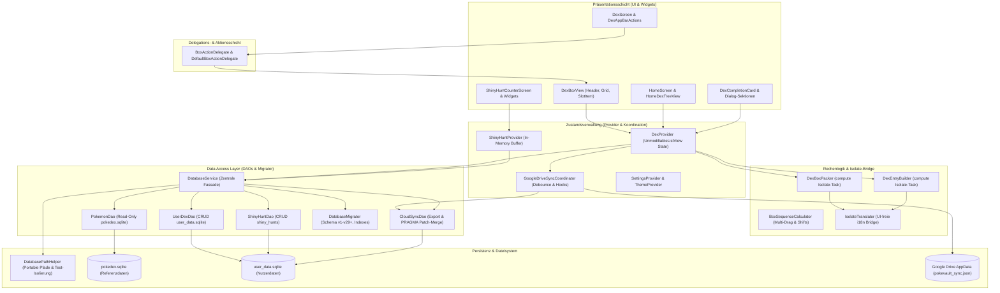

# Документация по архитектуре и системе PokéVault

> **Languages / Sprachen:** [🇩🇪 Deutsch](ARCHITECTURE.de.md) | [🇬🇧 English](../ARCHITECTURE.md) | [🇫🇷 Français](ARCHITECTURE.fr.md) | [🇪🇸 Español](ARCHITECTURE.es.md) | [🇮🇹 Italiano](ARCHITECTURE.it.md) | [🇯🇵 日本語](ARCHITECTURE.ja.md) | [🇰🇷 한국어](ARCHITECTURE.ko.md) | [🇨🇳 简体中文](ARCHITECTURE.zh-hans.md) | [🇹🇼 繁體中文](ARCHITECTURE.zh-hant.md) | [🇵🇹 Português](ARCHITECTURE.pt.md) | [🇳🇱 Nederlands](ARCHITECTURE.nl.md) | [🇵🇱 Polski](ARCHITECTURE.pl.md) | **[🇷🇺 Русский](ARCHITECTURE.ru.md)**


Этот документ описывает техническую архитектуру, хранилище данных, облачную синхронизацию, модульность и стандарты кода **PokéVault**. Он служит справочником для разработчиков и помощников ИИ при принятии дизайнерских решений и расширений.

> [!TIP]
> **Активная план и следующая версия (v1.7.0):**
> Полная спецификация и план реализации для следующей версии **v1.7.0 «Расширение языка»** (отключенные языки, 10 франчайзинговых языков, локальный REST-сервер, поиск нескольких эмуляторов, оптическое распознавание текста на рабочем столе и мобильный сканер PiP) находится в [docs/plans/v1_7_0_the_language_expansion.md](../docs/plans/v1_7_0_the_language_expansion.md).
> Интерактивный прототип доступен по адресу [docs/prototypes/v1_7_0_prototype.html](../docs/prototypes/v1_7_0_prototype.html).

---

## 1. Обзор и стек технологий

PokéVault — это кроссплатформенный компаньон для коллекционеров покемонов (Living Dex, Forms, Shinies, Bands & Marks, Shiny Hunting).

- **Framework**: [Flutter 3.x](https://flutter.dev/) (Dart SDK `^3.12`)
- **Целевые платформы**: Windows (Desktop), Android, iOS, macOS, Linux, Web
- **Управление состоянием**: [Provider](https://pub.dev/packages/provider) (`DexProvider`, `SettingsProvider`, `ShinyHuntProvider`, `TutorialProvider`, `ThemeProvider`) со строгой инкапсуляцией состояния (`UnmodifyingListView`)
- **Локализация (i18n) и многоязычное ядро (v1.7.0)**:
 - [сленг](https://pub.dev/packages/slang) для типобезопасная локализация пользовательского интерфейса (поддерживается 13 языков)
 - Полное разделение **Языка пользовательского интерфейса приложения** (`currentLanguage`) и **Языка франшизы Pokémon** (`pokemonLanguage`)
 - Динамическая регистрация языка через `lib/i18n/languages.json` и сгенерированный кодом `LanguageRegistry` (`lib/i18n/language_registry.g.dart`)
 - Многоязычная схема SQLite с 9 языковыми столбцами франшизы (`name_<lang>`) в `pokedex.sqlite`
 - Автоматический конвейер многомашинного перевода (`tool/translate_all.py`) с кэшированием MD5, маскированием токенов, синхронизацией документов `locales/` и генерация сленгового кода
 - `IsolateTranslator` как облегченный мост для фоновой изоляции без пользовательского интерфейса (`compute()`)
- **Persistence & DAO Layer**:
 - SQLite через `sqflite` (Android/iOS) и `sqflite_common_ffi` (рабочий стол) или `sqflite_common_ffi_web` (web)
 — модульные в объекты целевого доступа к данным: `PokemonDao`, `UserDexDao`, `ShinyHuntDao`, `CloudSyncDao` и `DatabaseMigrator`
 – `shared_preferences` для настроек приложения и состояний подключения
- **Облачная синхронизация**: Google Drive REST API v3 (папка AppData) через `googleapis` и `googleapis_auth`, координируемый через специальный `GoogleDriveSyncCoordinator`

---

## 2. Общая архитектура

На следующей диаграмме показана многоуровневая архитектура PokéVault, разделение компонентов пользовательского интерфейса с помощью делегатов, разделение ресурсоемких задач изоляции и модульный уровень базы данных DAO:



---

## 3. Архитектура базы данных и модель DAO (Dual-SQLite)

PokéVault строго разделяет неизменяемые статические данные франшизы и динамические данные пользователя:

```
┌─────────────────────────────────────────┐       ┌─────────────────────────────────────────┐
│             pokedex.sqlite              │       │            user_data.sqlite             │
│   (Read-Only Referenzdaten / PokemonDao)│       │  (Read-Write Nutzerdaten / UserDexDao)  │
├─────────────────────────────────────────┤       ├─────────────────────────────────────────┤
│ • pokemon (1025+ National Dex)          │       │ • user_dexes (Konfigurationen)          │
│ • forms (Mega, G-Max, Regional)         │       │ • folders (Ordnerhierarchie)            │
│ • encounters & dex_orders               │       │ • folder_structure (Relationen)         │
│ • pokemon_moves & abilities             │       │ • user_pokemon (Status/Shinies)         │
│ • ribbons, marks & catch_rates          │       │ • shiny_hunts (Zähler & Phasen)         │
│ • shiny_locks (502+ globale & lok. Locks│       │                                         │
└─────────────────────────────────────────┘       └─────────────────────────────────────────┘
```

### 3.1 Объекты доступа к данным (DAO)
Бывший монолитный `DatabaseService` теперь действует как легкий фасад и делегирует все операции специализированным DAO:
- **`PokemonDao`**: обрабатывает весь доступ для чтения к `pokedex.sqlite`. Инкапсулирует в памяти кэши для покемонов, атак, лент, шаров, фигур и блестящих замков.
- **`UserDexDao`**: отвечает за все CRUD-операции над пользовательскими таблицами в `user_data.sqlite` (`user_dexes`, `folders`, `folder_structure`, `user_pokemon`), включая потерянные записи (Orphan). очистка).
- **`ShinyHuntDao`**: управляет активными и архивными блестящими поисками, фазами поиска и инкрементным подсчетом.
- **`CloudSyncDao`**: обеспечивает `exportCloudSyncData()` и транзакционный `mergeCloudSyncData()` с динамической проверкой столбца `PRAGMA table_info` для обратной и прямой синхронизации данных.
- **`DatabaseMigrator`**: инкапсулирует миграцию схем (от версии 1 до версии 29+), создание индексов (`ensureUserDataIndexes`, `ensureAppDatabaseIndexes`) и процедуры безопасного перехода на более раннюю версию.

### 3.2 Переносимость и разрешение путей (`DatabasePathHelper`)
В соответствии с политикой репозитория, базы данных переносимо располагаются в подкаталоге `database/`, **никогда** в папке Windows Documents:
- **Среда разработки (рабочий стол)**: `<project_root>/database/` (обнаруживается через существующую `pubspec.yaml`).
- **Release/Portable Exe (Desktop)**: `<exe_dir>/database/` прямо рядом с исполняемым файлом.
- **Резервный вариант только для чтения**: если каталог доступен только для чтения (например, `C:\Program Files`), приложение закрывается автоматически `<application_support_dir>/database/` назад.
- **Устаревшая миграция**: если в папке документов существуют более старые базы данных, `DatabasePathHelper.migrateLegacyDocumentsDatabasesIfNeeded()` выполняет их прозрачную миграцию, проверяет временные метки на предмет разрешения конфликтов и создает резервные копии (`.bak_<timestamp>`).
- **Изоляция параллельного теста**. Во время автоматического выполнения тестов DatabasePathHelper динамически изолирует рабочие каталоги по идентификатору процесса (pokevault_test_dbs/proc_$pid), чтобы устранить условия гонки и заблокировать коллизии в параллельных наборах тестов.

---

## 4. Управление состоянием, инкапсуляция и координация

### 4.1 Инкапсуляция состояния с помощью `UnmodifyingListView`
В `DexProvider` внутренние состояния (`_userDexes`, `_folders`) защищены частным образом. Публичные геттеры возвращают неизменяемые представления (UnmodifyingListView). Мутации всегда выполняются с помощью специальных бизнес-методов («createUserDex», «deleteFolder», «updatePokemonStatus»), что предотвращает побочные эффекты и неконтролируемые изменения состояния в памяти.

### 4.2 `GoogleDriveSyncCoordinator`
Облачная синхронизация передается от `DexProvider` независимому `GoogleDriveSyncCoordinator`:
- **Debounced Upload**: предотвращает перегрузку сервера во время быстрого взаимодействия с пользователем с помощью управляемого по времени отладчика.
- **Периодическая синхронизация**: настраиваемый интервальный таймер для проверки и загрузки обновлений с других устройств.
- **Lifecycle Flush**: когда приложение приостановлено (`AppLifecycleState.paused` / `inactive`), несохраненные изменения немедленно синхронизируются с облаком.
- **Прозрачная цепочка перехватчиков**: перехватчики предварительной и постобработки (`registerBeforeUploadHook`, `registerCloudDataMergedHook`) отделить синхронизацию состояния от сетевых запросов.

---

## 5. Вычислительная логика, разделение и изоляция безопасности

Операции с интенсивными вычислениями модульны и усилены для фоновых потоков (`compute()`):

1. **`DexBoxPacker`**:
 - Рассчитывает разделение списков покемонов на боксы по 30 ПК ("generateBoxesIsolateTask").
 - Поддерживает динамические конфигурации боксов (Kanto, Johto, Living Dex, Forms).
2. **`DexEntryBuilder`**:
 — генерирует модели `DexDisplayEntry` в фоновых изолятах (`buildEntriesIsolateTask`).
3. **`BoxSequenceCalculator`**:
 — Функции математических вычислений для многократного перетаскивания, замены слотов, закрытия зазоров и перемещения между прямоугольниками.
4. **`IsolateTranslator` (i18n Bridge)**:
 — фоновые изоляты не имеют контекста пользовательского интерфейса Flutter (`BuildContext`). IsolateTranslator обеспечивает типобезопасный перевод областей, фигур и заголовков блоков без доступа к одиночным элементам пользовательского интерфейса.

---

## 6. Модульность пользовательского интерфейса и модель взаимодействия

Пользовательский интерфейс разделен на управляемые модульные подвиджеты:

### 6.1 `BoxActionDelegate` и `DexBoxView` 
Представление окна ПК (`DexBoxView`) отделено от логики приложения через интерфейс `BoxActionDelegate`: 
- `DexBoxHeader`: навигация, заголовок поля и отображение прогресса.
- `DexBoxGrid`: адаптивный Сетка 6x5 с автоматическим размером.
- `DexBoxSlotItem`: один слот Pokémon со спрайтами, маркерами типа, блестящими значками и обратной связью с перетаскиванием.

### 6.2 Модульные диалоги и экраны
- **Карточки завершения Dex**: разделены на `CardAppearanceSection`, `CardTogglesSection`, `CardActionsBar` и средство рендеринга холста (`CardPainterRenderer`, `CardPokemonMosaic`, `CardStatsSummary`).
- **Модуль Shiny Hunt**: разделен на HuntCounterControls (большой дисплей, кнопки), HuntOddsCard (вероятности) и HuntGameMethodSelector (издание и метод).
- **Главный экран**: навигация отделена от HomeDexTreeView с сортировкой перетаскиванием.

---

## 7. Автономный конвейер базы данных (`tool/data_pipeline/`)

Эталонная база данных `assets/db/pokedex.sqlite` генерируется через конвейер монорепо Python:
- **All-in-One Runner**: `pythontool/data_pipeline/run_pipeline.py` запускает всю цепочку (очистка веб-страниц, обновления подмодулей, построение базы данных, многоязычная синхронизация, деревья эволюции, блокировки и индексы) автоматически и детерминированно. from.
- **Отдельные шаги конвейера**:
 1. `python update_data.py`: загружает текущие веб-дампы (Bulbapedia, Bisafans, PokéWiki), таблицу допустимых совпадений покеболов и обновляет подмодуль PokeAPI.
 2. `python tool/data_pipeline/build_database.py`: объединяет все источники и создает базу данных SQLite.
 3. `pythontool/data_pipeline/update_pokemon_languages.py`: синхронизирует многоязычные названия видов для всех 10 официальных языков франшизы из подмодуля PokeAPI в столбцы `name_<lang>`.
 4. `pythontool/data_pipeline/update_evolutions_db.py`: добавляет структурированные деревья эволюции из необработанных данных PokeAPI.
 5. `pythontool/data_pipeline/update_cap_locks_and_trades.py`: добавляет блестящие замки для кепки Пикачу, форм косплея и сделок.
 6. `python Tool/data_pipeline/optimize_databases.py`: Создаёт покрывающие индексы, запускает `ANALYZE` и `VACUUM`.

Подробные инструкции для разработчиков можно найти в [tool/data_pipeline/README.md](../tool/data_pipeline/locales/README.ru.md).

---

## 8. Многоязычная архитектура перевода (`tool/translate_all.py`)

PokéVault Release v1.7.0 реализует отдельное управление языками и автоматизированный конвейер локализации:

### 8.1 Разделенный выбор языка
- **Язык пользовательского интерфейса (`currentLanguage`)**: управляет всеми элементами пользовательского интерфейса, диалоговыми окнами, навигацией и настройками (поддерживает 13 языков через `сленг`).
- **Язык покемонов (`pokemonLanguage`)**: контролирует названия видов, формы и полосы/символы независимо от языка пользовательского интерфейса (например, немецкий интерфейс с английскими или японскими именами покемонов). Если установлено значение «авто», язык пользовательского интерфейса будет принят, если существуют официальные названия франшизы; в противном случае вступает в силу резервный вариант английского языка (`resolveEffectivePokemonLanguage`).

### 8.2 Конфигурация и генерация кода
- **`lib/i18n/languages.json`**: центральный файл конфигурации JSON для всех языков с кодом ISO, флагом эмодзи, собственным именем, статусом франшизы (`isPokemonFranchise`) и сленговым кодом.
- **`LanguageRegistry` (`lib/i18n/language_registry.g.dart`)**: генерируется полностью автоматически из `languages.json` с помощью `translate_all.py`; предоставляет типобезопасные списки и методы поиска для виджетов и поставщиков Flutter.

### 8.3 Автоматизированный конвейер перевода
- **Мультимашинный каскад**: бесплатный каскад переводов (Bing $\rightarrow$ Google $\rightarrow$ MyMemory) с дополнительной поддержкой DeepL API (`DEEPL_API_KEY`).
- **Токен и множественная защита**: маскирует сленговые параметры (`{name}`, `{count}`), блоки множественного числа ICU и символы новой строки (`\n`) перед передачей API и восстанавливают их без потерь.
- **Кэширование MD5 и пакетная обработка запросов**: кэширует переводы в `tool/.translation_cache.json` с логикой защиты от отравления и группирует новые строки блоками по 30.
- **`locales/` синхронизация документов**: документация Markdown аккуратно хранится во вложенных папках `locales/`; внутренние ссылки и переключатель языка заголовка динамически перезаписываются с правильной относительной глубиной (`../`). Поддерживает двунаправленную синхронизацию и автоматическое определение исходного языка (`--source-lang auto`).

---

## 9. Обеспечение качества и гарантия качества с нулевой терпимостью

PokéVault обеспечивает соблюдение самых высоких стандартов качества посредством строгой разработки через тестирование (TDD) и автоматического тестирования:

- **Автоматизированные тесты**: Более **1 370 тестов** (`flutter test`) с **100% прохождением** через наборы Unit-, Widget-, Integration-, Boundary- и Adversarial-Challenger, а также отдельные Python Unit-тесты (`test/tool/test_translation_pipeline.py`).
- **Статический анализ**: `flutter analyze` с **0 ошибками, 0 предупреждениями и 0 Lints**.
- **Кроссплатформенная устойчивость**: стресс-тесты для экстремальных размеров экранов (например, от 320x480 до 4K), прерывание жестов и смена языка во время выполнения.
- **CI GitHub Actions**: полностью автоматизированный CI-пайплайн при каждом коммите и Pull Request (`.github/workflows/ci.yml`).
