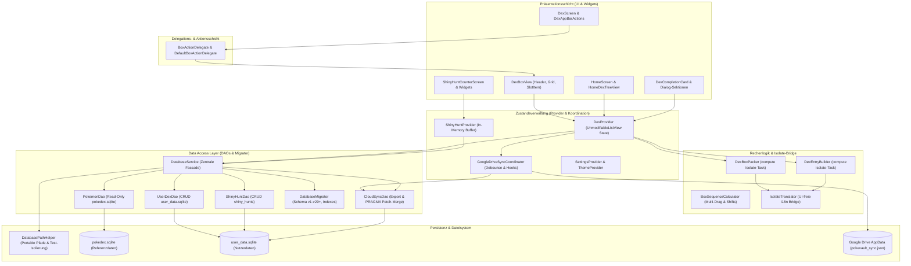

# PokéVault 架构和系统文档

> **Languages / Sprachen:** [🇩🇪 Deutsch](ARCHITECTURE.de.md) | [🇬🇧 English](../ARCHITECTURE.md) | [🇫🇷 Français](ARCHITECTURE.fr.md) | [🇪🇸 Español](ARCHITECTURE.es.md) | [🇮🇹 Italiano](ARCHITECTURE.it.md) | [🇯🇵 日本語](ARCHITECTURE.ja.md) | [🇰🇷 한국어](ARCHITECTURE.ko.md) | **[🇨🇳 简体中文](ARCHITECTURE.zh-hans.md)** | [🇹🇼 繁體中文](ARCHITECTURE.zh-hant.md) | [🇵🇹 Português](ARCHITECTURE.pt.md) | [🇳🇱 Nederlands](ARCHITECTURE.nl.md) | [🇵🇱 Polski](ARCHITECTURE.pl.md) | [🇷🇺 Русский](ARCHITECTURE.ru.md)


本文档描述了**PokéVault**的技术架构、数据存储、云同步、模块化和代码标准。 为开发者和AI助手进行设计决策和扩展提供参考。

> [!TIP]
> **有效路线图和下一版本 (v1.7.0):**
> 下一版本 **v1.7.0“语言扩展”**（断开连接的语言、10 种特许语言、本地 REST 服务器、多模拟器搜索、桌面 OCR 和移动 PiP 扫描仪）的完整规范和实施计划位于[docs/plans/v1_7_0_the_language_expansion.md](../docs/plans/v1_7_0_the_language_expansion.md).
> 交互式原型位于 [docs/prototypes/v1_7_0_prototype.html](../docs/prototypes/v1_7_0_prototype.html)。

---

## 1. 概述和技术堆栈

PokéVault 是 Pokémon 收藏者的跨平台伴侣（Living Dex、Forms、Shinies、Bands & Marks、Shiny Hunting）。

- **框架**：[Flutter 3.x](https://flutter.dev/) (Dart SDK `^3.12`)
- **目标平台**：Windows（桌面）、Android、iOS、macOS、Linux、Web
- **状态管理**：[Provider](https://pub.dev/packages/provider) (`DexProvider`、`SettingsProvider`、 `ShinyHuntProvider`、`TutorialProvider`、`ThemeProvider`) 具有严格的状态封装 (`UnmodifyingListView`)
- **本地化 (i18n) 和多语言核心 (v1.7.0)**:
 - [slang](https://pub.dev/packages/slang) 用于类型安全的 UI 本地化（支持 13 种语言）
 - 完整**App UI Language** (`currentLanguage`) 和 **Pokémon Franchise Language** (`pokemonLanguage`)
 - 通过 `lib/i18n/languages.json` 进行动态语言注册和代码生成的 `LanguageRegistry` (`lib/i18n/language_registry.g.dart`)
 - 多语言 SQLite 架构`pokedex.sqlite`
 中的 9 个特许经营语言列 (`name_<lang>`) - 自动化多引擎翻译管道 (`tool/translate_all.py`)，具有 MD5 缓存、令牌屏蔽、`locales/` 文档同步和俚语代码生成
 - `IsolateTranslator` 作为无 UI 后台隔离的轻量级桥梁 (`compute()`)
- **持久化和 DAO 层**：
 - SQLite 通过 `sqflite` (Android/iOS) 和 `sqflite_common_ffi` (桌面) 或 `sqflite_common_ffi_web` (web)
 - 模块化为集中数据访问对象：`PokemonDao`、`UserDexDao`、`ShinyHuntDao`、`CloudSyncDao` 和`DatabaseMigrator`
 - 用于应用程序设置和登录状态的 `shared_preferences`
- **云同步**：通过 `googleapis` 和 `googleapis_auth` 的 Google Drive REST API v3（AppData 文件夹），通过专用的 `GoogleDriveSyncCoordinator` 进行协调

---

## 2.整体架构

下图直观地展示了 PokéVault 的分层架构、通过委托分离 UI 组件、计算密集型 Isolate 任务的解耦以及模块化 DAO 数据库层：



---

## 3. 数据库架构和 DAO 模型（Dual-SQLite）

PokéVault 严格区分不可变的静态特许经营数据和动态用户数据：

```
┌─────────────────────────────────────────┐       ┌─────────────────────────────────────────┐
│             pokedex.sqlite              │       │            user_data.sqlite             │
│   (Read-Only Referenzdaten / PokemonDao)│       │  (Read-Write Nutzerdaten / UserDexDao)  │
├─────────────────────────────────────────┤       ├─────────────────────────────────────────┤
│ • pokemon (1025+ National Dex)          │       │ • user_dexes (Konfigurationen)          │
│ • forms (Mega, G-Max, Regional)         │       │ • folders (Ordnerhierarchie)            │
│ • encounters & dex_orders               │       │ • folder_structure (Relationen)         │
│ • pokemon_moves & abilities             │       │ • user_pokemon (Status/Shinies)         │
│ • ribbons, marks & catch_rates          │       │ • shiny_hunts (Zähler & Phasen)         │
│ • shiny_locks (502+ globale & lok. Locks│       │                                         │
└─────────────────────────────────────────┘       └─────────────────────────────────────────┘
```

### 3.1 数据访问对象 (DAO)
 以前的整体 `DatabaseService` 现在充当轻量级外观，并将所有操作委托给专门的 DAO：
- **`PokemonDao`**：处理对 `pokedex.sqlite` 的所有读取访问。 封装 Pokémon、攻击、丝带、球、形状和闪亮锁的内存缓存。
- **`UserDexDao`**：负责 `user_data.sqlite` 中用户表的所有 CRUD 操作（`user_dexes`、`folders`、`folder_struct`、`user_pokemon`），包括孤立记录（孤立清理）。
- **`ShinyHuntDao`**：管理活动和存档的闪亮搜索、搜索阶段和增量计数。
- **`CloudSyncDao`**：提供 `exportCloudSyncData()` 和事务性 `mergeCloudSyncData()` 以及动态 `PRAGMA table_info` 列检查，以实现向后和向前兼容的数据同步。
- **`DatabaseMigrator`**：封装架构迁移（v1 到v29+）、索引创建（`ensureUserDataIndexes`、`ensureAppDatabaseIndexes`）和安全降级例程。

### 3.2 可移植性和路径解析 (`DatabasePathHelper`)
根据存储库策略，数据库可移植地位于 `database/` 子目录中，**从不**位于 Windows Documents 文件夹中：
- **开发环境（桌面）**：`<project_root>/database/` （通过现有的 `pubspec.yaml` 检测到）.
- **发布/ Portable Exe（桌面）**：可执行文件旁边的`<exe_dir>/database/`。
- **只读回退**：如果目录是只读的（例如`C:\Program Files`），应用程序会自动回退到`<application_support_dir>/database/`。
- **旧版迁移**：如果文档文件夹中存在旧数据库， `DatabasePathHelper.migrateLegacyDocumentsDatabasesIfNeeded()` 透明地迁移它们，检查冲突解决的时间戳并创建备份副本 (`.bak_<timestamp>`)。
- **并行测试隔离**：在自动化测试运行期间，`DatabasePathHelper` 通过进程 ID (`pokevault_test_dbs/proc_$pid`) 动态隔离工作目录，以消除并行测试套件中的竞争条件和锁冲突。

---

## 4. 状态管理、封装和协调

### 4.1 使用`UnmodifyingListView`
进行状态封装在`DexProvider`中，内部状态（`_userDexes`、`_folders`）受到私有保护。 公共 getter 返回不可修改的视图 (`UnmodifyingListView`)。 突变始终通过专用业务方法（“createUserDex”、“deleteFolder”、“updatePokemonStatus”）完成，这可以防止副作用和不受控制的内存状态更改。

### 4.2 `GoogleDriveSyncCoordinator`
云同步从`DexProvider`外包给独立的`GoogleDriveSyncCoordinator`：
- **去抖上传**：通过时间控制的去抖器防止快速用户交互过程中的服务器过载。
- **定期同步**：可配置间隔计时器，用于检查和下载来自其他设备的更新devices.
- **生命周期刷新**：当应用程序暂停时（`AppLifecycleState.paused` / `inactive`），未保存的更改会立即同步到云端。
- **透明钩子链**：预处理和后处理钩子（`registerBeforeUploadHook`、`registerCloudDataMergedHook`）将状态同步与网络请求解耦。

---

## 5. 计算逻辑、分拆和隔离安全

计算密集型操作针对后台线程进行了模块化和强化（“compute()”）：

1. **`DexBoxPacker`**：
 - 将 Pokémon 列表划分为 30 个盒子（`generateBoxesIsolateTask`）。
 - 支持动态盒子配置（Kanto、Johto、Living Dex、Forms）。
2。 **`DexEntryBuilder`**：
 - 在后台隔离中生成`DexDisplayEntry`模型（`buildEntriesIsolateTask`）.
3。 **`BoxSequenceCalculator`**：
 - 用于多拖动、槽交换、间隙闭合和跨框移动的数学计算函数。
4。 **`IsolateTranslator`（i18n Bridge）**：
 - 后台隔离没有 Flutter UI 上下文（`BuildContext`）。 “IsolateTranslator”为区域、形状和框标题提供类型安全的翻译，而无需访问 UI 单例。

---

## 6. UI模块化&交互模型

用户界面分为可管理的模块化子小部件：

### 6.1 `BoxActionDelegate` & `DexBoxView`
PC 框视图 (`DexBoxView`) 通过 `BoxActionDelegate` 接口与应用程序逻辑解耦：
- `DexBoxHeader`：导航、框标题和进度显示。
- `DexBoxGrid`：响应式 6x5 网格auto-sizing.
- `DexBoxSlotItem`：带有精灵、类型标记、闪亮图标和拖放反馈的单个 Pokémon 插槽。

### 6.2 模块化对话框和屏幕
- **Dex 完成卡**：分为`CardAppearanceSection`、`CardTogglesSection`、`CardActionsBar` 和画布渲染器（`CardPainterRenderer`、`CardPokemonMosaic`、`CardStatsSummary`）.
- **Shiny Hunt 模块**：分为“HuntCounterControls”（大显示屏、按钮）、“HuntOddsCard”（概率）和“HuntGameMethodSelector”（版本和方法）。
- **主屏幕**：通过拖放排序与“HomeDexTreeView”分离的导航。

---

## 7. 离线数据库管道 (`tool/data_pipeline/`)

参考数据库`assets/db/pokedex.sqlite`是通过Python monorepo管道生成的：
- **All-in-One Runner**：`python tool/data_pipeline/run_pipeline.py`自动且确定性地从.
- **独立管道运行整个链（网页抓取、子模块更新、数据库构建、多语言同步、进化树、锁和索引）步骤**：
 1. `python update_data.py`：加载当前网络转储（Bulbapedia、Bisafans、PokéWiki）、合法匹配 Pokéballs 表并更新 PokeAPI 子模块。
 2. `python tool/data_pipeline/build_database.py`：聚合所有源并构建 SQLite 数据库。
 3. `python tool/data_pipeline/update_pokemon_languages.py`：将 PokeAPI 子模块中所有 10 种官方特许经营语言的多语言物种名称同步到 `name_<lang>` 列中。
 4. `python tool/data_pipeline/update_evolutions_db.py`：从原始 PokeAPI 数据添加结构化进化树。
 5. `python tool/data_pipeline/update_cap_locks_and_trades.py`：为皮卡丘帽、角色扮演形状和交易添加闪亮的锁。
 6.`python tool/data_pipeline/optimize_databases.py`：创建覆盖索引，运行`ANALYZE`和`VACUUM`。

详细的开发人员说明可以在 [tool/data_pipeline/README.md](../tool/data_pipeline/locales/README.zh-hans.md) 中找到。

---

## 8. 多语言和翻译架构 (`tool/translate_all.py`)

PokéVault v1.7.0 版本实现了单独的语言管理和自动本地化管道：

### 8.1 解耦语言选择
- **UI 语言 (`currentLanguage`)**：控制所有 UI 元素、对话框、导航和设置（通过 `slang` 支持 13 种语言）。
- **神奇宝贝语言 (`pokemonLanguage`)**：独立于 UI 语言控制物种名称、形状和带/字符（例如，德语 UI 与英语或日语）神奇宝贝名称）。 如果设置为“auto”，则在存在官方特许经营名称的情况下采用 UI 语言；否则英语后备生效（`resolveEffectivePokemonLanguage`）。

### 8.2 配置和代码生成
- **`lib/i18n/languages.json`**：所有语言的中央 JSON 配置文件，包含 ISO 代码、表情符号标志、本机名称、特许经营状态 (`isPokemonFranchise`) 和俚语代码。 
- **`LanguageRegistry` (`lib/i18n/language_registry.g.dart`)**：完全自动生成来自“translate_all.py”的“ languages.json”；为 Flutter 小部件和提供程序提供类型安全的列表和查找方法。

### 8.3 自动翻译管道
- **多引擎级联**：自由翻译级联（Bing $\rightarrow$ Google $\rightarrow$ MyMemory），具有可选的 DeepL API 支持（`DEEPL_API_KEY`）。
- **令牌和复数保护**：屏蔽俚语参数（`{name}`、`{count}`）、ICU API 传输之前的多个块和换行符 (`\n`) 并无损地恢复它们。
- **MD5 缓存和请求批处理**：使用防中毒逻辑将翻译缓存在 `tool/.translation_cache.json` 中，并以 30 个块批量批处理新字符串。 
- **`locales/` 文档同步**：Markdown 文档整齐地保存在 `locales/` 子文件夹中；内部链接和标题语言切换器以正确的相对深度（`../`）动态重写。 支持双向同步和自动源语言检测（`--source-lang auto`）。

---

## 9. 质量保证和零容忍质量门

PokéVault 通过严格的测试驱动开发 (TDD) 和自动化测试强制执行最高质量标准：

- **自动化测试**：通过 **1,370 个测试** (`flutter test`)，涵盖单元测试、组件测试、集成测试、边界测试和对抗性挑战者套件，以及独立的 Python 单元测试 (`test/tool/test_translation_pipeline.py`)，**通过率 100%**。
- **静态分析**：`flutter analyze`，**无错误、无警告、无 Lint**。
- **跨平台弹性**：针对极端屏幕尺寸（例如 320x480 到 4K）、手势中断和运行时语言切换进行压力测试。
- **GitHub Actions CI**：每次提交和拉取请求 (`.github/workflows/ci.yml`) 都进行全自动 CI 流程。
