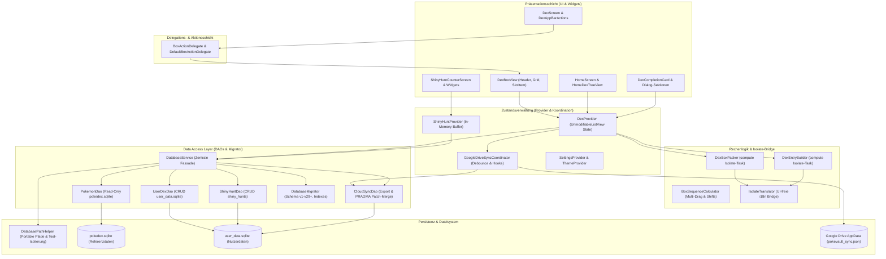

# PokéVault 架構與系統文件

> **Languages / Sprachen:** [🇩🇪 Deutsch](ARCHITECTURE.de.md) | [🇬🇧 English](../ARCHITECTURE.md) | [🇫🇷 Français](ARCHITECTURE.fr.md) | [🇪🇸 Español](ARCHITECTURE.es.md) | [🇮🇹 Italiano](ARCHITECTURE.it.md) | [🇯🇵 日本語](ARCHITECTURE.ja.md) | [🇰🇷 한국어](ARCHITECTURE.ko.md) | [🇨🇳 简体中文](ARCHITECTURE.zh-hans.md) | **[🇹🇼 繁體中文](ARCHITECTURE.zh-hant.md)** | [🇵🇹 Português](ARCHITECTURE.pt.md) | [🇳🇱 Nederlands](ARCHITECTURE.nl.md) | [🇵🇱 Polski](ARCHITECTURE.pl.md) | [🇷🇺 Русский](ARCHITECTURE.ru.md)


本文件描述了 **PokéVault** 的技術架構、數據存儲、雲端同步、模組化和程式碼標準。它作為開發人員和人工智慧助手在設計決策及擴展時的參考。

> [!TIP]
> **活躍的路線圖 & 下一版本發布 (v1.7.0)：**
> 下一版本 **v1.7.0 “語言擴展”**（獨立語言、10 個特許經營語言、本地 REST 伺服器、多模擬器狩獵、桌面 OCR & 行動 PiP 掃描器）的完整規格與實作計畫可參見 [docs/plans/v1_7_0_the_language_expansion.md](../docs/plans/v1_7_0_the_language_expansion.md)。
> 互動原型可於 [docs/prototypes/v1_7_0_prototype.html](../docs/prototypes/v1_7_0_prototype.html) 找到。

---

## 1. 概覽與技術堆疊

PokéVault 是一個跨平台的寶可夢收藏者夥伴（活躍圖鑑、形態、色違、徽章與標記、色違狩獵）。

- **Framework**: [Flutter 3.x](https://flutter.dev/) (Dart SDK `^3.12`)
- **Zielplattformen**: Windows (Desktop), Android, iOS, macOS, Linux, Web
- **Zustandsverwaltung**: [Provider](https://pub.dev/packages/provider) (`DexProvider`, `SettingsProvider`, `ShinyHuntProvider`, `TutorialProvider`, `ThemeProvider`) mit strikter State-Kapselung (`UnmodifiableListView`)
- **Lokalisierung (i18n) & Multi-Language Core (v1.7.0)**:
  - [slang](https://pub.dev/packages/slang) für typsichere UI-Lokalisierung (13 unterstützte Sprachen)
  - Vollständige Entkopplung von **App-UI-Sprache** (`currentLanguage`) und **Pokémon-Franchise-Sprache** (`pokemonLanguage`)
  - Dynamische Sprachregistrierung via `lib/i18n/languages.json` und codegenerierter `LanguageRegistry` (`lib/i18n/language_registry.g.dart`)
  - Multi-Language SQLite Schema mit 9 Franchise-Sprachspalten (`name_<lang>`) in `pokedex.sqlite`
  - Automatisierte Multi-Engine-Übersetzungspipeline (`tool/translate_all.py`) mit MD5-Caching, Token-Maskierung, `locales/`-Dokumentensynchronisation und Slang-Codegenerierung
  - `IsolateTranslator` als schlanke Bridge für UI-freie Hintergrund-Isolate (`compute()`)
- **Persistenz & DAO-Schicht**:
  - SQLite via `sqflite` (Android/iOS) und `sqflite_common_ffi` (Desktop) bzw. `sqflite_common_ffi_web` (Web)
  - Modularisiert in fokussierte Data Access Objects: `PokemonDao`, `UserDexDao`, `ShinyHuntDao`, `CloudSyncDao` und `DatabaseMigrator`
  - `shared_preferences` für App-Einstellungen und Onboarding-Zustände
- **Cloud-Synchronisation**: Google Drive REST API v3 (AppData Folder) via `googleapis` & `googleapis_auth`, koordiniert über den dedizierten `GoogleDriveSyncCoordinator`

---

## 2. 總體架構

下圖呈現了 PokéVault 的分層架構，通過委派分離 UI 組件、解耦計算密集型的獨立任務，以及模組化的 DAO 資料庫層：



---

## 3. 資料庫架構與 DAO 模型（雙 SQLite）

PokéVault 嚴格區分不可更改的靜態特許經營資料與動態的用戶資料：

```
┌─────────────────────────────────────────┐       ┌─────────────────────────────────────────┐
│             pokedex.sqlite              │       │            user_data.sqlite             │
│   (Read-Only Referenzdaten / PokemonDao)│       │  (Read-Write Nutzerdaten / UserDexDao)  │
├─────────────────────────────────────────┤       ├─────────────────────────────────────────┤
│ • pokemon (1025+ National Dex)          │       │ • user_dexes (Konfigurationen)          │
│ • forms (Mega, G-Max, Regional)         │       │ • folders (Ordnerhierarchie)            │
│ • encounters & dex_orders               │       │ • folder_structure (Relationen)         │
│ • pokemon_moves & abilities             │       │ • user_pokemon (Status/Shinies)         │
│ • ribbons, marks & catch_rates          │       │ • shiny_hunts (Zähler & Phasen)         │
│ • shiny_locks (502+ globale & lok. Locks│       │                                         │
└─────────────────────────────────────────┘       └─────────────────────────────────────────┘
```

### 3.1 Die Data Access Objects (DAOs)
Der frühere monolithische `DatabaseService` fungiert nun als schlanke Fassade und delegiert alle Operationen an spezialisierte DAOs:
- **`PokemonDao`**: Behandelt alle lesenden Zugriffe auf `pokedex.sqlite`. Kapselt In-Memory-Caches für Pokémon, Attacken, Bänder, Bälle, Formen und Shiny-Locks.
- **`UserDexDao`**: Verantwortlich für alle CRUD-Operationen der Nutzertabellen in `user_data.sqlite` (`user_dexes`, `folders`, `folder_structure`, `user_pokemon`), inklusive verwaister Datensätze (Orphan-Cleanup).
- **`ShinyHuntDao`**: Verwaltet aktive und archivierte Shiny-Hunts, Jagd-Phasen und inkrementelle Zählerstände.
- **`CloudSyncDao`**: Bietet `exportCloudSyncData()` und transaktionales `mergeCloudSyncData()` mit dynamischer `PRAGMA table_info`-Spaltenprüfung für abwärts- und aufwärtskompatiblen Datenabgleich.
- **`DatabaseMigrator`**: Kapselt Schema-Migrationen (v1 bis v29+), Index-Erstellung (`ensureUserDataIndexes`, `ensureAppDatabaseIndexes`) und sichere Downgrade-Routinen.

### 3.2 Portabilität & Pfadauflösung (`DatabasePathHelper`)
Gemäß Repository-Richtlinie liegen Datenbanken portabel im Unterverzeichnis `database/`, **niemals** im Windows-Dokumente-Ordner:
- **Entwicklungsumgebung (Desktop)**: `<project_root>/database/` (erkannt via vorhandene `pubspec.yaml`).
- **Release / Portable Exe (Desktop)**: `<exe_dir>/database/` direkt neben der ausführbaren Datei.
- **Read-Only Fallback**: Falls das Verzeichnis schreibgeschützt ist (z. B. `C:\Program Files`), fällt die App automatisch auf `<application_support_dir>/database/` zurück.
- **Legacy Migration**: Existieren ältere Datenbanken im Dokumente-Ordner, migriert `DatabasePathHelper.migrateLegacyDocumentsDatabasesIfNeeded()` diese transparent, prüft Zeitstempel für Konfliktlösungen und legt Sicherheitskopien (`.bak_<timestamp>`) an.
- **Parallele Test-Isolierung**: Bei automatisierten Testläufen isoliert `DatabasePathHelper` Arbeitsverzeichnisse dynamisch per Prozess-ID (`pokevault_test_dbs/proc_$pid`), um Race Conditions und Lock-Kollisionen bei parallelen Test-Suites auszuschließen.

---

## 4. 狀態管理、封裝與協調

### 4.1 使用 `UnmodifiableListView` 的狀態封裝
在 `DexProvider` 中，內部狀態（`_userDexes`、`_folders`）受到私有保護。公開的 getter 返回不可修改的視圖（`UnmodifiableListView`）。所有變更均通過專用的業務方法（`createUserDex`、`deleteFolder`、`updatePokemonStatus`）進行，從而防止副作用和不受控的內存狀態變化。

### 4.2 `GoogleDriveSyncCoordinator`
雲端同步已從 `DexProvider` 分離到獨立的 `GoogleDriveSyncCoordinator`：
- **去抖上傳**：透過定時去抖器防止使用者快速互動導致伺服器過載。
- **週期同步**：可配置間隔計時器，用於檢查並下載其他設備的更新。
- **生命周期刷新**：當應用程式暫停（`AppLifecycleState.paused` / `inactive`）時，未儲存的變更將立即同步到雲端。
- **透明 Hook 鏈**：前置與後置 Hook（`registerBeforeUploadHook`、`registerCloudDataMergedHook`）將狀態同步與網路請求解耦。

---

## 5. 計算邏輯、解耦與隔離安全

計算密集型操作已被模組化並為後台線程（`compute()`）加固：

1. **`DexBoxPacker`**:
   - 計算寶可夢清單在30個格子PC盒中的分配 (`generateBoxesIsolateTask`)。
   - 支援動態盒子配置（關都、城都、Living Dex、形態）。
2. **`DexEntryBuilder`**:
   - 在背景Isolates中生成 `DexDisplayEntry` 模型 (`buildEntriesIsolateTask`)。
3. **`BoxSequenceCalculator`**:
   - 用於多重拖曳、格子互換、填補空格及跨盒移動的數學計算功能。
4. **`IsolateTranslator` (i18n Bridge)**:
   - 背景Isolates沒有Flutter UI上下文 (`BuildContext`)。`IsolateTranslator` 提供區域、形態及盒子標題的型別安全翻譯，而不必訪問UI單例。

---

## 6. 使用者介面模組化與互動模型

用戶界面被分成易於操作的模組化子小部件：

### 6.1 `BoxActionDelegate` 與 `DexBoxView`
電腦版寶可夢方格視圖 (`DexBoxView`) 通過 `BoxActionDelegate` 介面與應用程式邏輯解耦：
- `DexBoxHeader`：導航、方格標題和進度顯示。
- `DexBoxGrid`：響應式 6x5 網格，自動調整大小。
- `DexBoxSlotItem`：單個寶可夢槽位，包含精靈圖像、屬性標記、閃光符號和拖放反饋。

### 6.2 模組化對話與螢幕
- **寶可夢圖鑑完成卡**：分為 `CardAppearanceSection`、`CardTogglesSection`、`CardActionsBar` 以及畫布渲染器（`CardPainterRenderer`、`CardPokemonMosaic`、`CardStatsSummary`）。
- **閃光獵捕模組**：分為 `HuntCounterControls`（大型顯示、按鈕）、`HuntOddsCard`（機率）以及 `HuntGameMethodSelector`（版本與方法）。
- **主畫面**：導航與 `HomeDexTreeView` 分開，並支援拖放排序。

---

## 7. 離線資料庫管道（`tool/data_pipeline/`）

Die Referenzdatenbank `assets/db/pokedex.sqlite` wird über eine Python-Monorepo-Pipeline generiert:
- **All-in-One Runner**: `python tool/data_pipeline/run_pipeline.py` führt die gesamte Kette (Web-Scraping, Submodule-Updates, Datenbankbau, Multi-Language Sync, Evolutionsbäume, Locks & Indizes) automatisch und deterministisch aus.
- **Einzelne Pipeline-Schritte**:
  1. `python update_data.py`: Lädt aktuelle Web-Dumps (Bulbapedia, Bisafans, PokéWiki), die Legal Matching Pokéballs Tabelle und aktualisiert das PokeAPI Submodul.
  2. `python tool/data_pipeline/build_database.py`: Aggregiert alle Quellen und baut die SQLite-Datenbank.
  3. `python tool/data_pipeline/update_pokemon_languages.py`: Synchronisiert mehrsprachige Speziesnamen für alle 10 offiziellen Franchise-Sprachen aus dem PokeAPI-Submodul in `name_<lang>`-Spalten.
  4. `python tool/data_pipeline/update_evolutions_db.py`: Ergänzt strukturierte Evolutionsbäume aus den PokeAPI-Rohdaten.
  5. `python tool/data_pipeline/update_cap_locks_and_trades.py`: Integriert Shiny-Locks für Kappen-Pikachu, Cosplay-Formen und Tausche.
  6. `python tool/data_pipeline/optimize_databases.py`: Erstellt Covering-Indexes, führt `ANALYZE` und `VACUUM` aus.

詳細的開發者指南位於 [tool/data_pipeline/README.md](../tool/data_pipeline/locales/README.zh-hant.md)。

---

## 8. 多語言與翻譯架構 (`tool/translate_all.py`)

PokéVault 釋出 v1.7.0 實現了獨立的語言管理和自動化本地化流程：

### 8.1 分離語言選擇
- **介面語言 (`currentLanguage`)**：控制所有使用者介面元素、對話框、導航及設定（支援 13 種語言，透過 `slang`）。
- **寶可夢語言 (`pokemonLanguage`)**：控制寶可夢的種類名稱、型態及帶/符號，獨立於介面語言（例如德文介面搭配英文或日文的寶可夢名稱）。若設定為 `'auto'`，將會採用介面語言，前提是官方系列名稱存在；否則採用英文備用方案 (`resolveEffectivePokemonLanguage`)。

### 8.2 配置與程式碼生成
- **`lib/i18n/languages.json`**：所有語言的中央 JSON 配置檔，包含 ISO 代碼、表情符號旗幟、原生名稱、特許經營狀態（`isPokemonFranchise`）及俚語代碼。
- **`LanguageRegistry` (`lib/i18n/language_registry.g.dart`)**：由 `translate_all.py` 從 `languages.json` 全自動生成；提供 Flutter 小部件和 Provider 的型別安全清單及查找方法。

### 8.3 自動化翻譯流程
- **多引擎級聯**：免費翻譯級聯（Bing $
ightarrow$ Google $
ightarrow$ MyMemory），可選 DeepL API 支援（`DEEPL_API_KEY`）。
- **標記與複數保護**：在 API 傳輸前遮蔽俚語參數（`{name}`、`{count}`）、ICU 複數區塊及換行符號（`
`），並能無損還原。
- **MD5 快取與請求批次處理**：將翻譯結果快取於 `tool/.translation_cache.json`，具備防中毒邏輯，並將新字串以 30 個為一批進行打包。
- **`locales/` 文件同步**：Markdown 文件整齊放置於 `locales/` 子資料夾，內部連結與頁首語言切換器會動態重寫為正確的相對路徑（`../`）。支援雙向同步及自動源語言檢測（`--source-lang auto`）。

---

## 9. 品質保證與零容忍品質檢查

PokéVault 透過嚴格的測試驅動開發（TDD）和自動化檢查，強制執行最高品質標準：

- **自動化測試**：超過 **1,370 個測試** (`flutter test`)，在單元、元件、整合、邊界及對抗挑戰測試套件以及獨立 Python 單元測試 (`test/tool/test_translation_pipeline.py`) 中 **100% 通過率**。
- **靜態分析**：`flutter analyze` 顯示 **0 錯誤、0 警告、0 Lint 問題**。
- **跨平台韌性**：針對極端螢幕尺寸（例如 320x480 到 4K）、手勢中斷及運行時語言切換進行壓力測試。
- **GitHub Actions CI**：每次提交與 Pull Request 都啟動全自動化 CI 流程 (`.github/workflows/ci.yml`)。
