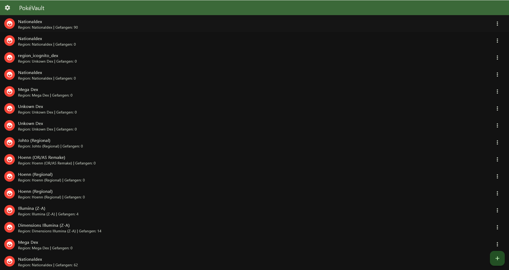
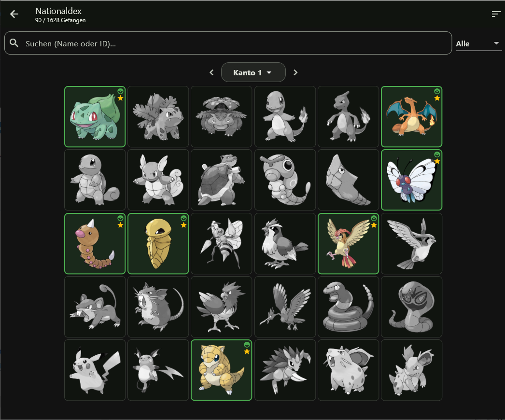
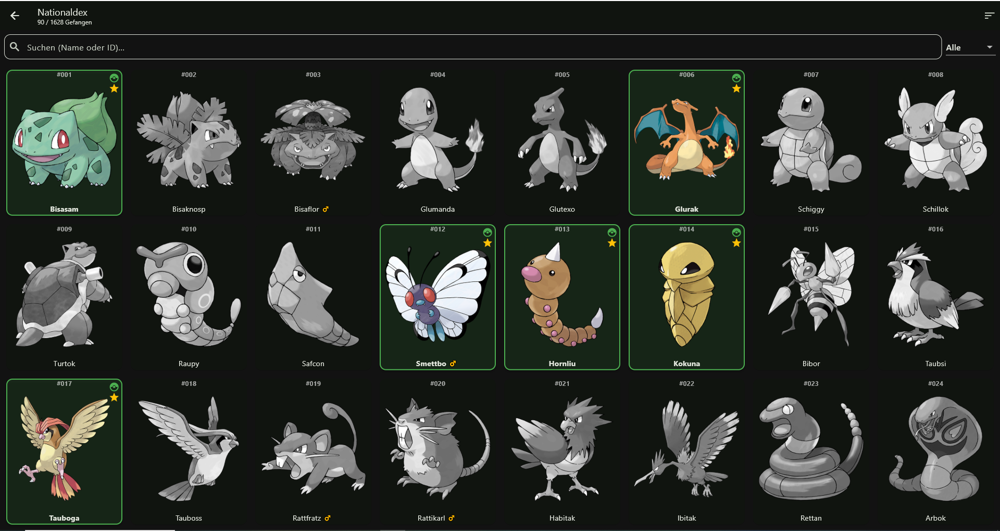
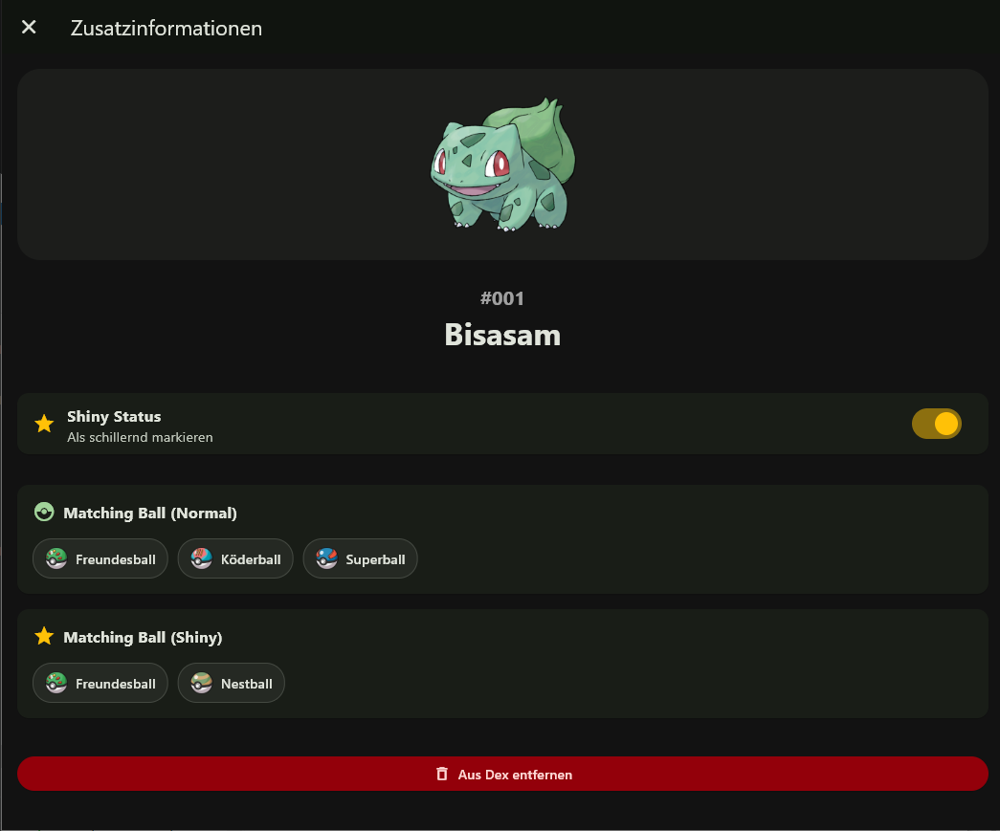
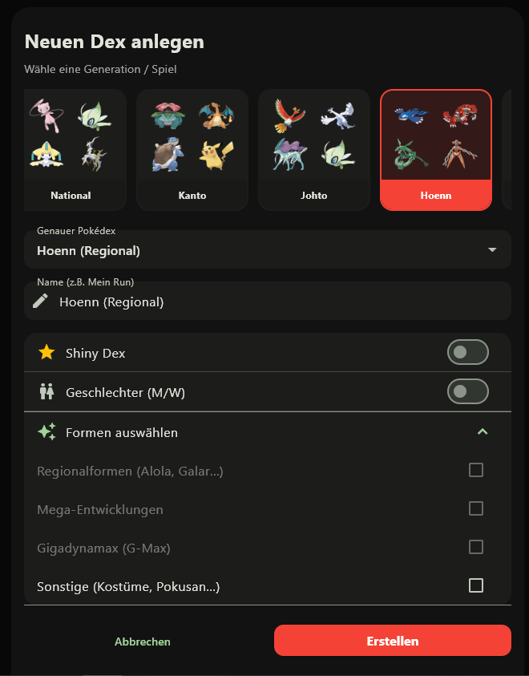
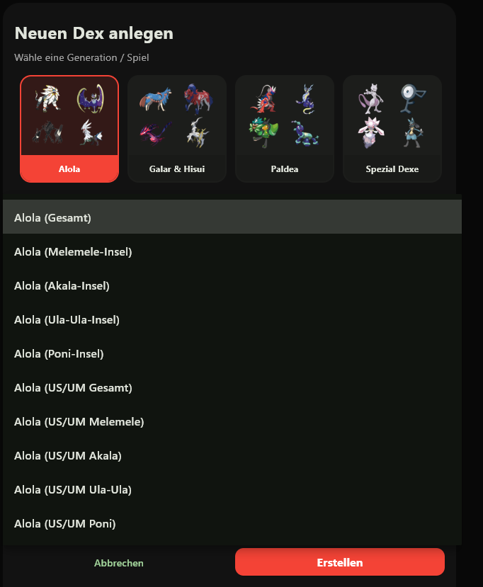

# 🔴 PokéVault

> **Languages / Sprachen:** [🇩🇪 Deutsch](README.de.md) | [🇬🇧 English](../README.md) | [🇫🇷 Français](README.fr.md) | [🇪🇸 Español](README.es.md) | **[🇮🇹 Italiano](README.it.md)** | [🇯🇵 日本語](README.ja.md) | [🇰🇷 한국어](README.ko.md) | [🇨🇳 简体中文](README.zh-hans.md) | [🇹🇼 繁體中文](README.zh-hant.md) | [🇵🇹 Português](README.pt.md) | [🇳🇱 Nederlands](README.nl.md) | [🇵🇱 Polski](README.pl.md) | [🇷🇺 Русский](README.ru.md)

**PokéVault** è un compagno completo e completamente personalizzabile per allenatori di Pokémon, collezionisti e cacciatori di Shiny, sviluppato con Flutter. Non importa se stai pianificando un Dex regionale, un Dex nazionale, un Dex delle forme o un Dex Shiny: PokéVault ti aiuta a tenere facilmente traccia dei tuoi progressi e ti fornisce gli strumenti necessari per la tua caccia agli Shiny.

[](https://github.com/RaptorClash/pokevault/actions/workflows/ci.yml)


## ✨ Funzioni principali

* **Gestione Multi-Dex:** Crea tutti i tracker che desideri per diversi giochi, generazioni o le tue sfide.
* **Tracciamento dettagliato dei moduli:** Pieno supporto per moduli regionali, mega evoluzioni, Gigantamax e forme speciali (Pokusan, Vivillon, Unown, ecc.).
* **PC Box e visualizzazione elenco:** Visualizza i tuoi Pokémon nella classica griglia "PC Box" da 30 slot o in un elenco ricercabile con trascinamento della selezione senza soluzione di continuità.
* **Tracciamento lucido e contatore di caccia:** Tieni traccia dei Pokémon normali e brillanti separatamente. Contatore Shiny Hunt integrato con calcolo della probabilità in tempo reale, selezione del metodo, cronologia delle fasi e timer della sessione con rilevamento della pausa AFK.
* **🎖️ Carte di completamento Dex:** Progetta, personalizza ed esporta certificati di conseguimento ad alta risoluzione, carte statistiche e mosaici Pokémon per condividere i tuoi progressi.
* **Palle abbinate:** Ricevi consigli curati dalla community per le migliori Poké Ball (per la modalità normale) *e* varianti Shiny)!
* **📊 Calcolatore avanzato del tasso di cattura:** Calcolo preciso della probabilità di cattura per tutte le generazioni, comprese le meccaniche speciali di *Pokémon Legends: Arceus* e *Pokémon Legends: Z-A*.
* **🧬 Calcolatore di allevamento e percorso Shiny:** Calcola catene di allevamento a più fasi (inclusi Ditto e Baby Pokémon) e visualizza le probabilità esatte per il bersaglio prole.
* **📖 Guide dettagliate per la caccia brillante:** Istruzioni passo passo per metodi specifici della generazione (ad es. PokéRadar, DexNav, ricette sandwich).
* **🎮 Panoramica delle operazioni e scorciatoie in-app:** Schermata personale nelle impostazioni con scorciatoie adattabili alla piattaforma, comandi del mouse e gesti tattili.
* **☁️ Cloud Sync e Offline-First:** compatibile al 100% offline con un robusto database SQLite locale. Sincronizzazione opzionale tramite il tuo Google Drive privato con resilienza di unione delle patch.
* **Personalizzazione completa:** Supporta la modalità scuro/chiaro e colori di sfondo e accenti personalizzabili.
* **Multilingue:** Completamente disponibile in 13 lingue (interfaccia utente tramite slang). Inoltre, selezione indipendente della lingua del franchise Pokémon (ad esempio interfaccia utente tedesca con nomi Pokémon inglesi o giapponesi) basata su 10 lingue ufficiali del franchise in "pokedex.sqlite".

## 📸 Screenshot

| Schermata Home | Vista PC Box |
| :---: | :---: |
|  |   |
| **Dettagli Pokémon & Sfere abbinate** | **Creazione Dex & Filtri** |
|  |   |

## 🚀 Primi passi (esecuzione locale)

### Requisiti
* [Flutter SDK](https://docs.flutter.dev/get-started/install) (si consiglia la versione stabile più recente)
* Dart SDK
* Un IDE come VS Code o Android Studio

### Installazione
1. Clonare il repository:
   ```bash
   git clone https://github.com/RaptorClash/pokevault.git
   ```

2. Passare alla directory:
   ```bash
   cd pokevault
   ```

3. Scaricare le dipendenze:
   ```bash
   flutter pub get
   ```

4. Scaricare dati esterni e inizializzare i sottomoduli:
   Scarica i repository di dati e i wiki più recenti necessari per il database:
   ```bash
   python3 update_data.py
   ```

5. Generare e ottimizzare il database SQLite:
   *PokéVault richiede un database SQLite precompilato per i dati di base dei Pokémon.* 
   Esegui lo script pipeline all-in-one per generare e ottimizzare `assets/db/pokedex.sqlite` con un solo comando:
   ```bash
   python3 tool/data_pipeline/run_pipeline.py
   ```
   *(In alternativa, esegui con `--skip-download` se possiedi già i dump web esterni e desideri solo ricostruire il database).*

6. Avviare l'app:
   ```bash
   flutter run
   ```

## 🛠️ Creare build

Per creare una build di rilascio, usa uno dei seguenti comandi:

**Android (APK):**
```bash
flutter build apk --release
```

**Windows:**
```bash
flutter build windows --release
```

**Linux:**
```bash
flutter build linux --release
```

**Immagine dell'app Linux:**
```bash
appimage-builder --recipe AppImageBuilder.yml
```

**Web:**
```bash
flutter build web --release
```

## 📚 Architettura e documentazione
* [Guida all'architettura (`ARCHITECTURE.md`)](ARCHITECTURE.it.md): panoramica dettagliata dell'architettura del sistema, gestione dello stato del provider, modello di persistenza DAO, coordinatore di sincronizzazione di Google Drive, Isolate Translation Bridge e Test Quality Gates.
* [Git ramificazione e pipeline di rilascio (`docs/GIT_WORKFLOW_AND_RELEASES.md`)](../docs/locales/GIT_WORKFLOW_AND_RELEASES.it.md): modello di branching Git ufficiale, regole di protezione dei branch, build multipiattaforma (APK Android, Windows Zip, Linux AppImage/tar.gz) e pre-release Beta automatizzate.
* [v1.7.0 Roadmap: L'espansione linguistica (`docs/plans/v1_7_0_the_language_expansion.md`)](../docs/plans/v1_7_0_the_language_expansion.md): specifiche tecniche complete per lingue separate, server REST locale, tracciamento multi-emulatore, OCR desktop e scanner per fotocamera mobile.
* [Pipeline di generazione di database (`tool/data_pipeline/locales/README.de.md`)](../tool/data_pipeline/locales/README.it.md): documentazione della preparazione dei dati PokeAPI offline, scraper, importazione di palline corrispondenti, indici e compilazione di database.
* [Strumenti di sviluppo e rilascio (`tool/locales/README.de.md`)](../tool/locales/README.it.md): gestione automatizzata delle versioni di rilascio (`bump_version.py`), suite di test, copertura del codice e pipeline di traduzione (`translate_all.py`).

## 🤝 Aggiungi dati (Contributi della comunità)
Ti mancano dei luoghi o le Palline corrispondenti non sono corrette? Puoi aggiungere questi dati nei file JSON nella directory `tool/data_pipeline/` (se presenti) o contribuire direttamente tramite Issues/Pull Request.

Se desideri contribuire con codice, funzionalità o correzioni di bug, utilizza per favore i modelli di issue corrispondenti nella cartella `.github/ISSUE_TEMPLATE` e apri una pull request su un branch dedicato alla funzionalità.

## 🙏 Ringraziamenti & Fonti
Questa app non sarebbe stata possibile senza queste fantastiche risorse della community:
*   [PokeAPI](https://pokeapi.co/): Dati di base e artwork ufficiali.
*   [Living Dex Inspiration](https://drive.google.com/drive/folders/1jgopfeGuNA8oJX6mnYearpnNti4a8W-v): Google Sheets della community come base per il tracker.
*   [Matching Balls Guide](https://docs.google.com/spreadsheets/d/1bvIx7Q2Lxp7efHRrUh48WkuwirNlKardwSHVz_R8kA0/edit?gid=877479959#gid=877479959): Tabella Excel curata dalla community per le Poké Ball perfette.
*   [Bulbapedia](https://bulbapedia.bulbagarden.net/wiki/Catch_rate): Meccaniche del Catch Rate.
*   [Google Gemini](https://gemini.google.com): Assistenza KI per la programmazione e il refactoring.
* E molte altre!

## 📄 Licenza
Questo progetto è concesso in licenza sotto la [GNU General Public License v3.0 (GPL-3.0)](../LICENSE).

**Esclusione di responsabilità:** Pokémon e tutti i nomi correlati sono marchi e © di Nintendo, Creatures Inc., e GAME FREAK inc. Questo è un progetto amatoriale gratuito e non commerciale e non ha alcuna connessione con Nintendo, né è supportato o sponsorizzato da essa.
